# NIVORA — Master Prototype Blueprint

**THE RENTAL LIVING ECOSYSTEM · FIND. TRUST. LIVE.**

Product definition, interface specification, user journeys and implementation roadmap for the NIVORA competition prototype.

| Item | Value |
|---|---|
| Document status | **Draft v1.1 — founder decisions of 2026-10-10 recorded; awaiting approval to start Phase 1** |
| Document type | Single source of truth for implementation (no application code exists yet) |
| Primary readers | Founder (approval), future Claude Code implementation sessions, any developer/designer joining |
| Geography | Jaipur, Rajasthan, India |
| Prototype nature | Browser-based, local-only, fictional demonstration data |
| Companion documents | None. This is deliberately the only document. |

---

## 0. How to Use This Document

### 0.1 Reading order for implementers

1. §2–§3 (what NIVORA is, what is allowed to be claimed, what is in/out of scope).
2. §9 (connected-experience rules) and §13 (data model) — these constrain everything else.
3. §5–§8 and §11 (screens). §11 is the canonical per-screen contract; §5–§8 hold the detailed behaviour it references.
4. §14 (design system), §15 (acceptance criteria), §16 (technical plan), §17 (phases).
5. §19 (decision register) before making any product decision not covered here.

### 0.2 Priority legend (used everywhere)

| Tag | Meaning |
|---|---|
| **P0 — Critical** | Required for a convincing, connected competition prototype. Must be complete and stable. |
| **P1 — Important** | Build after all P0 flows pass acceptance. Must never destabilise P0. |
| **P2 — Roadmap** | Future concept or low-priority preview. Must not block the demo. Never presented as a live service. |

### 0.3 Normative language

"**Must**" = required for acceptance. "**Should**" = strongly recommended; deviation needs a note in §19. "**May**" = optional.

### 0.4 Confirmed direction vs. proposed choices

- **Confirmed product direction** (from the founder brief): brand text, tagline, welcome copy, two roles, Jaipur geography, trust-centred positioning, connected Tenant–Owner experience, roadmap concepts (Agreements / Move / Protect), no real payments/OTP/notifications.
- **Proposed implementation choices** (this document's recommendations): everything else — routes, status vocabularies, thresholds, fixtures, tech stack. Each significant one is recorded in the **Decision Register (§19)** with reason, effect, and whether founder approval is needed.

### 0.5 Conventions

- **IDs:** screens `S-xx` (shared), `T-xx` (tenant), `O-xx` (owner), `R-xx` (roadmap); decisions `D-xx`; acceptance criteria `AC-xx`; fixtures `FX-xx`.
- **Currency:** `₹` with Indian digit grouping (₹1,25,000), via `Intl.NumberFormat("en-IN")`. Compact marker form: `₹14.5k`.
- **Dates:** `12 Oct 2026` (day, short month, year). Times in 12-hour form. Timezone fixed to IST for display.
- **Locale of copy:** English (India). Hindi is out of scope.
- **"Demo"** is the single word used to label fictional/simulated content. Do not mix "sample", "mock", "dummy" in user-visible copy (internal docs may).

### 0.6 Change log

| Version | Date | Change |
|---|---|---|
| 1.0 | 2026-10-10 | Initial master blueprint. |
| 1.1 | 2026-10-10 | Recorded founder decisions FD-1…FD-5d (§19.0): licensed local imagery plan (§14.13); real Jaipur search anchors with a mandatory verification gate (§13.6); NIVORA Move prices withheld from every screen (§10.2); Presenter Demo Mode for simulated verification-review outcomes (§9.6, screen S-04); confirmation of D-03, D-06, D-15 and the map-verification task (D-28). Consistency review: capability classification matrix (§3.4), updated screen inventory/counts, flows, data model, acceptance criteria (AC-36…AC-38), phases and decision register; remaining uncertainties listed in §19.3. |

---

## 1. Project Inspection Report

| Check | Result |
|---|---|
| Working directory | `C:\Users\Modi\Desktop\NIVORA` (matches intended project name) |
| Existing contents at start | Empty (no files, no subfolders) |
| Existing blueprint/spec | None found |
| Git repository | No |
| Conflict with deliverable | None. `docs/` did not exist and was created. |
| Files preserved/changed | Nothing existed; nothing deleted, renamed or overwritten. |
| Created | `docs/NIVORA_MASTER_PROTOTYPE_BLUEPRINT.md` (this file) only. |

---

## 2. Project Identity and Truthfulness Policy

### 2.1 Brand constants (use verbatim)

| Element | Text |
|---|---|
| Product name | NIVORA |
| Brand descriptor | THE RENTAL LIVING ECOSYSTEM |
| Tagline | FIND. TRUST. LIVE. |
| Welcome headline | Your next chapter starts at home. |
| Supporting copy | Discover a rental. Build trust. Feel at home. |
| Welcome footer line | Prototype preview · Choose your journey |
| Tenant search heading | Find a home that fits your life. |

### 2.2 Product vision (hypothesis, not fact)

NIVORA is envisioned as a verified, transparent, end-to-end rental living ecosystem serving tenants and property owners across the lifecycle:

**Property listing → Verification → Discovery → Matching → Property visit → Rental agreement → Move-in → Rent management → Maintenance → Renewal**

Proposed differentiators (all **hypotheses**, to be tested — never stated as proven):

1. Transparent, itemised verification status.
2. Better location-based discovery.
3. Clearer availability and listing freshness.
4. Connected Tenant and Owner experience.
5. A longer-term rental-management ecosystem.

The prototype **demonstrates how NIVORA intends to address these needs**. It does not evidence traction, customers, performance, fraud reduction or market validation.

### 2.3 Truthfulness policy (binding on all copy, data and UI)

| # | Rule |
|---|---|
| TP-1 | Every property, owner, tenant, price, address area, metric, request and verification record is **fictional demo data** unless explicitly stated otherwise. |
| TP-2 | No UI may state or imply that a real person, property or document has been verified. Verification labels always carry "(demo)" or a visible Demo marker. |
| TP-3 | No fabricated testimonials, user counts, ratings, "trusted by", savings figures, response times, or fraud statistics. Dashboard numbers are derived from demo data and labelled as such. |
| TP-4 | A success state/toast/message appears **only after** the corresponding record was actually written to prototype state. |
| TP-5 | No simulated notification (SMS/WhatsApp/email/push) is ever shown as "sent". Use wording like "Status updated in this prototype". |
| TP-6 | No real OTP, authentication, payment, banking details, or identity documents. No collection of PII beyond name + phone, and only at the moment needed. |
| TP-7 | Never claim "fraud-free", "100% safe", "guaranteed", "zero risk". A verification badge never implies the whole listing is trustworthy. |
| TP-8 | Roadmap concepts (Agreements, Move, Protect, etc.) are labelled **Future concept** and are not bookable/purchasable anywhere. No prices for roadmap concepts are shown anywhere in the prototype (D-20). |
| TP-9 | Distances are approximate straight-line figures, never travel times. Map pins are approximate demo locations. |
| TP-10 | Local persistence is a demo convenience, not a backend; there is no multi-user sync. The UI must not suggest otherwise. |
| TP-11 | **Real search anchors, fictional homes.** Colleges and office-area landmarks used as search anchors are real places shown only as approximate location references; every property, owner, tenant and request is fictional. The UI and copy keep the two visibly and verbally distinct, imply no affiliation or endorsement, claim no travel times and no precise property locations (D-12, D-26). |
| TP-12 | **Simulation is labelled and fenced.** Anything produced by Presenter Demo Mode (§9.6) is simulated, labelled "Simulated by presenter (demo)", reachable only through deliberate entry, and is not a security or administrative mechanism. No real identity documents are collected; no real person or property is claimed to be verified. |

### 2.4 Initial geography

Jaipur only. A fixed list of 11 localities and a short list of real search anchors (§13.6). No other city selectable in the prototype. No teaser for other cities is shown (D-18).

### 2.5 Role model

There are no accounts. A **persona** (Tenant or Owner) is chosen on the Welcome screen and stored locally. Each persona maps to one fixed demo identity (`tenant_demo`, `owner_demo`). Other people in the data (other owners, other tenants) are fictional fixtures labelled "Sample".

---

## 3. Scope, Design Philosophy and Experience Principles

### 3.1 Scope summary

| Tier | Contents |
|---|---|
| **P0** | Welcome; Tenant Home; Search with filters; Map/List results with synchronised markers and offline-safe fallback; Property Details with itemised trust breakdown; Trust Center; Save/unsave; Request-a-Visit with review + success; Tenant Dashboard (overview, saved, visit requests, profile); Owner entry + dashboard; My Properties; Add-Property wizard (8 steps) with publish; Owner property detail + edit + availability toggle; Enquiries & Visits with status updates; Owner Verification Center (read + reconfirm availability); shared persisted state; Reset Demo; prototype disclaimer shell. |
| **P1** | Rent Tracking (owner) with demo "record payment"; Maintenance (owner + tenant create/view); Tenant "My Rental" preview (agreement overview, move-in info, rent status, maintenance, renewal reminder); drafts ("Save draft"); **Presenter Demo Mode** with simulated verification-review outcomes (S-04; first P1 item to build, §9.6); owner house-rules fields; local photo upload (resized, size-capped); lightbox gallery; "updated" in-app indicators; Undo toasts; find-similar for unavailable saved homes. |
| **P2** | Future Roadmap page (Agreements, Move, Protect, Property-management expansion); everything in §10. Optional "concept preview" cards only, never actionable. |

**Out of scope for the whole competition prototype:** real auth/OTP, backend, database server, payments, e-signing/legal agreements, document upload/storage, notifications, real verification, geocoding APIs, chat, reviews/ratings, admin console, analytics, multi-city.

### 3.2 Visual direction

Premium, minimal, modern, trustworthy rental technology. White and soft off-white surfaces; deep navy for text/navigation/emphasis; restrained violet for primary actions and selected states; neutral grey borders and secondary text; subtle shadows; controlled radii; generous spacing; strong hierarchy. It should look like a considered real-estate product, not a template.

**Avoid:** heavy gradients, neon, futuristic effects, overloaded dashboards, excess animation, emoji in place of icons, decorative do-nothing buttons, fake social proof, unsupported verification claims, early PII collection.

### 3.3 Experience principles (testable)

1. Every screen has one clear purpose (stated in §11).
2. Every visible primary button has a defined outcome (§11 "User actions"). **No dead buttons**: if a control is not built, it is not rendered (or is explicitly disabled with an explanatory label).
3. Navigation is consistent and never duplicated within one shell.
4. Every user action yields visible, truthful feedback.
5. Tenant and Owner sides read and write the **same** store (§9).
6. Demo data looks realistic but is always labelled demo.
7. No forced onboarding; explore first, provide details when an action needs them.
8. The product remains fully usable with no internet (map falls back; images are local; fonts are bundled).
9. **Honest UI:** no artificial loading delays to feign work. Skeletons only for genuinely asynchronous things (map tiles, image decode).

### 3.4 Capability classification matrix (single reference for tier and nature)

"**Real local**" = genuinely works inside the browser on demo data. "**Simulated**" = shows what a real service would do but nothing real occurs. "**Not implemented**" = text or absent only.

| Capability | Tier | Nature |
|---|---|---|
| Welcome, role entry, navigation, About dialog, Reset demo data | P0 | Real local |
| Search, filters, sorting, straight-line distance maths | P0 | Real local (on fictional data; anchors are real places, approximate) |
| Street map (OpenStreetMap tiles) | P0 | Real third-party service, online only |
| Schematic map fallback | P0 | Real local |
| Properties, saves, tenant/owner profiles, visit requests (create, status changes, cancel) | P0 | Real local records, fictional content; nothing is sent to anyone |
| Add / edit / publish / unpublish listing; Owner reconfirms availability | P0 | Real local records; availability is owner-declared |
| Verification statuses and Trust Center | P0 | **Simulated** (demo data), always labelled |
| Licensed local imagery | P0 | Real local assets; illustrative only |
| Presenter Demo Mode (simulated verification review, Undo all, restore) | P1 | **Simulated**; local demonstration feature only |
| Rent tracking (record paid status), Maintenance, Tenant "My Rental" preview | P1 | Real local records; status only; no money or technicians |
| Save draft, objective house rules, owner photo upload (resized), lightbox, Undo toasts, Updated indicators | P1 | Real local |
| Future Roadmap page (Agreements, Move, Protect, expansion) | P2 | Text only; **Not implemented** |
| Real verification, authentication/OTP, payments, SMS/WhatsApp/email, legal agreements, insurance, moving vendors/booking | Roadmap / out of scope | **Not implemented**, never presented as available |

---

## 4. Global Application Structure

### 4.1 Shell variants

| Shell | Used on | Structure |
|---|---|---|
| **Public shell** | Welcome (`/`), Roadmap (`/roadmap`) | Slim header (wordmark only + "Future roadmap" text link + "About this prototype" button); full-width content; footer with disclaimer. No role switcher (no role chosen yet). |
| **Tenant shell** | `/tenant/*` | **Top navigation bar** (no sidebar): wordmark · Find a Home · Saved (count) · My Visits (count) · Trust Center · Role switcher · About/Reset menu. Content below. Footer with disclaimer. On mobile the nav collapses to a hamburger sheet; Find/Saved/Visits also reachable via a 3-item bottom bar. The Tenant Dashboard uses **in-page tabs** (not a second sidebar) to avoid duplicate navigation. |
| **Owner shell** | `/owner/*` | **Left sidebar** on ≥1024 px (240 px wide, collapsible to icons ≥1024, never overlaying) + slim top bar (page title, role switcher, About/Reset menu). On <1024 px sidebar becomes a slide-over opened from the top bar; additionally a **bottom tab bar** with 4 items (Overview, Properties, Requests, More). Sidebar justified because the Owner area has 8 peer sections and sustained management work. |
| **Wizard focus mode** | `/owner/properties/new`, `/owner/properties/:id/edit` | Sidebar remains on desktop; on mobile bottom bar is replaced by the wizard's Back/Next bar to avoid two competing bars. |

### 4.2 Role switcher

- Control labelled **"Viewing as: Tenant ▾"** (or Owner). Menu items: *Tenant view*, *Owner view*, divider, *Back to Welcome*.
- Switching **preserves each role's last route** (stored `lastRoute.tenant`, `lastRoute.owner`) and never clears shared data.
- Always visible in Tenant and Owner shells (it is the presenter's main tool in a live demo).
- When switching from a context with an unsaved form, a confirmation dialog appears ("Leave without saving?").

### 4.3 Route map

Hash-based routing is recommended (`/#/tenant`) so the build works from any static host or `file://`-like preview without server rewrites (D-07).

| Route | Screen | Priority |
|---|---|---|
| `/` | S-00 Welcome | P0 |
| `/trust` | S-01 Trust Center (page; also available as drawer) | P0 |
| `/roadmap` | R-01 Future Roadmap | P2 |
| `/presenter` | S-04 Presenter Panel (usable only while Presenter Mode is active; otherwise redirects to `/`) | P1 |
| `*` | S-02 Not Found | P0 |
| `/tenant` | T-01 Tenant Home | P0 |
| `/tenant/search` | T-02 Results (Map/List) | P0 |
| `/tenant/property/:propertyId` | T-03 Property Details (hosts T-04/T-05 modal) | P0 |
| `/tenant/dashboard` | T-06 Dashboard Overview | P0 |
| `/tenant/dashboard/saved` | T-07 Saved Properties | P0 |
| `/tenant/dashboard/requests` | T-08 Visit Requests | P0 |
| `/tenant/dashboard/profile` | T-09 Tenant Profile | P0 |
| `/tenant/dashboard/rental` | T-10 My Rental (preview) | P1 |
| `/owner` | O-01 Owner Demo Access → redirects to `/owner/dashboard` after first confirm | P0 |
| `/owner/dashboard` | O-02 Overview | P0 |
| `/owner/properties` | O-03 My Properties | P0 |
| `/owner/properties/new` | O-04 Add Property wizard | P0 |
| `/owner/properties/:propertyId` | O-05 Property Detail/Manage | P0 |
| `/owner/properties/:propertyId/edit` | O-06 Edit Listing | P0 |
| `/owner/requests` | O-07 Enquiries & Visits | P0 |
| `/owner/rent` | O-08 Rent Tracking | P1 |
| `/owner/maintenance` | O-09 Maintenance | P1 |
| `/owner/verification` | O-10 Verification Center | P0 |
| `/owner/settings` | O-11 Profile & Settings (includes Reset Demo) | P0 |

Search state lives in the URL query string (shareable, refresh-safe): `?mode=locality|anchor&locality=&anchor=&radius=&min=&max=&type=&beds=&furn=&amen=&avail=&verif=&sort=&q=&view=map|list&sel=`.

### 4.4 Shared interface components (behaviour and appearance)

| Component | Specification |
|---|---|
| **Wordmark** | "NIVORA" in semibold, wide letter-spacing, navy, with a house/key brand mark (a simple geometric house outline whose doorway forms a key bit; single-colour SVG, 24–32 px). Descriptor "THE RENTAL LIVING ECOSYSTEM" appears under/beside the wordmark on Welcome and in the Welcome header only; in app shells show wordmark + small tagline-less mark to save space. |
| **Global navigation** | Per §4.1. Active item = navy text + violet 2 px indicator (top-nav) or violet-tinted pill (sidebar), plus `aria-current="page"`. |
| **Breadcrumbs** | Used on Property Details (Find a Home › Results › {Title}) and Owner Property Detail/Edit (My Properties › {Title} › Edit). Not used on top-level pages. Last crumb is plain text. |
| **Search inputs** | Combobox for locality/anchor (type-ahead over fixed lists, keyboard navigable); keyword input searches title, locality, landmark. Clear (×) button. |
| **Buttons** | Primary (violet fill), Secondary (white, navy border), Tertiary/text, Destructive (red outline; red fill only inside confirm dialogs), Icon button (36–44 px hit area). States: default/hover/focus-visible/active/disabled/loading (loading only for genuinely async work). |
| **Property card** | §6.3.4. |
| **Status badges** | Text + icon + colour (never colour alone). Semantics §14.6. |
| **Modal dialog** | Centered ≤560 px (bottom sheet on mobile). Focus trap, Esc closes (unless mid-submit), returns focus to trigger, `aria-modal`, labelled title. |
| **Forms** | Labels above fields; helper text under; errors inline under field in red with icon + text; first invalid field focused on submit; error summary at top of long forms (wizard review). Validate on blur and on submit; never on first keystroke. |
| **Empty states** | Icon + one-line title + one-sentence explanation + one primary action. Every list/table defines its own copy (§11). |
| **Loading states** | Skeleton for map container, image placeholders blur-up from SVG. No fake spinners. |
| **Success / error states** | Inline success panels for flows (visit request, publish). Toast for lightweight confirmations. Persistent inline banner for errors that block progress. |
| **Confirmation dialogs** | Required for: cancel request, mark listing unavailable, reset demo, leave unsaved wizard, remove photo (only if it is the last one), record demo payment. Title states consequence; buttons name the action ("Mark unavailable"), never "OK". |
| **Toasts** | Bottom-center on mobile, top-right on desktop; `role="status"`/`aria-live="polite"`; success auto-dismiss 4 s; errors persist until dismissed; max 3 stacked; may include one action (Undo, View). |
| **Footer + disclaimer** | Present on all non-wizard pages. Fixed text: *"NIVORA is an interactive prototype. All properties, people, prices, verification statuses and requests shown are fictional demonstration data. No real bookings, payments, verifications or notifications occur."* Plus: *Map data © OpenStreetMap contributors* when the street map is active. |
| **Demo ribbon** | Small "DEMO DATA" pill on property cards and detail headers for fixtures and user-created records alike (user-created are demo too). |
| **About this prototype menu** | Opens a dialog: what is real/simulated, current data counts, **Reset demo data** action, map mode toggle (Street / Schematic), an **Image credits** link (§14.13), the note on real search anchors (§13.6) and, as a low-emphasis text link at the very bottom, **Presenter tools…** (§9.6). Available from every shell. |

---

## 5. Screen S-00 — Welcome / Landing

### 5.1 Purpose
Introduce NIVORA in seconds and route the visitor to the Tenant or Owner journey. No login, no forms.

### 5.2 Layout (desktop ≥1024)
- Public shell header (wordmark, descriptor, "Future roadmap" link, "About this prototype").
- Hero (centered column, max 960 px): brand mark → **NIVORA** → **THE RENTAL LIVING ECOSYSTEM** (small caps, letter-spaced) → H1 **Your next chapter starts at home.** → **Discover a rental. Build trust. Feel at home.**
- Two equal journey cards side by side (stack on <720 px, Tenant first).
- Compact **Discover · Trust · Manage** strip (3 columns, icon + 1 short line each).
- Footer line **Prototype preview · Choose your journey**, then the standard disclaimer footer.

### 5.3 Journey cards

| Card | Title | Supporting text | Primary action | Destination |
|---|---|---|---|---|
| Tenant | I'm a Tenant | Find a place to call home. | **Find a Home** | sets persona `tenant`; navigates to `/tenant` |
| Owner | I'm a Property Owner | List and manage your rental. | **Manage Properties** | sets persona `owner`; navigates to `/owner` (O-01 on first visit this session, else `/owner/dashboard`) |

The **entire card is a single focusable control** (`<a>`/button semantics) with the primary action rendered as its visual call-to-action; Enter and Space activate it; focus ring visible; accessible name e.g. "I'm a Tenant — Find a place to call home. Find a Home". No nested interactive elements inside the card.

### 5.4 Discover · Trust · Manage strip

| Pillar | Line (proposed copy) |
|---|---|
| Discover | Search by locality or around your college or office. |
| Trust | See what has been checked — and what hasn't. |
| Manage | Visits, rent and upkeep in one place. *(Rent and upkeep are previews in this prototype.)* |

### 5.5 Rules
- No external images; hero uses inline SVG and CSS only (instant load, offline-safe). Fonts bundled.
- No name/phone/identity fields. No cookie banner needed (no tracking; see §16.8).
- If a persona is already stored, still show Welcome (do not auto-redirect); show a quiet text link "Continue as Tenant/Owner" under the cards (P1).
- Acceptance: AC-01, AC-02.

---

## 6. Tenant Experience — Complete Journey

**Primary journey:** Welcome → Tenant Home → Search → Map/List Results → Property Details → Request a Visit → Confirmation → Tenant Dashboard.

### 6.1 T-01 Tenant Home — "Find a home that fits your life."

**Layout:** Tenant shell. Hero band (off-white) with H1 *Find a home that fits your life.*, sub-line *Jaipur · demo listings*, and the **Search panel** (white card, elevated). Below: Featured homes, Trust Center intro, quick links.

**Search panel (all controls, in order):**

| Control | Type | Default | Notes |
|---|---|---|---|
| Search mode | Segmented: **Locality** / **Near a college or office** | Locality | Switching mode keeps other filters. |
| Keyword | Text | empty | Matches title, locality, landmark (case-insensitive substring). Optional. |
| Locality | Combobox (11 localities, §13.6) | "All Jaipur" | Only in Locality mode. |
| Anchor | Combobox (verified real search anchors, §13.6) | none | Only in Anchor mode. Required in that mode. |
| Radius | Chips 1 / 3 / **5** / 10 km | 5 km | Only in Anchor mode. |
| Rent budget | Min and Max numeric inputs (₹) + presets (Under ₹10k, ₹10–20k, ₹20–40k, ₹40k+) | none / none | Presets fill both inputs. |
| Property type | Multi-select chips: Apartment, Independent House, Builder Floor, Studio, Single Room | none (any) | OR within group. |
| Bedrooms / rooms | Chips: Any, 1, 2, 3+ | Any | "1" includes Studio and Single Room (1 room). |
| Amenity shortcuts | 4 toggle chips: Parking, Wi-Fi, Lift, Power backup | none | AND with other amenity selections. Full amenity list is on the results page. |
| **Search** | Primary button | — | Navigates to `/tenant/search` with query params. |

**Other sections:**
- **Featured homes:** 3–4 cards chosen deterministically from published, available fixtures with differing trust profiles (not ranked by verification; label "Featured demo homes"). Same Property Card component.
- **Trust Center intro:** 3 short points (four separate checks; what "verified (demo)" means; how freshness works) + link "See how trust works" → `/trust`.
- **Quick links:** *Saved homes (n)* → `/tenant/dashboard/saved`; *My visit requests (n)* → `/tenant/dashboard/requests`. Counts from store; shown only when n>0, otherwise plain links.

**Validation and edge cases**

| Situation | Behaviour |
|---|---|
| Empty search (nothing chosen) | Valid. Searches all available Jaipur demo homes. Not an error. |
| Anchor mode with no anchor chosen | On Search click, inline error under Anchor: *"Choose a college or office to search around."* and focus the field. No navigation. |
| Min > Max rent | Inline error on Max: *"Maximum rent must be at least the minimum."* No navigation. |
| Non-numeric / negative rent | Input strips non-digits; negative impossible. Values clamped to ₹0–₹3,00,000. |
| Zero matches | Handled on T-02 (§6.3.6). |
| Keyword only, e.g. "Vaishali" | Valid; matches locality text. |

### 6.2 Location-based search (shared by T-01 and T-02)

**Capabilities**

| Capability | Specification |
|---|---|
| By locality | Exact match against property `locality`. "All Jaipur" disables the filter. |
| Around anchor | Anchor = one of the verified real search anchors, each with fixed approximate coordinates (§13.6). Match if great-circle distance ≤ radius. |
| Radius | 1, 3, 5, 10 km (chips). Default 5. |
| Rent | `min ≤ rent ≤ max`, inclusive. |
| Type, rooms, furnishing, amenities, availability, verification | See §6.4. |

**Anchor representation.** An anchor is a **real, recognisable Jaipur place** — a college or an office-area landmark (§13.6.1) — used purely as a location reference. It is stored as a named point with an *approximate* latitude/longitude, a category (College / Office area) and a verification record (§13.6.2). On the map it renders as a distinct navy diamond pin with a building icon and a translucent violet circle of the chosen radius; the map legend has two entries — **"Search anchor — real place, approximate location"** and **"Demo home (fictional)"** — so real and fictional items are never confused. Helper text beside the anchor field: *"Colleges and offices are used only as location references. NIVORA has no affiliation with or endorsement from them."* No anchor is shown as "verified" unless its verification record is complete; a build with unverified anchors must not be used for the live demo (D-12, D-28).

**Distance calculation.** Haversine great-circle distance between the anchor and the property's approximate coordinates. Displayed as **"≈ 3.2 km straight-line"** (one decimal; <1 km shown as "≈ 650 m"). Help text: *"Approximate straight-line distance from the selected anchor. Not a travel time or route."* **Never** display minutes, "walkable", or "commute" claims.

**Property coordinates.** Fixture and user-created properties get `lat/lng` = locality centroid + deterministic offset (≤ ~600 m, derived from the property id) and `locationPrecision = "locality_approximate"`. UI wording: *"Approximate location"*. Never show a pinpoint street address or house number.

**Behaviour of controls**

| Control | Behaviour |
|---|---|
| **Apply Filters** | Exists only in the "More filters" drawer/sheet. Applies all drawer changes at once; label shows live count: *"Show 7 homes"*; disabled while invalid (e.g. Min>Max). |
| Quick controls (top bar chips) | Apply **immediately** on change (no Apply button). |
| **Clear all** | Resets every filter to its default (all Jaipur, no anchor, no rent limits, availability = Available now, sort = default). Does **not** change `view` (map/list). Clears selection. Toast *"Filters cleared"*. Disabled when already at defaults. |
| Result count | Always `n homes` where n = currently displayed list length; announced via `aria-live="polite"`. In anchor mode: *"7 homes within 5 km of MNIT Jaipur"*. |
| Zero results | §6.3.6. |

### 6.3 T-02 Search Results — Map and List

#### 6.3.1 Desktop layout (≥1024 px)

```
┌─────────────────────────────────────────────────────────────────────────────┐
│ Tenant top nav                                                              │
├─────────────────────────────────────────────────────────────────────────────┤
│ Filter bar: [Location ▾] [Rent ▾] [Type ▾] [Rooms ▾] [More filters (n)] [Clear all]        Sort ▾ │
│ "7 homes within 5 km of MNIT Jaipur"                                        │
├───────────────────────────────┬─────────────────────────────────────────────┤
│ LIST (scrolls) ~440 px        │ MAP (sticky, fills remaining width/height)  │
│ Property cards                │ markers • radius ring • zoom +/− • preview  │
└───────────────────────────────┴─────────────────────────────────────────────┘
```

#### 6.3.2 Tablet and mobile
- 768–1023 px: list and map as one pane at a time with a **List | Map** segmented toggle; default List.
- <768 px: full-screen single view with floating segmented toggle (bottom centre, above bottom bar); filters via full-height bottom sheet; the selected-property preview appears as a bottom card over the map.
- Selection and filters persist across toggling (state in URL: `view`, `sel`).

#### 6.3.3 Map requirements and interaction rules

| Element | Specification |
|---|---|
| Markers | One per displayed result. Pill with compact rent (`₹14.5k`). Default: white pill, navy text, navy border. Selected: violet fill, white text, raised z-index, slight scale. Unavailable listings (only under "Include unavailable") use a grey pill. |
| Keyboard | Markers are real buttons in tab order following list order; Enter selects; **View details** in the preview opens the page. The list is the accessible equivalent of the map. |
| Zoom | Visible +/− buttons; scroll/pinch supported; "Reset view" re-fits to results (or anchor + radius). |
| Radius ring | Anchor mode only; centre = anchor pin; label "5 km (straight-line)". |
| Preview | Selecting a marker opens a compact card (image, rent, title, locality, rooms, verification summary, **View details**, save button) anchored to the marker on desktop, bottom card on mobile. |
| Attribution | "© OpenStreetMap contributors" visible whenever tiles are used. |

**Synchronisation rules (AC-07–AC-10):**
1. Click marker → that card gets selected style, scrolls into view, preview opens.
2. Activate card (outside its View details/Save buttons) → marker selected, map pans only if the marker is outside the viewport; preview opens.
3. Filter change → markers and cards recompute from the **same `results` array** (single selector); if the selected property is no longer in results, selection clears.
4. Result count = `results.length`.
5. Clear all → results recompute from defaults; map re-fits.
6. Details open from card title/image/**View details**, or preview **View details**; "Back to results" returns to the exact `/tenant/search?...` URL.
7. Hover on a card highlights its marker (desktop only); hover is never the only way to get information.

#### 6.3.4 Property Card

| Region | Content |
|---|---|
| Image | 4:3 cover image (local asset), lazy-loaded, SVG placeholder fallback (§14.12). Overlays: **Demo** pill (top-left), Save heart (top-right, 44 px target, `aria-pressed`, label "Save {title}"). |
| Primary line | **₹22,000 / month** (bold) |
| Title | Property title (1 line, ellipsis) |
| Meta | `{Type} · {Locality}` |
| Specs | `2 BHK · 2 bath · Semi-furnished` (Studio/Single Room: "Studio · 1 bath") |
| Amenities | Up to 3 chips, then `+n` |
| Availability | Badge: *Available now* / *Available from 20 Oct* / *No longer available* |
| Verification summary | Text such as **"3 of 4 checks verified (demo)"** with a 4-segment indicator (segments differ by status shape/pattern, not colour alone) — never a lone checkmark. |
| Distance | Anchor mode: `≈ 2.4 km from MNIT Jaipur` (straight-line). |
| Actions | **View details** (secondary button) + card body click. |

Cards must not show deposit, description, owner, or the full amenity list.

#### 6.3.5 Sorting

| Option | Rule |
|---|---|
| **Default** | Anchor mode → Nearest first; otherwise Newest listed first. |
| Nearest | Enabled in anchor mode only. |
| Rent: low to high / high to low | By monthly rent; ties by newest. |
| Newest | By `publishedAt` desc. |

There is no "Best match/Recommended" ranking, and verification is **not** used for ranking (avoids implying a validated algorithm). D-14.

#### 6.3.6 Zero-result and error states

| State | UI |
|---|---|
| Zero results | Illustration + *"No homes match these filters."* + removable chips for active filters + computed suggestions such as *"Increase radius to 10 km (4 homes)"*, *"Remove 'Fully furnished' (3 homes)"* — only suggestions that would yield ≥1 result, max 3, derived by re-running the selector with one filter relaxed. Primary: **Clear all filters**. |
| Map unavailable | Banner *"Street map couldn't load. Showing the schematic map instead."* List unaffected. |
| Invalid query params | Ignore invalid values silently; use defaults. |
| Selected property no longer in results | Selection clears; no error. |

#### 6.3.7 Map implementation approach, fallback and trade-offs

| Option | Pros | Cons |
|---|---|---|
| **A. Leaflet + OpenStreetMap raster tiles** (primary when online) | No API key, no cost, real geography, familiar interaction. | Needs internet; subject to the OSM tile usage policy (acceptable for low-volume demo; attribution required; no bulk prefetching); first paint depends on network. |
| **B. Schematic SVG map** (required fallback, also manually selectable) | Fully offline, fast, deterministic, styled in NIVORA palette, no third-party dependency. | Not real streets; positions approximate; must be labelled "Schematic"; less impressive. |

**Decision D-08:** ship both behind one `MapView` interface with identical props (`items`, `selectedId`, `onSelect`, `anchor`, `radiusKm`). Street map is default **when online**; schematic is the automatic fallback and a manual **Street | Schematic** toggle is always available in the map corner and in About this prototype.

**Failover triggers (any one):** Leaflet fails to load/initialise; `navigator.onLine === false` at mount; no tile loads within 4 s of mount; ≥6 tile errors within the first 10 s. Failover is non-destructive (markers, selection, filters, scroll position persist). Manual choice persists in `ui.mapMode`.

**Schematic map spec:** SVG with linear lat/lng projection over the Jaipur bounding box (approx. lat 26.76–26.98, lng 75.66–75.90, expanded to fit current items); soft off-white ground; **locality labels** placed from the centroid table; **no drawn roads** (avoid fabricated geography); markers, anchor pin, radius ring (latitude-corrected), zoom +/− (scale transform), pan by drag/arrow keys, scale bar; caption chip *"Schematic map — positions approximate"*.

**Hard rules:** no invented street addresses; coordinates are approximate and labelled; location never implies verification.

### 6.4 Filters Interface and Semantics

**Placement:** a top **filter bar** with the most-used filters as popovers (Location/Anchor+Radius, Rent, Type, Rooms, Sort) plus **More filters** opening a right-hand **drawer** (desktop/tablet) or full-height **bottom sheet** (mobile) with the remaining filters, an explicit **Show n homes** apply button, and **Reset**. Rationale: keeps the map visible; no permanent sidebar eating map width.

**Complete filter table**

| Filter | Control | Default | Values | Semantics | Validation |
|---|---|---|---|---|---|
| Keyword | Text | — | ≤60 chars | substring over title, locality, landmark | trim |
| Mode | Segmented | locality | locality / anchor | — | — |
| Locality | Combobox | All | 11 localities | equality | — |
| Anchor | Combobox | — | verified anchors (§13.6) | required in anchor mode | error if empty on Search |
| Radius | Chips | 5 | 1/3/5/10 | `distance ≤ r` | — |
| Rent min / max | Numeric | — | 0–3,00,000 | inclusive range | min ≤ max |
| Property type | Chips (multi) | any | Apartment, Independent House, Builder Floor, Studio, Single Room | OR | — |
| Rooms | Chips | Any | 1, 2, 3+ | `bedrooms == n`, or `≥3` | — |
| Furnishing | Chips (multi) | any | Unfurnished, Semi-furnished, Fully furnished | OR | — |
| Amenities | Checkbox list | none | Parking, Wi-Fi, Lift, Power backup, 24h water, Modular kitchen, Security, Air conditioning, Balcony, Gym access, Pet-friendly, Gated society | AND (must have all) | — |
| Availability | Radio | **Available now** | Available now / Within 30 days / Include unavailable | below | — |
| Verification | Radio | Any | Any / Owner identity verified (demo) / All 4 checks verified (demo) | uses *effective* statuses (freshness-aware, §8.4) | — |
| Sort | Select | default | §6.3.5 | — | — |

**Availability filter definition.** Only `listingStatus ∈ {published, unavailable}` are ever candidates (draft/pending_review never appear).
- *Available now* (default): `published` and `availableFrom ≤ today`.
- *Within 30 days*: `published` and `availableFrom ≤ today + 30`.
- *Include unavailable*: also `unavailable` listings, shown as "No longer available" and not visit-requestable.

**Sample interaction.** *"Within 5 km of MNIT Jaipur, rent up to ₹25,000."* Tenant picks mode *Near a college or office* → anchor *MNIT Jaipur* → radius 5 km (default) → Max rent `25000` → **Search**. Results show "n homes within 5 km of MNIT Jaipur", sorted Nearest first, ring on map. Changing radius to 3 km immediately updates cards, markers and count; **Clear all** returns to all Jaipur and removes the ring.

### 6.5 T-03 Property Details

**Layout:** breadcrumbs → title row (title, locality, Demo pill, availability badge, Save) → gallery → two columns (content ≈65 %, sticky **action card** ≈35 %; on mobile the action card becomes a sticky bottom bar with rent + **Request a Visit**).

**Sections**

1. **Gallery.** Hero + up to 4 thumbnails; 1–6 images; keyboard-operable thumbnails; chip *"Illustrative photo"* (tooltip: *"Licensed stock image used for demonstration. Not this property."*); credits are listed under **Image credits** (§14.13). Lightbox is P1. Missing image → SVG placeholder.
2. **Overview facts:** Monthly rent, Deposit, Maintenance charge (or "Included"), Available from, Type, Rooms, Bathrooms, Furnishing, Size (if present), Tenancy terms (P1, only if provided).
3. **Description** (owner text, ≤1000 chars).
4. **Amenities** (selected ones only, with icons).
5. **Location.** Locality, address area, landmark; map preview (street or schematic per global mode) with *approximate location* pin; if the Tenant arrived with an anchor: "≈ 2.4 km straight-line from MNIT Jaipur"; otherwise a control "Add a college or office to see distance" (affects this view only). Nothing else about distance is stated.
6. **Trust & verification** (§6.5.1, §8).
7. **Listed by.** Demo owner display name (e.g. "Sample Owner B") with a *Demo owner* tag; "Owner contact is not shown in this prototype." No phone numbers.
8. **Demo notice:** *"This is a demo listing. Nothing here has been verified in the real world."*

**Action card:** rent, deposit, available-from, **Request a Visit** (primary), **Save** (secondary toggle), **Back to results** (text). Note: *"Visit requests in this prototype are not sent to a real landlord."*

#### 6.5.1 Trust & verification block

Four rows, always all four, always in this order. Each row: category name, status badge (icon + text), last checked/confirmed date when present, one-line explanation, expandable *What this means*. Header: *"Verification details (demo data)"*. Footer link **How trust works on NIVORA** opens the Trust Center drawer (S-01). A summary like "3 of 4 checks verified (demo)" may appear, but **no single combined green check**.

| Category | Question it answers |
|---|---|
| Owner identity | Has the listing owner's identity been checked? |
| Authority to list | Has the owner's right to list/rent this property been checked? (Identity ≠ ownership.) |
| Listing accuracy | Do the photos and details match the property? |
| Availability freshness | Was availability confirmed recently? |

Statuses: *Verified (demo)*, *Pending review*, *Not yet checked*, *Needs re-verification* (§8).

#### 6.5.2 Unavailable / non-visible property behaviour

| Case | Behaviour |
|---|---|
| `unavailable` (reached by link, saved, or from request history) | Banner *"This home is no longer available."* **Request a Visit** disabled with reason text; Save/unsave still works; "Find similar homes" link. Not in default search. |
| `draft` / `pending_review` / unknown id (as Tenant) | Not Found (S-02): *"This home isn't available to view."* + Back to search. |
| Becomes unavailable while Tenant is on the page | Next render (storage event or navigation) shows the banner; an open visit form's submit is blocked (§6.6). |

### 6.6 T-04 Request a Visit (modal) and T-05 Confirmation

**Container:** modal opened from T-03 (bottom sheet on mobile). One modal, three views: **Form → Review → Success**. Focus moves to the modal title; closing a dirty form asks for confirmation.

**Fields**

| Field | Required | Format and rules | Error copy |
|---|---|---|---|
| Full name | Yes | 2–60 chars; letters, spaces, `.` `'` `-`; trimmed | "Enter your full name (2–60 letters)." |
| Phone number | Yes | Indian mobile: strip `+91`/leading `0`/spaces/dashes; remaining **10 digits starting 6–9**; stored as 10 digits; displayed `+91 98765 43210` | "Enter a valid 10-digit Indian mobile number." |
| Preferred date | Yes | Today → +30 days; no past dates; native date input with min/max | "Choose a date within the next 30 days." |
| Preferred time slot | Yes | Radio: Morning (9–12), Afternoon (12–4), Evening (4–7) | "Choose a time slot." |
| Message to owner | No | ≤300 chars with counter; plain text | "Message is too long (max 300)." |

Prefill from Tenant profile when present. Helper under phone: *"Used only inside this prototype. No SMS will be sent."* No OTP.

**Review view:** property summary (image, title, locality, rent), date + slot, name, phone, message; buttons **Edit** and **Submit request**. Notice: *"Prototype request — no real visit is booked with a real landlord."*

**Submit rules**
1. Re-read the property from the store; if `listingStatus ≠ published` → blocking error *"This home is no longer available, so a visit can't be requested."* and **no record is created**.
2. Duplicate guard: if this Tenant already has a request for the property in `pending`, `contacted` or `scheduled` → *"You already have an open request (NIV-VR-1042) for this home."* with **View request**; no second record.
3. Otherwise write a `VisitRequest` (status `pending`, `statusHistory[0]`, property snapshot), upsert Tenant profile (name/phone), then render Success.

**Success view:** *"Request created"*, **Request ID** (e.g. `NIV-VR-1042`), property summary, date/slot, status badge *Pending*, text: *"This is a prototype request. It is now visible in your Tenant Dashboard and in the Owner's dashboard in this demo. No real visit has been booked and no notification was sent."* Actions: **View my visit requests** (→ `/tenant/dashboard/requests`), **Back to property**, **Keep searching**.

### 6.7 T-06 to T-09 Tenant Dashboard

**Navigation:** header "Your dashboard" + horizontal tabs: **Overview · Saved · Visit requests · My Rental (preview) · Profile** (routes in §4.3).

**T-06 Overview**
- Greeting: *"Hi, {firstName}"* if a profile exists else *"Welcome back"*.
- Summary cards: **Saved homes** (n), **Open requests** (pending+contacted+scheduled), **Upcoming visits** (scheduled with date ≥ today).
- **Next visit** card (earliest scheduled visit) or an empty prompt.
- **Recent requests** (latest 3) with status badges and "View all".
- No activity: *"Your journey starts here"* → **Find a Home**.
- In-app *Updated* dot on a request whose status changed since the Tenant last viewed it (P1). This is not a notification.

**T-08 Visit requests**
- Sorted by `updatedAt` desc; filter chips: All / Open / Scheduled / Closed (Completed + Cancelled).
- Row: request ID, property thumbnail + title + locality, requested date/slot, **status badge**, last update time, **View details** (drawer: status timeline from `statusHistory`, message, property snapshot, link to property), **Cancel request** (while `pending`/`contacted`/`scheduled`; confirm dialog).
- Rows read live from the store — the same record the Owner edits.
- Empty: *"No visit requests yet."* → **Find a Home**.

**Request status model** (one canonical set; D-03):

| Internal | Label (everywhere) | Meaning |
|---|---|---|
| `pending` | Pending | Created by Tenant; Owner hasn't acted. |
| `contacted` | Contacted | Owner recorded that they reached out (recorded manually; nothing is sent). |
| `scheduled` | Visit Scheduled | A visit date/slot is agreed (`scheduledFor`). |
| `completed` | Visit Completed | Visit took place (owner-recorded). |
| `cancelled` | Cancelled | Cancelled by Tenant or Owner (`cancelledBy`). |

> **Resolution of a brief inconsistency:** the brief lists "Pending" on the Tenant side and "New" on the Owner side for the same state. The prototype uses **one label, "Pending"**, in both places so both sides always show identical wording. The Owner dashboard card is titled "New Requests" and counts requests in `pending`. (D-03, founder approval requested.)

**Valid transitions** (enforced in one function, §13.5):

| From → To | Allowed actor |
|---|---|
| pending → contacted, scheduled, cancelled | Owner (all); Tenant (cancelled only) |
| contacted → scheduled, cancelled | Owner (all); Tenant (cancelled only) |
| scheduled → completed, cancelled | Owner (all); Tenant (cancelled only) |
| completed, cancelled | none (terminal) |

Rescheduling is not supported in P0 (Owner may cancel; Tenant may create a new request). An invalid transition shows *"This request is already {status}. The list has been refreshed."* and reloads from the store.

**T-07 Saved Properties** — §6.8. **T-09 Profile** — fields: name, phone (both empty until a visit is requested); actions Save and **Clear my details** (confirm). Explainer: *"Stored only in this browser for the demo."*

### 6.8 Saved Properties

- Heart toggle on cards, preview and details: instant, written to the store; `aria-pressed`; toast *"Saved to your homes"* with **View** (removal toast gets **Undo**, P1). Saving needs no profile.
- Stored as `SavedProperty {tenantId, propertyId, savedAt}`; unique per pair.
- T-07 shows saved cards (same Property Card) by `savedAt` desc, each with remove. Counts appear in nav and dashboard.
- If a saved property becomes `unavailable`: card stays with badge *No longer available*, muted image, no visit action; offers **Remove** and **Find similar homes** (search prefilled with same locality + type).
- Empty state: heart icon + *"No saved homes yet."* + *"Tap the heart on any home to keep it here."* + **Find a Home**.

### 6.9 T-10 Tenant Rental Lifecycle Preview (P1)

Tab **My Rental** shows, for demo tenancy `tn_demo` (property FX-15), everything badged **"Preview · demo data"**. It reads the same store records the Owner screens use.

| Block | Content | Implemented as |
|---|---|---|
| Agreement overview | Start/end dates, monthly rent, deposit, notice period. Caption: *"Summary of sample terms. NIVORA does not generate or store legal agreements in this prototype."* | Read-only demo data |
| Move-in info | Move-in date, key-handover note, simple checklist | Demo interaction (local check-offs) |
| Rent status | Current month *Due / Paid (demo record) / Overdue* + history. No Pay button. | Read-only (Owner records status) |
| Maintenance | This tenancy's requests + **Raise a request** (category, description, priority) | Demo interaction; shared with Owner O-09 |
| Renewal reminder | Banner computed from tenancy end date: *"Your tenancy ends in 74 days. Renewal reminders would appear here."* | Computed display only |

**Not implemented (roadmap, §10):** legally executed digital agreements, payments, vendor dispatch, real reminders.

---

## 7. Property Owner Experience — Complete Journey

**Primary journey:** Welcome → Owner Entry → Owner Dashboard → Add Property → Property Review → Publish Demo Listing → Manage Listing → Receive Visit Requests → Update Request Status.

### 7.1 O-01 Owner Entry and Profile Setup

- `/owner` shows, on the first visit of a browser session, a single centred **Demo access** card: *"You're entering the Owner view as the NIVORA demo owner."* Explains: no account is created; sample properties are pre-loaded; changes stay in this browser. One button **Enter dashboard** → `/owner/dashboard`. Later visits in the same session skip it.
- **No signup, no OTP, no password.** The persona is `owner_demo`.
- **Demo vs real users:** all people records carry `isDemo: true`; the UI labels the current owner "Demo Owner" with a Demo pill in the top bar. There is no data type for a "real" user in the prototype.
- **Progressive profile:** name and phone are requested only at **Review & publish** (Step 8) if the Owner profile is empty (name 2–60 chars; phone 10-digit Indian mobile, same rules as §6.6). They can be edited in Settings (O-11). Until supplied, the owner displays as "Demo Owner" on Tenant-facing screens.

### 7.2 O-02 Owner Dashboard — Overview

**Sidebar items** (order): Overview · My Properties · Add Property · Enquiries & Visits · Rent Tracking · Maintenance · Verification Center · Settings. Rent Tracking and Maintenance carry a "Preview" tag while P1 (they link to working screens once built; never to dead pages — D-19: until built, the items are not rendered).

**Summary cards** (derived from the store; each has a "Demo data" footnote):

| Card | Definition | Links to |
|---|---|---|
| Total properties | Owner's properties excluding none (all statuses) | My Properties |
| Active listings | `listingStatus = published` | My Properties filtered |
| Pending verification tasks | Count of verification items on owner's published/pending_review properties whose effective status ∈ {pending_review, not_checked, needs_reverification} | Verification Center |
| New Requests | Visit requests in `pending` on owner's properties | Enquiries & Visits filtered |
| Scheduled visits | `scheduled` with date ≥ today | Enquiries & Visits filtered |
| Rent overview (P1) | This month: ₹ expected / ₹ recorded as paid (demo) / count overdue | Rent Tracking |
| Open maintenance (P1) | status ∈ {open, in_progress} | Maintenance |

**Below the cards (kept restrained):** *Needs your attention* (max 5 items: new requests, stale availability, pending verification) and *Recent activity* (max 5 events from property `history` and request `statusHistory`). Primary shortcut **Add property**. Metrics that are purely illustrative (none planned) must carry an "Illustrative" tag.

**Responsive:** ≥1024: sidebar + 3-column card grid; 768–1023: slide-over sidebar + 2-column grid; <768: single column + bottom tab bar (Overview, Properties, Requests, More → remaining items in a sheet).

### 7.3 O-03 My Properties

**Header:** title, count, **Add property** primary button, search box (title/locality), filter chips (All · Published · Unavailable · Pending review · Draft), sort (Recently updated, Rent, Title).

**Card/row content:** image, title, type, locality, rent, **Listing status** badge, **Availability** (derived text, e.g. "Available now"), **Verification summary** ("2 of 4 checks verified (demo)" with attention icon if anything needs action), **Requests** count (open requests / total).

**Row actions:** View details (→ O-05) · Edit listing (→ O-06) · **Mark unavailable / Mark available** (confirm for unavailable) · Review verification (→ O-10 scrolled to property) · View enquiries (→ O-07 filtered by property).

**Rules:** only the persona's own properties; a published listing is immediately visible to the Tenant side (AC-15). **Empty state:** *"You haven't listed a home yet."* + **Add your first demo property**. Filter with no matches: *"No properties match this filter."* + **Clear filter**.

### 7.4 O-04 Add Property — Multi-Step Wizard

**Frame:** page title "Add a demo property"; stepper (8 steps, current/complete/error marks, clickable only for already-visited steps); body; sticky footer **Back · Next** (Step 8: **Publish demo listing**); **Save draft** (P1) and **Cancel** (dirty → confirm). On mobile the stepper collapses to "Step 3 of 8 · Rental details". Progress is held in a wizard working copy persisted in the store (`wizardDraft`) so a refresh doesn't lose it; it is discarded on Publish/Cancel/Reset.

**Validation:** each step validates on **Next**; errors inline with first error focused; steps with errors show an error mark in the stepper. Final publish re-validates all steps and routes to the first failing step.

| Step | Fields | Rules |
|---|---|---|
| **1 Basic information** | Property type* (Apartment, Independent House, Builder Floor, Studio, Single Room); Title* ; Description* | Title 10–80 chars; description 40–1000 chars; no HTML; no contact details in text (simple pattern check for 10-digit numbers/emails → error *"Please don't include phone numbers or emails in the description."*) |
| **2 Location** | Locality* (11 options); Address area* (e.g. "Near Gandhi Path, Vaishali Nagar"); Landmark (optional); Map preview | Address area 5–100 chars; helper *"Don't enter a house number or exact address in the prototype."* Map preview shows the **approximate** location (centroid + deterministic offset). Draggable pin = P1 (bounded to 1 km of centroid). |
| **3 Rental details** | Monthly rent*; Deposit*; Maintenance charge (optional, with "Included in rent" toggle); Available from*; House rules (P1 optional) | Rent integer ₹1,000–₹3,00,000; deposit 0 to 12× rent (suggest 2×); maintenance ≥0; date today → +180 days. **House rules (P1)** are objective only: minimum lease (6/11/12 months), max occupants (1–10), pets allowed (Y/N), smoking allowed (Y/N). **No** field relating to religion, caste, gender, marital status, diet, nationality, occupation or family status (D-15). |
| **4 Specifications** | Rooms/bedrooms* (1–6; Studio and Single Room fixed to 1); Bathrooms* (1–6); Furnishing*; Size in sq ft (optional) | Size 100–10,000 |
| **5 Amenities** | 12 checkboxes (same list as §6.4) | Optional; none selected is allowed |
| **6 Photographs** | Pick 1–6 from the **bundled, licensed demo image pool** (§14.13; pool images are separate from the images assigned to fixture listings) | ≥1 required; first = cover; reorder with **Move up/down** buttons (keyboard friendly; drag optional); remove with ×. Copy: *"Demo images only. Nothing is uploaded."* Local file upload (resized ≤1280 px, ≤200 KB each, max 3, stored as data URLs) is **P1** with a warning about browser storage limits (D-11). |
| **7 Verification information** | Explanatory panel + **demo submission** | See below |
| **8 Review & publish** | Read-only summary per step with **Edit** links; contact details (name*, phone*) if profile empty; checkbox* *"I understand this is a demo listing and no real verification will occur."* | All required fields re-validated |

**Step 7 detail.** Shows the four categories and what a *real* product would need (illustrative list: identity proof of owner; proof of ownership or authorisation to rent; photos matching the property; recent availability confirmation). **The prototype collects no documents.** Controls: for *Owner identity* and *Authority to list*, an optional toggle **"Attach sample document (demo)"**, which merely records a mock label such as "Sample ID document (demo)" — no file dialog. Resulting initial statuses on publish:

| Category | Initial status on publish |
|---|---|
| Owner identity | `pending_review` if sample doc attached, else `not_checked` |
| Authority to list | `pending_review` if sample doc attached, else `not_checked` |
| Listing accuracy | `pending_review` |
| Availability freshness | `verified_demo` with source `owner_declared`, confirmed today ("Owner-confirmed on {date}") |

Nothing is ever auto-set to a fully verified state by publishing, except the owner's own availability declaration, which is labelled as owner-declared.

**On Publish (all must happen atomically in one store action):**
1. Validate all steps.
2. Upsert Owner profile (name/phone) if provided.
3. Create `Property` with new id (`prop_u_###`, display code `NIV-DEMO-P###`), `source: "user"`, `listingStatus: "published"`, `publishedAt`, coordinates, `history` event "Listing published".
4. Create four `VerificationItem` records with statuses above.
5. Clear `wizardDraft`.
6. Navigate to a success panel at `/owner/properties/:id` (O-05) with a dismissible banner: *"Demo listing published. It is now visible to Tenants in this prototype."* and buttons **Preview as Tenant** (switches persona, opens `/tenant/property/:id`), **View in My Properties**, **Add another**.

**Listing states**

| `listingStatus` | Label | Tenant-visible? | How reached |
|---|---|---|---|
| `draft` | Draft | No | Save draft (P1) or fixture FX-12 |
| `pending_review` | Pending review | No | Fixture FX-11 and (P1) "Submit for review" from a draft; in Presenter Demo Mode (S-04, P1) the presenter can run "Simulate review completed" → `published` |
| `published` | Published | Yes (if `availableFrom` condition met) | Publish |
| `unavailable` | Unavailable | Only by direct link/saved/history, flagged "No longer available" | Owner toggle |

### 7.5 O-05 Property Detail / Manage and O-06 Edit Listing

**O-05 layout:** breadcrumbs → header (title, status badges, actions: **Edit listing**, **Mark unavailable/available**, **Preview as Tenant**) → tabs: **Overview** (tenant-style preview + stats) · **Requests** (list for this property) · **Verification** (four rows with owner actions) · **Activity** (property `history` log, newest first).

**O-06 Edit:** the wizard in *edit mode*: all steps reachable via the stepper, **Save changes** replaces Publish, no Step 8 acknowledgement. Editable: everything except `source`, ids and history. Saving writes to the same `Property` record, sets `updatedAt`, appends a history event listing changed fields (e.g. "Rent changed ₹22,000 → ₹23,500"). Tenant-facing screens reflect changes immediately (same store). Editing **listing accuracy-relevant fields** (photos, rent, specs) on a published listing resets *Listing accuracy* to `pending_review` with note "Details changed after last check" — shown honestly on the Tenant side (D-16).

**Availability handling**

| Action | Effect |
|---|---|
| **Mark unavailable** (confirm: *"This home will disappear from Tenant search. Existing visit requests are kept and stay visible."*) | `listingStatus=unavailable`; history event; hidden from default search/map; Tenant detail shows banner; visit action disabled; **requests unchanged** (no auto-cancel, no deletion). Optional second step: button on O-07 to cancel open requests individually. |
| **Mark available** | `listingStatus=published`; `availabilityConfirmedAt=now`; availability item → `verified_demo` (owner-declared); history event. |
| **Reconfirm availability** (from Verification Center/attention list) | Updates `availabilityConfirmedAt=now`; clears stale state. |

Existing visit history is **never** deleted by availability changes, edits, or unpublishing.

### 7.6 O-07 Enquiries and Visit Management

**Header:** title, count, filter chips by status (All · Pending · Contacted · Visit Scheduled · Visit Completed · Cancelled), property filter select, search by request ID/tenant name, sort (Newest, Visit date).

**Request row/card:** Request ID · property (thumbnail + title + locality) · tenant name (as entered) · preferred date + slot · message (truncated, expandable) · created date · **status badge** · actions.

**Actions per status**

| Current | Owner actions (buttons) |
|---|---|
| Pending | **Mark contacted** · **Schedule visit** · **Cancel** |
| Contacted | **Schedule visit** · **Cancel** |
| Visit Scheduled | **Mark completed** · **Cancel** |
| Visit Completed / Cancelled | none (read-only, timeline visible) |

- **Schedule visit** opens a small dialog: date (default = preferred, today → +60 days) and slot; saves `scheduledFor {date, slot}` and sets `scheduled`. Copy: *"This only records the schedule in the prototype. No message is sent to the tenant."*
- **Cancel** → confirm dialog with optional reason (≤120 chars); sets `cancelledBy: owner`.
- **Mark completed** allowed at any time after `scheduled` (demo convenience; D-17).
- Every change appends to `statusHistory {status, at, by, note?}`, updates `updatedAt`, and shows toast *"Status updated to Visit Scheduled (prototype only — no message sent)."*
- **Details drawer:** full message, status timeline, property snapshot, tenant name and phone (as entered in the mock flow; phone is displayed so the Owner screen feels realistic, but is fictional), link to property.
- **Error handling:** actions re-read the record; if the stored status is no longer valid for the transition (e.g. Tenant cancelled in another tab) → toast error *"This request is already Cancelled."* and the list refreshes. Nothing is written.
- **Empty state:** *"No visit requests yet."* + *"When a Tenant requests a visit, it appears here."* + **Preview as Tenant** (helps the demo).

### 7.7 O-08 Rent Tracking (P1)

**Purpose:** demonstrate rent tracking, **not** payments. Banner: *"Demo rent records. Nothing here moves real money."*

- Summary tiles for the selected month: Expected total, Recorded as paid (demo), Outstanding, Overdue count.
- Table/cards of `RentRecord`s: property/tenancy (tenant name as sample), month, monthly rent, due date, **status** (`paid` "Paid (demo record)", `due` "Due", `overdue` "Overdue"), paid-on date.
- Filters: month select, status chips, property select.
- **Status derivation:** `paid` if `paidAt` set; else `overdue` if `dueDate < today`; else `due`.
- **Action:** **Record as paid (demo)** on due/overdue rows → confirm dialog: *"This records a paid status in the prototype only. No payment is made or checked."* → sets `paidAt=now`, `recordedBy=owner`, toast *"Recorded as paid (demo)."* The Tenant's My Rental shows the same record (T-10).
- No gateways, bank fields, UPI IDs, or receipts.

### 7.8 O-09 Maintenance (P1)

- List of `MaintenanceRequest`s for the owner's tenancies: property, category (Plumbing, Electrical, Appliance, Cleaning, Furniture/Carpentry, Other), description, created date, priority (Low/Medium/High), status, last update.
- Statuses: `open` "Open" → `in_progress` "In Progress" → `resolved` "Resolved" (also `open → resolved`). Resolved is terminal in P1.
- **Update action** opens a drawer: choose next status + optional note (≤200 chars). Appends to `updates[]`.
- **Tenant view:** the same record appears in T-10 Maintenance with identical status labels and the Owner's notes. Tenant can raise a request (creates `open`).
- Out of scope: technician dispatch, vendor booking, payments, external notifications.
- Empty: *"No maintenance requests."*

### 7.9 O-10 Verification Center

**Purpose:** show, per property, which of the four verification categories are complete, pending or missing — and let the Owner understand what to do next, **without implying any real third-party verification occurred**.

**Layout:** top explainer card (the four categories and the distinction — *identity ≠ ownership; accuracy ≠ availability*), then one expandable card per property (own properties): property header + a 4-row checklist.

**Row content:** category name · status badge · source label (`Demo fixture`, `Owner declared`, `Simulated by presenter (demo)`) · date · plain-language "what's next" text.

| Status | "What's next" text (examples) |
|---|---|
| `verified_demo` | "Marked verified in demo data on 12 Oct 2026." |
| `pending_review` | "Waiting for review. In a real product this is where a reviewer would check your documents." |
| `not_checked` | "No documents provided yet. In a real product you'd submit proof here." |
| `needs_reverification` | "Availability not confirmed for 18 days. Reconfirm to keep your listing fresh." + **Reconfirm availability** |

**Owner actions:** **Reconfirm availability** (real state change, owner-declared). **Attach sample document (demo)** for identity/authority (moves `not_checked → pending_review`). There are **no simulation controls on this screen** (they exist only in Presenter Demo Mode, §9.6, so they stay out of the normal Owner journey); when a status was changed by the presenter, the row shows the source label *Simulated by presenter (demo)*. All statuses everywhere read from the same `VerificationItem` records.

---

## 8. Shared Trust System and Trust Center (S-01)

### 8.1 Purpose
Make trust *legible*: separate checks, honest labels, clear meaning and limits. It is the heart of NIVORA's differentiation hypothesis, and the area where over-claiming would be most damaging.

### 8.2 Categories (fixed set of four)

| ID | Category | What it covers | What it does **not** cover |
|---|---|---|---|
| `identity` | Owner identity | The listing owner is who they say they are | Does not prove they own or may rent the property |
| `authority` | Authority to list | The owner owns the property or is authorised to rent it | Does not prove the details/photos are accurate |
| `listing_accuracy` | Listing accuracy | Photos, rent and specs correspond to the property | Does not guarantee condition, behaviour of parties, or absence of fraud |
| `availability` | Availability freshness | The owner confirmed the home is still available recently | Does not reserve the home for anyone |

### 8.3 Statuses (exactly four; each has icon + text + colour + pattern)

| Internal | Label | Icon | Meaning | Does not mean |
|---|---|---|---|---|
| `verified_demo` | Verified (demo) | check-in-circle | In this prototype's demo data, this check is marked complete | That a real check happened; that the listing is risk-free |
| `pending_review` | Pending review | clock | Information submitted; awaiting a (simulated) review | Passed or failed |
| `not_checked` | Not yet checked | dashed-circle | Nothing has been submitted or reviewed | That anything is wrong |
| `needs_reverification` | Needs re-verification | refresh-alert | A previously checked item is out of date | That the home is unavailable or unsafe |

### 8.4 Freshness (availability staleness)
- `availabilityConfirmedAt` is set at publish, on "Mark available", and on "Reconfirm availability".
- **Effective status** is computed on read: if the stored `availability` status is `verified_demo` and `now − availabilityConfirmedAt > 14 days` → effective `needs_reverification`. (Threshold is a constant `AVAILABILITY_FRESH_DAYS = 14`, D-13.)
- Fixtures store `availabilityConfirmedDaysAgo` and are resolved to absolute dates at seed time so staleness is reproducible regardless of when the demo is run.
- Tenant filter "All 4 checks verified (demo)" uses effective statuses, so a stale listing doesn't pass it.
- Stale listings remain visible and requestable (the status is information, not a block), but show the *Needs re-verification* row on details and a card-level indicator.

### 8.5 Trust Center UI (S-01)
- **Entry points:** nav link (Tenant), "How trust works" in property details (opens as a right drawer), Owner Verification Center explainer link, Tenant Home intro.
- **Content blocks:** (1) *The four checks* (table in §8.2 in plain language); (2) *Status guide* (table in §8.3); (3) *How freshness works* (14-day rule, with an example timeline); (4) *Two example listings* side by side — **Example A (broad coverage)** and **Example B (mostly pending)** built from FX-01 and FX-04 — showing why one summary tick would mislead; (5) *What NIVORA does not claim* (no guarantees, no fraud-free claim, see TP-7); (6) *In a real product* (clearly separate "Future" section: possible real verification workflows — ID checks via approved providers, document review, site visits — all subject to legal/regulatory design; none exist in the prototype).
- A short note explains that in a demonstration a presenter may simulate review outcomes; such statuses are labelled *Simulated by presenter (demo)*.
- Everything in the page carries the **Demo data** note.

### 8.6 Long-term (non-prototype) note
Real verification would require identity-verification partners, document handling and retention policies, consent, grievance processes, audit trails and compliance review (e.g. with respect to Indian data-protection and consumer rules). None of that is implemented, simulated as complete, or claimed.

---

## 9. Connected Experience — The Shared-State Contract (Most Important Requirement)

### 9.1 Principle
One in-browser **store** is the only source of truth. Tenant and Owner screens are *views* over it. There are no per-role copies of properties or requests. Derived values (counts, effective statuses, rent status, availability labels) are computed by shared selectors, never duplicated or stored twice.

### 9.2 Connected scenario (must work end to end)

| # | Step | Store effect | Visible result |
|---|---|---|---|
| 1 | Owner opens NIVORA | persona=owner | Owner dashboard (seed data present) |
| 2 | Owner creates and publishes a demo property | `Property` + 4 `VerificationItem`s created | Appears in My Properties as Published |
| 3 | New property appears in Tenant search | same `Property` read by tenant selectors | Visible via role switch → Find a Home (recent first) |
| 4 | Tenant opens it | — | Details with trust rows (Identity: Not yet checked/Pending…, Availability: Owner-confirmed) |
| 5 | Tenant submits visit request | `VisitRequest` created | Success with ID |
| 6 | Appears in Tenant Dashboard | selector by `tenantId` | Visit requests list, status Pending |
| 7 | Same request in Owner dashboard + Enquiries | selector by owner's property ids | "New Requests" +1; row in O-07 |
| 8 | Owner changes status (e.g. Contacted → Visit Scheduled) | `status`, `statusHistory`, `updatedAt` updated on **same record** | Owner toast |
| 9 | Tenant sees updated status | same record | Badge + timeline updated, in-app Updated dot |
| 10 | Owner marks property unavailable | `listingStatus=unavailable` | Owner list shows Unavailable |
| 11 | Tenant listing reflects it | — | Removed from default search; details show banner; Save still available; request history intact |

### 9.3 Behaviour across role switching, navigation and refresh

| Event | Behaviour |
|---|---|
| Role switch | Store untouched; persona + per-role last route saved; unsaved forms prompt. |
| In-app navigation | Selectors re-run; no stale caches. |
| Browser refresh | Entire store rehydrated from `localStorage` (`nivora.state.v1`); URL state restores search/selection. In-progress wizard restores from `wizardDraft`; open modals do not restore. |
| Second tab | `storage` event triggers rehydrate so tabs converge (best effort; no conflict resolution; last write wins). Useful if the presenter keeps Tenant and Owner in two windows side by side. |
| Storage unavailable/full | App continues **in memory**; persistent banner *"Changes won't survive a refresh in this browser."* Writes that throw are surfaced, never silently swallowed. |
| Schema version mismatch | Re-seed with a notice (*"Demo data was updated and has been reset."*); no migration code in prototype. |

### 9.4 Reset Demo Data
- **Where:** About this prototype dialog and Owner Settings. Also URL shortcut `/#/?reset=1` (confirms before acting) for pre-demo prep.
- **What:** confirm dialog *"Reset demo data? This removes everything you added in this browser (listings, requests, saved homes, profile) and restores the starting demo data."* → clears `nivora.state.v1`, reseeds fixtures with dates resolved to *today*, resets counters, clears persona and wizard, navigates to `/`, toast *"Demo data reset."*
- **Guarantee:** after reset the app equals the **Known Starting State** (§18.1).

### 9.5 Honest-persistence statement
`localStorage` persistence is a **demo convenience**, not a backend. It provides no authentication, no security, no multi-device or multi-user sync, and is limited to roughly 5 MB per origin. This statement appears in About this prototype.

### 9.6 Presenter Demo Mode — simulated verification review (P1, D-25)

**Purpose.** Let a presenter show how verification statuses *would* progress (for example Pending review → Verified (demo) → Needs re-verification) without any real verification taking place. It is a local demonstration feature, **not** an administrative system.

**Principles**

| # | Rule |
|---|---|
| PM-1 | **Simulated, never real.** Nothing is checked. No identity documents or personal verification data are requested, collected or stored. Evidence labels are fixed text. No real person or property is claimed to be verified. |
| PM-2 | **Outside normal journeys.** No Tenant or Owner screen, menu, card or toast contains a simulation control. Controls exist only on S-04 (`/presenter`). |
| PM-3 | **Deliberate entry.** About dialog → low-emphasis **Presenter tools…** link → confirmation dialog *"Enter Presenter Mode?"* with the text *"Presenter Mode lets you simulate verification review outcomes for this demo. Nothing is actually verified. Statuses changed here are labelled 'Simulated by presenter (demo)' wherever they appear."*, a required checkbox *"I understand these are simulated"*, and **Enter Presenter Mode**. No hidden keyboard shortcut. Opening `/presenter` while the mode is inactive redirects to `/` without explanation. |
| PM-4 | **Visible state.** While active, a slim banner appears in every shell: *"PRESENTER MODE · Simulated tools active"* with **Open panel** and **Exit**. The flag `ui.presenterMode` is session-scoped (cleared when the tab/session ends) and survives a refresh within the session. |
| PM-5 | **Reversible.** Every simulated change is logged and can be undone; the original seeded data can always be restored. |
| PM-6 | **Not a security boundary.** Hiding the entry point and the redirect are usability measures only. Anyone with browser developer tools can read or modify local storage; the prototype has no authentication, no roles enforcement and no server. This must not be reused as a production admin function. A future real review process would be a separate, access-controlled back-office. A build flag (e.g. `VITE_ENABLE_PRESENTER_MODE`, on in the demo build) lets any non-demo build exclude the feature entirely. |

**S-04 Presenter Panel contents**

1. **Property picker** — all properties (fixtures and user-created, any listing status).
2. **Verification item simulator** — for each of the four categories choose a target status: *Pending review*, *Verified (demo)*, *Needs re-verification* (the three outcomes the founder named) or *Not yet checked*. Any status may be set from any status (it is a simulation, so the normal-journey transition rules do not apply). Writes `source = simulated_review`, `simulatedAt`, a property `history` event (*"Verification (demo): Owner identity → Verified (demo) — simulated by presenter"*) and a log entry.
3. **Age availability confirmation** — shortcut to set `availabilityConfirmedAt` to 7, 15 or 20 days ago so staleness (§8.4) can be shown. Logged and undoable.
4. **Simulate review completed** — for a `pending_review` listing (e.g. FX-11) → `published`. Logged and undoable.
5. **Simulation log** — time, property, category, from → to.
6. **Restore controls** — **Undo all simulated changes** (reverts every logged change to its previous value; leaves user-created listings, requests, saves and profiles untouched); **Restore seeded verification state** (sets every fixture's four verification items and availability timestamps back to their seed values, and every user-created property's items to the values assigned at publish); **Reset demo data** (full reset, same confirmation as §9.4). Each asks for confirmation and shows what will change.
7. **Exit Presenter Mode** — hides the banner and makes `/presenter` inaccessible again. Exiting does *not* undo changes; the panel warns *"Simulated statuses stay visible until you undo them or reset the demo."*

**Effect elsewhere.** Trust rows on property details, cards' verification summary, the Owner Verification Center and Owner counts recompute from the same `VerificationItem` records; changed rows show the source label *Simulated by presenter (demo)*. Effective-status rules (§8.4) still apply, so a simulated *Verified (demo)* on availability becomes stale again if its timestamp is old.

**Data.** `VerificationItem.source = simulated_review` (+ `simulatedAt`, `seedStatus` for restore), `ui.presenterMode` (session-scoped), `presenter.simulationLog[]` (persisted so Undo survives a refresh). See §13.2 and §13.5.

**Priority and sequencing.** P1; the first P1 item to build (Phase 6) because it strengthens the trust narrative; cut last if Phase 6 is trimmed. Whether it should instead be P0 is recorded as an open question (§19.3).

**Acceptance:** AC-36.

---

## 10. Future Ecosystem — Roadmap (Not Implemented)

**Screen R-01 "Future roadmap" (P2)** at `/roadmap`: a single informational page, linked from the Welcome header and About dialog. Every section carries a **Future concept — not available** tag. No buttons that imply purchase, booking or sign-up; at most a neutral text link back to Welcome. No prices are shown anywhere on this page (D-20).

### 10.1 NIVORA Agreements (Future concept)
Potential: rental agreement workflow, document preview, important dates, renewal reminders. Real use requires legal design for Indian rental agreements (stamping/registration requirements vary by state and tenure), identity checks, e-sign provider integration and records handling — none is built or simulated. The prototype's only touchpoint is the read-only *Agreement overview* summary in T-10 (§6.9), labelled sample terms.

### 10.2 NIVORA Move (Future concept)
Status: **proposed** moving and settling-in service concept (**Future concept — not available**). Potential components: transport of belongings, transport plus furniture placement, moving plus setup and cleaning, vendor coordination, move-in task checklist.

**Pricing:** *not yet validated.* On R-01 the Move section carries exactly this line — *"Pricing: not yet validated."* — and **no currency amounts**.

**Not an operational service in the prototype:** no booking form, quote request, package selector, waitlist or email capture, vendor list, payment control or "coming soon — notify me" mechanism. It is descriptive text only.

*Internal note (never for UI, fixtures or copy):* early ideation produced three package-price figures. They are unvalidated brainstorming numbers — not confirmed package prices, quotes or evidence of unit economics — and are excluded from every screen unless the founder separately approves a clearly labelled presentation (D-20).


### 10.3 NIVORA Protect (Future concept)
Potential exploration of insurance partnerships for owners' belongings and tenants' possessions. Any offering depends on insurer partnerships, regulatory requirements, eligibility, policy wording, exclusions, distribution permissions and claims processes. The prototype makes **no** statements about coverage, reimbursement or reduced liability. Shown only as text on R-01.

### 10.4 Property-management expansion (Future concept)
Fuller tenancy lifecycle management; agreements and renewals; maintenance coordination; owner subscriptions; corporate rentals; student housing; PG/co-living; additional rental segments.

### 10.5 Why the core comes first
Each future module depends on the foundation being trustworthy: shared property/tenancy data, honest verification, and a reliable Tenant–Owner loop. A well-defined core (discovery → trust → visit → status) is the thing a competition panel can evaluate end to end; adding half-built modules would dilute credibility and risk the P0 demo. Expansion modules reuse the same entities (`Tenancy`, `RentRecord`, `MaintenanceRequest`) already present as P1 previews.

---

## 11. Information Architecture and Screen Inventory

### 11.1 Summary table

| ID | Screen | User | Route | Priority |
|---|---|---|---|---|
| S-00 | Welcome | Public | `/` | P0 |
| S-01 | Trust Center | Shared | `/trust` (+ drawer) | P0 |
| S-02 | Not Found | Shared | `*` | P0 |
| S-03 | About this prototype (dialog) | Shared | dialog | P0 |
| S-04 | Presenter Panel (simulation tools) | Presenter | `/presenter` | P1 |
| T-01 | Tenant Home | Tenant | `/tenant` | P0 |
| T-02 | Search Results (Map/List) | Tenant | `/tenant/search` | P0 |
| T-03 | Property Details | Tenant | `/tenant/property/:id` | P0 |
| T-04 | Request a Visit (form + review) | Tenant | modal on T-03 | P0 |
| T-05 | Visit Request Confirmation | Tenant | success view in T-04 | P0 |
| T-06 | Dashboard Overview | Tenant | `/tenant/dashboard` | P0 |
| T-07 | Saved Properties | Tenant | `/tenant/dashboard/saved` | P0 |
| T-08 | Visit Requests | Tenant | `/tenant/dashboard/requests` | P0 |
| T-09 | Tenant Profile | Tenant | `/tenant/dashboard/profile` | P0 |
| T-10 | My Rental (preview) | Tenant | `/tenant/dashboard/rental` | P1 |
| O-01 | Owner Demo Access | Owner | `/owner` | P0 |
| O-02 | Owner Overview | Owner | `/owner/dashboard` | P0 |
| O-03 | My Properties | Owner | `/owner/properties` | P0 |
| O-04 | Add Property Wizard | Owner | `/owner/properties/new` | P0 |
| O-05 | Property Detail / Manage | Owner | `/owner/properties/:id` | P0 |
| O-06 | Edit Listing | Owner | `/owner/properties/:id/edit` | P0 |
| O-07 | Enquiries and Visits | Owner | `/owner/requests` | P0 |
| O-08 | Rent Tracking | Owner | `/owner/rent` | P1 |
| O-09 | Maintenance | Owner | `/owner/maintenance` | P1 |
| O-10 | Verification Center | Owner | `/owner/verification` | P0 |
| O-11 | Profile and Settings | Owner | `/owner/settings` | P0 |
| R-01 | Future Roadmap | Public | `/roadmap` | P2 |

P0 = 22 screens/views, P1 = 4 (T-10, O-08, O-09, S-04) plus the P1 enhancements listed in §3.1, P2 = 1 (R-01). Tier and nature of every capability: §3.4.

### 11.2 Screen specifications

Each entry lists the 14 required attributes. "AC" refers to §15.

---

#### S-00 Welcome
1. **ID** S-00 · 2. **Name** Welcome · 3. **User** Public · 
4. **Purpose** Introduce NIVORA and route to a journey.
5. **Entry** App open; role switcher "Back to Welcome"; wordmark click.
6. **Content** Brand block, headline, supporting copy, two journey cards, Discover/Trust/Manage strip, footer line, disclaimer.
7. **Components** PublicHeader, BrandMark, JourneyCard×2, PillarStrip, Footer.
8. **Actions** Activate Tenant card → set persona, go `/tenant`; Owner card → set persona, go `/owner`; Future roadmap link; About dialog.
9. **Validation/errors** None (no forms). If store fails to hydrate, still renders.
10. **Exit** `/tenant`, `/owner`, `/roadmap`.
11. **Data consumed** none (persona optional). 12. **Data changed** `ui.persona`.
13. **Priority** P0 · 14. **AC** AC-01, AC-02, AC-03.

#### S-01 Trust Center
1. S-01 · Trust Center · Shared (Tenant/Owner/Public)
4. **Purpose** Explain the four checks, statuses, freshness, limits.
5. **Entry** Tenant nav; property details "How trust works" (drawer); Tenant Home intro; Owner Verification Center.
6. **Content** §8.5 blocks 1–6, with two example trust profiles.
7. **Components** TrustCategoryTable, StatusGuide, FreshnessExplainer, TrustExampleCompare, DisclaimerNote, Drawer/Page container.
8. **Actions** Expand/collapse explanations; close drawer; link back.
9. **Validation** none.
10. **Exit** previous route (drawer) or `/tenant`/`/owner/dashboard`.
11. **Consumed** fixtures FX-01 and FX-04 trust items (read-only). 12. **Changed** none.
13. **P0** · 14. **AC** AC-17, AC-18.

#### S-02 Not Found
S-02 · Not Found · Shared · **Purpose** Handle unknown routes and non-visible properties safely. **Entry** bad URL; Tenant opens draft/pending/unknown property. **Content** Title, short explanation, role-appropriate primary button (Tenant: Back to search; Owner: Back to dashboard; Public: Back to Welcome). **Components** EmptyState. **Actions** one button. **Validation** n/a. **Exit** as above. **Consumed** persona. **Changed** none. **P0** · **AC** AC-21.

#### S-03 About this prototype (dialog)
S-03 · About · Shared · **Purpose** Set expectations, expose demo controls. **Entry** header/menu in every shell. **Content** What is real vs simulated (bullets from TP-1–TP-12), local-persistence statement, data counts (properties, requests), map mode toggle, note on real search anchors, **Image credits** link, **Reset demo data**, and a low-emphasis **Presenter tools…** link at the bottom. **Components** Dialog, Toggle, ConfirmDialog. **Actions** toggle map mode; open Image credits; reset (confirm); start Presenter Mode entry (confirm dialog, PM-3); close. **Validation** reset and presenter entry require confirmation. **Exit** closes in place; reset → `/`; presenter entry → stays (banner appears). **Consumed** store counts, `ui.mapMode`, image credits data. **Changed** `ui.mapMode`; `ui.presenterMode`; full store on reset. **P0** (Presenter link P1) · **AC** AC-19, AC-20, AC-24, AC-36.

#### S-04 Presenter Panel
S-04 · Presenter Panel · Presenter (demo only) · **Purpose** Let a presenter simulate verification-review outcomes and restore the original data (§9.6). **Entry** About → Presenter tools… → confirm; banner "Open panel"; only while Presenter Mode is active (otherwise redirect to `/`). **Content** Property picker, per-category status simulator, age-availability shortcuts, simulate review completed, simulation log, restore controls, exit. **Components** PresenterBanner, PropertyPicker, VerificationSimulator, SimulationLog, ConfirmDialog. **Actions** set item status; age availability; simulate review completed; Undo all simulated changes; Restore seeded verification state; Reset demo data; Exit Presenter Mode. **Validation** every destructive/restoring action confirms; inactive mode redirects; no file or identity input exists. **Exit** previous route; `/` when inactive. **Consumed** properties, verification items, `presenter.simulationLog`. **Changed** `VerificationItem` (status, `source=simulated_review`, `simulatedAt`), `availabilityConfirmedAt`, `listingStatus` (pending_review → published), property `history`, `presenter.simulationLog`, `ui.presenterMode`. **P1** · **AC** AC-36.

---

#### T-01 Tenant Home
T-01 · Tenant Home · Tenant · **Purpose** Start a search; surface featured demo homes and trust intro. **Entry** Welcome Tenant card; Tenant nav "Find a Home"; role switch. **Content** §6.1. **Components** SearchPanel (ModeSegment, Combobox, RadiusChips, RentInputs, TypeChips, RoomsChips, AmenityChips), PropertyCard×3–4, TrustIntro, QuickLinks. **Actions** Search → `/tenant/search?...`; open card → T-03; save/unsave; trust link → S-01. **Validation** anchor required in anchor mode; min≤max; empty search valid. **Exit** T-02, T-03, S-01, T-07, T-08. **Consumed** properties (published), saved, requests counts. **Changed** saved (via heart). **P0** · **AC** AC-04, AC-05, AC-06.

#### T-02 Search Results (Map/List)
T-02 · Results · Tenant · **Purpose** Discover homes in a synchronised map and list. **Entry** T-01 Search; nav; back links. **Content** Filter bar, result count, list, map (street or schematic), preview, empty state. **Components** FilterBar, MoreFiltersDrawer, ResultCount, PropertyList, PropertyCard, MapView (LeafletMap | SchematicMap), MapPreviewCard, ViewToggle, EmptyResults. **Actions** change filters, clear all, sort, select card/marker, toggle view/map mode, open details, save/unsave. **Validation** min≤max inline; invalid params ignored. **Exit** T-03, T-01. **Consumed** properties, saved, verification items (effective), anchors, localities. **Changed** saved; URL state; `ui.mapMode`. **P0** · **AC** AC-06 to AC-11, AC-22.

#### T-03 Property Details
T-03 · Property Details · Tenant · **Purpose** Give enough information and trust context to request a visit. **Entry** Cards, markers, saved list, request history, deep link. **Content** §6.5 (gallery, facts, description, amenities, location, trust block, owner, notice, action card). **Components** Breadcrumbs, Gallery, FactGrid, AmenityList, LocationBlock (MapView mini), TrustBreakdown, ActionCard, UnavailableBanner, VisitRequestModal. **Actions** Request a Visit; Save; Back to results; open Trust Center; add anchor for distance. **Validation** disabled request when not `published`; Not Found if hidden status. **Exit** T-02 (return URL), T-08, S-01, S-02. **Consumed** property, verification items, saved, tenant's requests (duplicate guard). **Changed** saved; (modal) requests. **P0** · **AC** AC-12, AC-13, AC-17, AC-21.

#### T-04 Request a Visit (form + review)
T-04 · Request a Visit · Tenant · **Purpose** Collect minimum details to create a visit request. **Entry** T-03 primary button. **Content** Property summary strip, form (name, phone, date, slot, message), Review view. **Components** Modal, TextField, PhoneField, DateField, RadioGroup, Textarea+counter, ReviewSummary. **Actions** Continue to review; Edit; Submit; Close (dirty confirm). **Validation** §6.6 table; submit-time availability re-check; duplicate guard. **Exit** T-05 on success; stays with error otherwise. **Consumed** property, tenant profile, requests. **Changed** on submit: `VisitRequest` (new), `TenantProfile` (upsert), id counter. **P0** · **AC** AC-13, AC-14, AC-25.

#### T-05 Confirmation
T-05 · Visit Request Confirmation · Tenant · **Purpose** Truthful confirmation that a prototype record exists. **Entry** Successful submit only. **Content** Request ID, property summary, date/slot, Pending badge, prototype notice. **Components** SuccessPanel, StatusBadge. **Actions** View my visit requests; Back to property; Keep searching. **Validation** n/a — shown only after a write succeeded (TP-4). **Exit** T-08, T-03, T-02. **Consumed** the created request (read back from store). **Changed** none. **P0** · **AC** AC-14, AC-26.

#### T-06 Dashboard Overview
T-06 · Dashboard Overview · Tenant · **Purpose** Return point for the Tenant journey. **Entry** Nav; post-confirmation link; role switch. **Content** §6.7 Overview. **Components** DashboardTabs, SummaryCard×3, NextVisitCard, RecentRequestsList, EmptyState. **Actions** open request, saved, search. **Validation** n/a. **Exit** T-07, T-08, T-09, T-01. **Consumed** saved, requests, profile, properties. **Changed** none. **P0** · **AC** AC-15.

#### T-07 Saved Properties
T-07 · Saved · Tenant · **Purpose** Revisit shortlisted homes. **Entry** Tab; nav; Home quick link. **Content** Saved cards; unavailable variants. **Components** PropertyCard (saved variant), EmptyState. **Actions** Remove; View details; Find similar (unavailable). **Validation** n/a. **Exit** T-03, T-02. **Consumed** saved, properties. **Changed** saved. **P0** · **AC** AC-16.

#### T-08 Visit Requests
T-08 · Visit Requests · Tenant · **Purpose** Track the status of requests. **Entry** Tab; confirmation; nav. **Content** §6.7 list, drawer, timeline. **Components** RequestRow, StatusBadge, FilterChips, RequestDrawer, StatusTimeline, ConfirmDialog. **Actions** filter; view details; cancel request. **Validation** cancel only from open statuses; stale-state handling. **Exit** T-03. **Consumed** requests (tenant), properties (snapshot + live). **Changed** request status → `cancelled` (+history). **P0** · **AC** AC-14, AC-15, AC-23.

#### T-09 Tenant Profile
T-09 · Profile · Tenant · **Purpose** Review/edit the details used for requests. **Entry** Tab. **Content** Name, phone, privacy note. **Components** TextField, PhoneField, ConfirmDialog. **Actions** Save; Clear my details. **Validation** same name/phone rules as T-04 (fields optional when both empty). **Exit** stays. **Consumed/Changed** `TenantProfile`. **P0** · **AC** AC-14.

#### T-10 My Rental (preview)
T-10 · My Rental · Tenant · **Purpose** Preview the post-move-in lifecycle. **Entry** Tab. **Content** §6.9. **Components** PreviewBanner, AgreementSummary, MoveInChecklist, RentStatusList, MaintenanceList+Form, RenewalBanner. **Actions** Raise maintenance request. **Validation** category, description 10–300 chars, priority required. **Exit** stays. **Consumed** tenancy, rent records, maintenance. **Changed** `MaintenanceRequest` (create). **P1** · **AC** AC-30 (P1).

---

#### O-01 Owner Demo Access
O-01 · Owner Demo Access · Owner · **Purpose** Explain demo access without signup. **Entry** Welcome Owner card (first visit per session). **Content** Explanation card + **Enter dashboard**. **Components** InfoCard, PrimaryButton. **Actions** Enter dashboard. **Validation** none. **Exit** O-02. **Consumed** session flag. **Changed** `ui.ownerIntroSeen`. **P0** · **AC** AC-03.

#### O-02 Owner Overview
O-02 · Overview · Owner · **Purpose** Quick operational picture. **Entry** Sidebar; O-01; wizard completion. **Content** §7.2 cards, attention list, recent activity. **Components** Sidebar/TopBar/BottomTabs, SummaryCard, AttentionList, ActivityFeed. **Actions** open linked screens; Add property. **Validation** n/a. **Exit** O-03, O-04, O-07, O-10, O-08, O-09. **Consumed** owner properties, requests, verification, rent, maintenance. **Changed** none. **P0** · **AC** AC-03, AC-15.

#### O-03 My Properties
O-03 · My Properties · Owner · **Purpose** Manage all listings. **Entry** Sidebar; O-02 cards. **Content** §7.3. **Components** SearchBox, FilterChips, SortSelect, OwnerPropertyCard/Row, StatusBadge, ConfirmDialog. **Actions** view, edit, toggle availability, review verification, view enquiries, add. **Validation** confirm before unavailable. **Exit** O-05, O-06, O-10, O-07, O-04. **Consumed** owner properties, requests counts, verification. **Changed** `listingStatus` (toggle), history. **P0** · **AC** AC-16, AC-27.

#### O-04 Add Property Wizard
O-04 · Add Property · Owner · **Purpose** Create a demo listing. **Entry** Sidebar; O-03/O-02 buttons. **Content** §7.4 (8 steps). **Components** Stepper, Step forms, PhotoPicker, SampleDocToggle, ReviewSummary, ContactFields, ConfirmDialog. **Actions** Next/Back/Edit/Cancel/Save draft(P1)/Publish. **Validation** §7.4 table. **Exit** O-05 (with success banner). **Consumed** localities, amenities, licensed image pool, owner profile. **Changed** `wizardDraft`; on publish: `Property`, 4 `VerificationItem`, `OwnerProfile`, counters. **P0** · **AC** AC-28.

#### O-05 Property Detail / Manage
O-05 · Property Manage · Owner · **Purpose** Inspect one listing and act on it. **Entry** O-03; publish success; O-07 property link. **Content** §7.5 tabs. **Components** Breadcrumbs, Tabs, TenantPreview, RequestList, VerificationRows, ActivityLog. **Actions** Edit; availability toggle; Preview as Tenant; reconfirm availability. **Validation** confirm unavailable. **Exit** O-06, O-07, O-10, T-03 (role switch). **Consumed** property, requests, verification. **Changed** `listingStatus`, `availabilityConfirmedAt`, history. **P0** · **AC** AC-27, AC-29.

#### O-06 Edit Listing
O-06 · Edit Listing · Owner · **Purpose** Update listing data. **Entry** O-03/O-05. **Content** Wizard in edit mode. **Components** as O-04. **Actions** Save changes; Cancel. **Validation** as O-04. **Exit** O-05. **Consumed/Changed** `Property` (+ history, possibly accuracy item reset §7.5). **P0** · **AC** AC-27.

#### O-07 Enquiries and Visits
O-07 · Enquiries & Visits · Owner · **Purpose** Manage tenant visit requests. **Entry** Sidebar; cards; property links. **Content** §7.6. **Components** FilterChips, RequestRow, RequestDrawer, ScheduleDialog, ConfirmDialog, StatusBadge. **Actions** Mark contacted; Schedule visit; Mark completed; Cancel. **Validation** transition table; schedule date range; stale-state handling. **Exit** O-05, O-02. **Consumed** requests for owner's properties. **Changed** request status/history/`scheduledFor`. **P0** · **AC** AC-14, AC-15, AC-23, AC-26.

#### O-08 Rent Tracking
O-08 · Rent Tracking · Owner · **Purpose** Demonstrate rent status tracking. **Entry** Sidebar. **Content** §7.7. **Components** SummaryTiles, FilterChips, RentTable, ConfirmDialog, DemoBanner. **Actions** Record as paid (demo). **Validation** confirm; only unpaid rows. **Exit** O-02. **Consumed** rent records, tenancies. **Changed** `paidAt`, `recordedBy`. **P1** · **AC** AC-31 (P1).

#### O-09 Maintenance
O-09 · Maintenance · Owner · **Purpose** Track and update maintenance requests. **Entry** Sidebar. **Content** §7.8. **Components** RequestList, UpdateDrawer, StatusBadge. **Actions** Update status + note. **Validation** valid next statuses only. **Exit** O-02. **Consumed/Changed** `MaintenanceRequest`. **P1** · **AC** AC-32 (P1).

#### O-10 Verification Center
O-10 · Verification Center · Owner · **Purpose** Make verification state and next steps clear. **Entry** Sidebar; cards; property menu. **Content** §7.9. **Components** ExplainerCard, PropertyChecklistCard, StatusBadge. **Actions** Reconfirm availability; Attach sample document (demo). **No simulation controls** (those live only in S-04). **Validation** n/a; rows changed by the presenter show *Simulated by presenter (demo)*. **Exit** O-05. **Consumed/Changed** `VerificationItem`, `availabilityConfirmedAt`. **P0** · **AC** AC-17, AC-18.

#### O-11 Profile and Settings
O-11 · Settings · Owner · **Purpose** Edit owner details; reset demo. **Entry** Sidebar. **Content** Name, phone, demo-user note, map mode, **Reset demo data**, persistence note. **Components** TextField, PhoneField, Toggle, ConfirmDialog. **Actions** Save; Reset. **Validation** name/phone rules. **Exit** stays; reset → `/`. **Consumed/Changed** `OwnerProfile`, `ui`, full store on reset. **P0** · **AC** AC-19, AC-20.

#### R-01 Future Roadmap
R-01 · Future Roadmap · Public · **Purpose** Show direction without claiming availability. **Entry** Welcome header link; About dialog. **Content** §10 sections, each tagged "Future concept — not available"; Move shown as a proposed concept with the line "Pricing: not yet validated" and no currency amounts. **Components** RoadmapSection, ConceptTag. **Actions** Back to Welcome. **Validation** none; no purchase, booking, quote, waitlist or sign-up controls. **Exit** `/`. **Consumed/Changed** none. **P2** · **AC** AC-33.

---

## 12. User Flow Diagrams

All diagrams agree with §5–§9. Labels use the canonical status names from §6.7, §7.4 and §8.3.

### 12.1 Welcome to Tenant journey

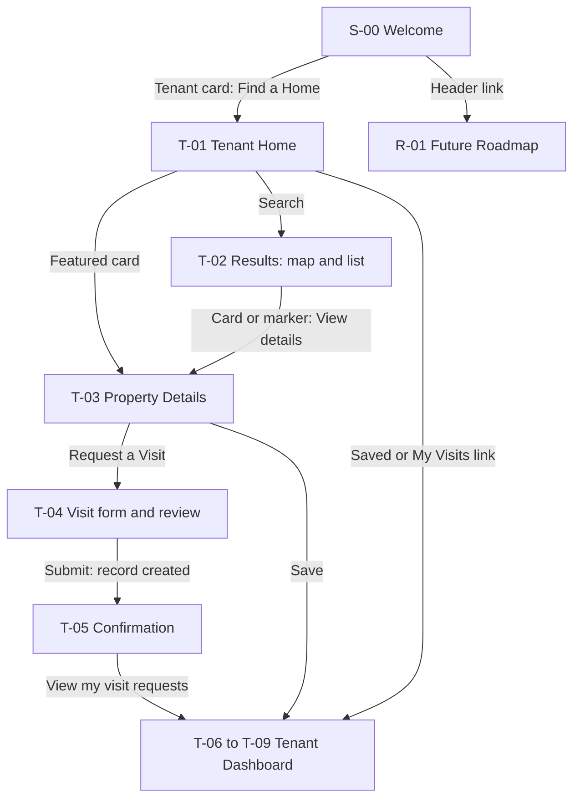

### 12.2 Welcome to Owner journey

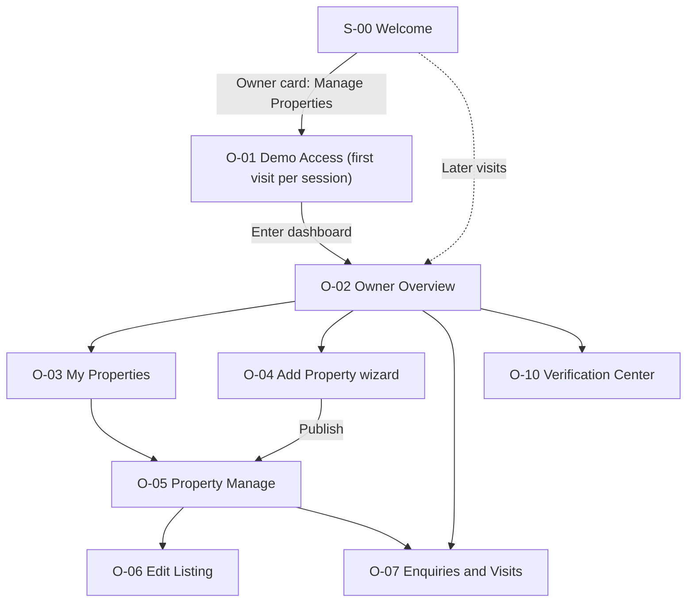

### 12.3 Tenant search-to-visit-request journey

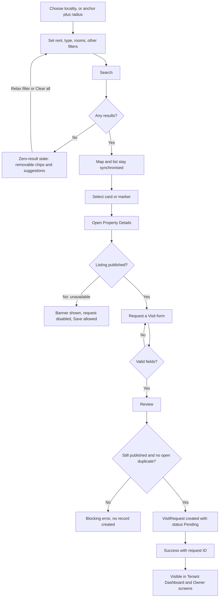

### 12.4 Owner add-property-to-publish journey

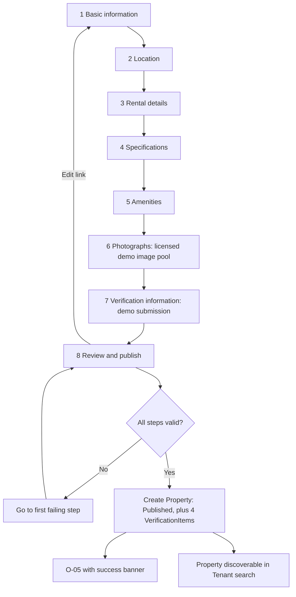

### 12.5 Shared visit-request lifecycle

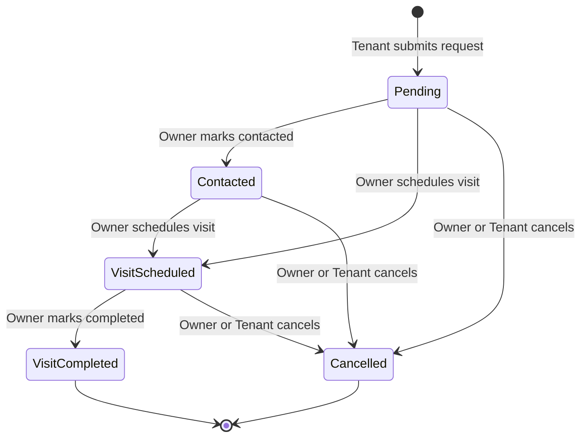

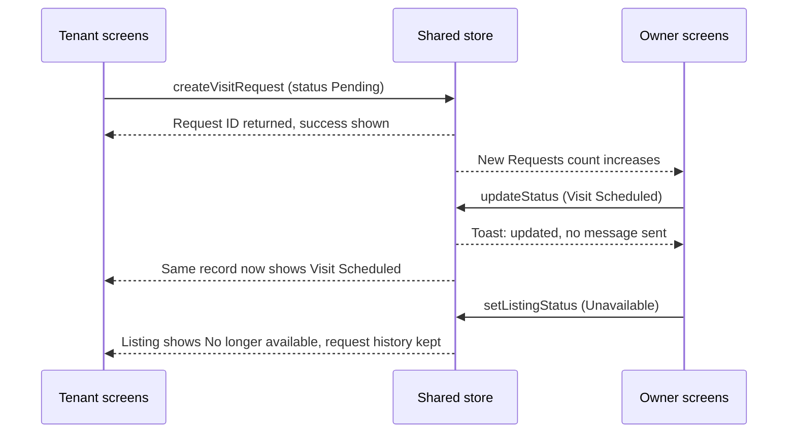

### 12.6 Verification and availability-state flow

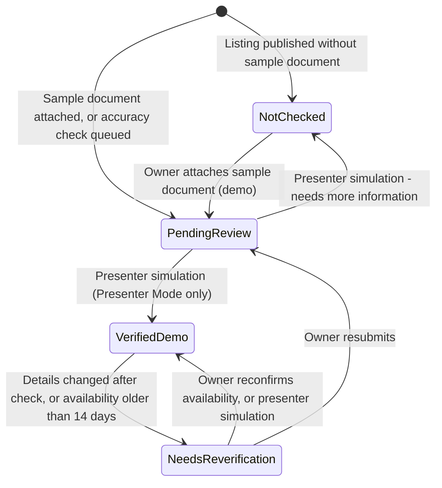

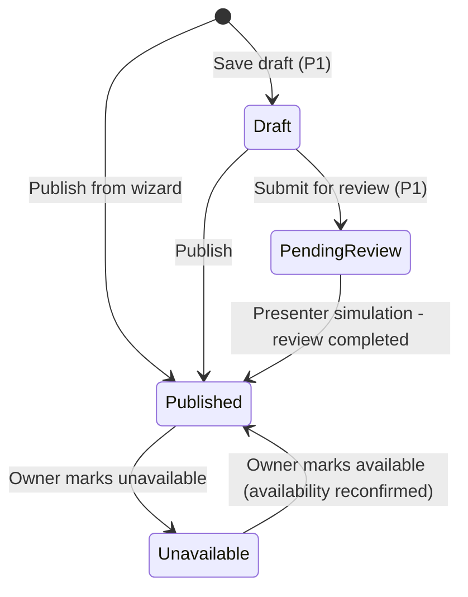

### 12.7 Presenter Demo Mode (simulation, P1)

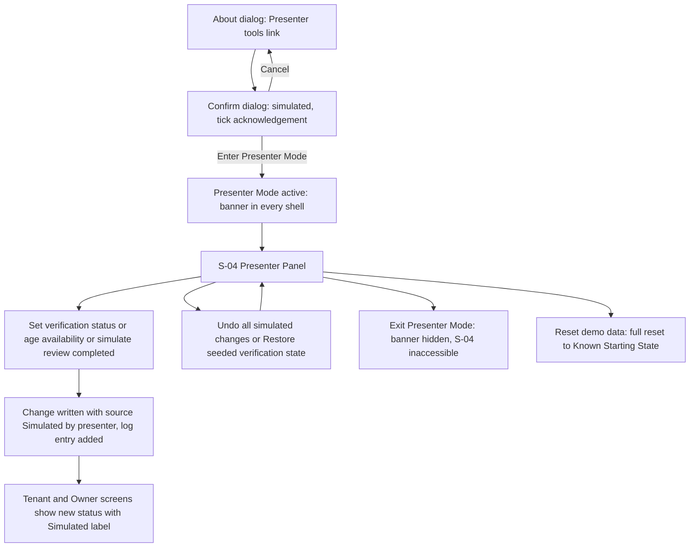

---

## 13. Data Model and Demonstration Data

> Conceptual schema only; no production code. Types are indicative. All timestamps are ISO-8601 strings; "date" fields are `YYYY-MM-DD`.

### 13.1 Conventions
- **IDs:** opaque strings. Fixtures: `prop_fx_01`, `req_fx_01`, … User-created: `prop_u_001`, `req_u_001`. **Display codes**: `NIV-DEMO-P001` (property), `NIV-VR-1001` (visit request; counter starts at 1001 and continues, fixtures consume 1001–1006), `NIV-RM-…` (maintenance, P1).
- Every record has `id`, `createdAt`, `updatedAt`, and `source: "fixture" | "user"` (distinguishes seeded data from prototype-created data). Every person record has `isDemo: true`.
- **Snapshots:** `VisitRequest` stores `propertySnapshot` (title, locality, rent, image id) at creation, so history stays intelligible after edits, while live screens read the current `Property`.
- **Statuses** are enumerated strings; labels live in one dictionary (single source for UI copy).

### 13.2 Entities

**Property**

| Field | Type / values | Notes |
|---|---|---|
| id, displayCode | string | |
| ownerId | → OwnerProfile.id | |
| title, description | string | |
| type | `apartment`, `independent_house`, `builder_floor`, `studio`, `single_room` | |
| locality | enum of 11 | §13.6 |
| addressArea, landmark | string | no exact address |
| lat, lng, locationPrecision | number, `"locality_approximate"` | derived (centroid + offset) |
| rent, deposit, maintenanceCharge | integer ₹; `maintenanceIncluded` bool | |
| availableFrom | date | |
| bedrooms, bathrooms | integer | studio/single_room: bedrooms=1 |
| furnishing | `unfurnished`, `semi_furnished`, `fully_furnished` | |
| sizeSqft | integer? | |
| amenities | string[] (ids) | |
| houseRules? (P1) | {minLeaseMonths, maxOccupants, petsAllowed, smokingAllowed} | objective only |
| photoIds | string[] (1–6 ids from the licensed image set, §14.13; data URLs in P1) | first = cover; each has an image-credit record |
| listingStatus | `draft`, `pending_review`, `published`, `unavailable` | |
| availabilityConfirmedAt | timestamp | drives freshness |
| publishedAt | timestamp? | |
| history | {at, type, summary}[] | activity log |
| source | fixture/user | |

Derived (never stored): `availabilityLabel`, `effectiveVerification[4]`, `verifiedCount`, `distanceFromAnchor`, `openRequestCount`.

**OwnerProfile**: `id`, `displayName?`, `phone?`, `isDemo`. Fixture owners: `owner_demo` (the persona), `owner_fx_a`, `owner_fx_b`, `owner_fx_c` (display "Sample Owner A/B/C").

**TenantProfile**: `id`, `name?`, `phone?`, `isDemo`. Persona `tenant_demo` starts with empty name/phone. Other tenants (`tenant_fx_*`) exist only as names on fixture requests.

**VisitRequest**

| Field | Notes |
|---|---|
| id, displayCode (`NIV-VR-####`) | |
| propertyId → Property; ownerId (denormalised for owner queries) ; tenantId → TenantProfile | |
| tenantNameEntered, tenantPhoneEntered | as typed in the mock form |
| preferredDate, preferredSlot (`morning`,`afternoon`,`evening`) | |
| message? | ≤300 |
| status | `pending`, `contacted`, `scheduled`, `completed`, `cancelled` |
| scheduledFor? | {date, slot} |
| cancelledBy?, cancelReason? | `tenant`/`owner` |
| statusHistory | {status, at, by:`tenant`/`owner`/`system`, note?}[] |
| tenantLastSeenStatusAt? | for Updated dot (P1) |
| propertySnapshot | {title, locality, rent, photoId} |

**SavedProperty**: `id`, `tenantId`, `propertyId`, `savedAt`. Unique (tenantId, propertyId).

**VerificationItem**

| Field | Notes |
|---|---|
| id, propertyId | exactly 4 per property, one per category |
| category | `identity`, `authority`, `listing_accuracy`, `availability` |
| status | `verified_demo`, `pending_review`, `not_checked`, `needs_reverification` |
| source | `demo_fixture`, `owner_declared`, `simulated_review` (written **only** by Presenter Mode) |
| checkedAt? | date of last status determination |
| evidenceLabel? | mock label, e.g. "Sample ID document (demo)" — never a file |
| note? | explanatory text |
| seedStatus | status assigned at seed/publish; basis for *Restore seeded verification state* |
| simulatedAt? | set when changed by Presenter Mode |

**Tenancy** (P1): `id`, `propertyId`, `ownerId`, `tenantId`, `startDate`, `endDate`, `monthlyRent`, `deposit`, `dueDay` (1–28), `noticeDays`.
**RentRecord** (P1): `id`, `tenancyId`, `month` (`YYYY-MM`), `amount`, `dueDate`, `paidAt?`, `recordedBy?`. Status derived: `paid` / `due` / `overdue`.
**MaintenanceRequest** (P1): `id`, `displayCode`, `tenancyId`, `propertyId`, `category`, `description`, `priority` (`low`,`medium`,`high`), `status` (`open`,`in_progress`,`resolved`), `createdBy` (`tenant`/`owner`), `updates` {at, by, status, note?}[].

**Session/UI state** (`ui`): `persona`, `lastRoute{tenant,owner}`, `mapMode` (`auto`,`street`,`schematic`), `ownerIntroSeen`, `wizardDraft?`, `presenterMode` (session-scoped, default false), `presenter.simulationLog[]` {id, target (item or property id), field, from, to, at}. Counters: `nextRequestSeq`, `nextPropertySeq`, `nextMaintenanceSeq`.

### 13.3 Relationships

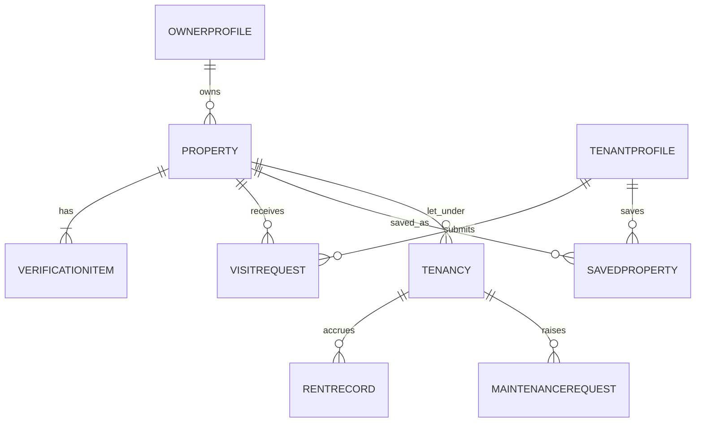

### 13.4 How owner-created property becomes searchable
Tenant search is a pure selector over the **same `properties` collection** (`listingStatus ∈ {published, unavailable}` filtered per §6.4). Publishing writes one record with `listingStatus: "published"`; the next selector run includes it. There is no copy, sync job or "publish to tenant" step. Cross-tab updates arrive via the `storage` event.

### 13.5 Mutations (the only write paths)

| Action | Preconditions | Writes |
|---|---|---|
| `publishProperty(wizardData)` | valid | Property, 4 VerificationItems, OwnerProfile upsert, counters, clear `wizardDraft` |
| `updateProperty(id, patch)` | owner's property | Property fields, `updatedAt`, history; maybe accuracy item → `pending_review` |
| `setListingStatus(id, status)` | allowed transition (§12.6) | status, history, `availabilityConfirmedAt` when → published |
| `reconfirmAvailability(id)` | published | `availabilityConfirmedAt`, availability item |
| `simulateVerification(itemId, to)` (P1) | Presenter Mode active | item status, `source=simulated_review`, `simulatedAt`, property history, log entry |
| `ageAvailability(propertyId, days)` (P1) | Presenter Mode active | `availabilityConfirmedAt`, log entry |
| `undoSimulations()` / `restoreSeededVerification()` (P1) | Presenter Mode active; confirmed | reverts logged changes / restores seed values; clears log |
| `createVisitRequest(input)` | property published; no open duplicate; valid | VisitRequest, TenantProfile upsert, counter |
| `transitionRequest(id, to, actor, payload)` | transition valid for **current stored** status and actor (§6.7); throws `InvalidTransition` otherwise | status, statusHistory, updatedAt, scheduledFor/cancel fields |
| `toggleSaved(tenantId, propertyId)` | — | SavedProperty add/remove |
| `recordRentPaid(rentId)` (P1) | unpaid | paidAt, recordedBy |
| `createMaintenance(...)`, `updateMaintenance(...)` (P1) | valid | MaintenanceRequest |
| `resetDemo()` | confirmed | whole store replaced by seed |

All mutations are pure functions of (state, input) → new state, followed by a single persistence write. Validation lives with the mutation (not only in the form) so UI bugs cannot create invalid records.

**Consistency of request status:** one `VisitRequest` record per request; both dashboards render from it via the same `getRequestViewModel(id)` selector. There is no second copy to drift.

### 13.6 Reference data

**Localities (11)** — centroids are *approximate* and unverified until the verification step in §13.6.2 is completed (D-12, D-28):

| Locality | Approx. lat, lng |
|---|---|
| Malviya Nagar | 26.8545, 75.8115 |
| C-Scheme | 26.9065, 75.8000 |
| Vaishali Nagar | 26.9130, 75.7430 |
| Mansarovar | 26.8500, 75.7640 |
| Raja Park | 26.9010, 75.8260 |
| Bani Park | 26.9380, 75.7890 |
| Jagatpura | 26.8330, 75.8650 |
| Sitapura | 26.7900, 75.8330 |
| Jawahar Nagar | 26.8960, 75.8180 |
| Sodala | 26.9080, 75.7700 |
| Gopalpura (Tonk Road) | 26.8700, 75.7970 |

#### 13.6.1 Real search anchors — candidates (all UNVERIFIED until §13.6.2 is completed)

Founder decision FD-2: use real, recognisable Jaipur colleges and suitable office-area landmarks as search-anchor examples. **Names and coordinates below come from general knowledge and were not verified in this blueprint task; treat them as candidates only.** Target final list: **4–8 anchors** (at least 3 colleges and 2 office-area landmarks).

| Candidate | Category | Locality context | Prior coordinate estimate (unverified) |
|---|---|---|---|
| MNIT Jaipur (Malaviya National Institute of Technology) | College | Malviya Nagar / JLN Marg | 26.8630, 75.8100 |
| University of Rajasthan | College | JLN Marg, Jawahar Nagar area | 26.8880, 75.8190 |
| IIS University | College | Mansarovar area | to be determined |
| SMS Medical College | College | Central Jaipur | to be determined |
| Manipal University Jaipur | College | Outer Jaipur (Dehmi Kalan) — probably beyond 10 km of most demo homes | to be determined; include only if nearby demo homes are added |
| World Trade Park, Malviya Nagar | Office-area / commercial landmark | Malviya Nagar | 26.8530, 75.8050 |
| JECC / Sitapura Industrial Area | Office-area | Sitapura | 26.7960, 75.8350 |
| C-Scheme business district (Ashok Marg area) | Office-area | C-Scheme | to be determined |
| Mahindra World City Jaipur | Business park | Outer Jaipur — far from the core localities | to be determined; optional |

**Selection rules.** (1) Only candidates that pass §13.6.2 enter the app; rejected ones are recorded with the reason. (2) If fewer than 4 pass, ask the founder before proceeding. (3) After the list is fixed, the demonstration data must give every anchor **at least one demo home within 5 km and at least two within 10 km**, and the 1/3/5/10 km radii must produce visibly different result sets for the two or three main demo anchors; if coverage is lacking, adjust the *fictional* fixtures (locality/offset), never the anchor coordinates. (4) Outer-city anchors are included only if fixtures are added nearby. (5) The final table replaces this one and is marked "Verified on <date>".

**Presentation rules (real anchors vs fictional homes).** Anchors are labelled "Search anchor — real place, approximate location"; homes carry the Demo pill. Distances are always "≈ x km straight-line (approx.)". No copy mentions travel time, walking/driving minutes, commute or "walkable". Fixture titles and descriptions never name a real institution or landmark, so no fictional home appears to be a real listing near a real place (D-26). The About dialog states that anchors are location references only, with no affiliation or endorsement. Whether any institution's permission or review is appropriate for using its name as a location reference has not been assessed here (open question, §19.3).

#### 13.6.2 Location-data verification step (mandatory gate, D-28)

When: **before any map code is written** (first task of Phase 2; the data structure with empty verification fields is created in Phase 1) and re-confirmed in the pre-demo checklist (§18.2, Phase 7).

For every anchor **and every locality centroid**:

1. **Name** — confirm the official name and common spelling from the institution's or operator's own official website (or another authoritative source); record URL and date.
2. **Existence and place** — confirm it exists in Jaipur at the location used and is operating.
3. **Coordinates** — obtain the centre of the campus/building/area from OpenStreetMap; round to 4 decimals; cross-check visually against a second independent map source; the two must agree within roughly 300 m. Coordinates remain **approximate** and are never described as exact.
4. **Attribution** — OSM-derived coordinates are credited to "© OpenStreetMap contributors" (About/Image-credits-style credits page); do not bulk-copy tile or map data.
5. **Record** — store `{name, officialName, category, lat, lng, precision: "approximate", sources[], checkedOn, checkedBy, status: verified | rejected}` with the reference data.
6. **Fixture sanity check** — recompute derived property coordinates; spot-check at least three property–anchor distances against a map ruler (tolerance ±10 %).
7. **Sign-off** — founder reviews the final anchor and locality tables; this document is updated with "Verified on <date>".

Until step 7 is done the data carries `verification.status = "unverified"`, the About dialog says so, and the build is not used for the live demo. A custom anchor (geocoding) is out of scope.

**Amenities (12):** parking, wifi, lift, power_backup, water_24h, modular_kitchen, security, air_conditioning, balcony, gym_access, pet_friendly, gated_society.

**Slots:** morning 9–12, afternoon 12–4, evening 4–7.

### 13.7 Demonstration data plan

**Rules:** all fictional; titles generic and never naming a real institution or landmark (D-26); no real landlord, building or contact; prices plausible but not market claims; phone numbers on fixture requests use obviously fictional patterns (e.g. `98xxxxxx01` masked "98•••• ••01"). Dates stored as offsets and resolved at seed time (`today = seed day`). Fixtures carry `source: "fixture"`; anything created through the UI carries `source: "user"` and is listed separately in About → counts.

**Properties (16).** Statuses: P=published, U=unavailable, R=pending_review, D=draft. Verification order: Identity / Authority / Accuracy / Availability — V=verified_demo, P=pending_review, N=not_checked, R=needs_reverification (availability R is produced by staleness, 20 days ago).

| FX | Title (demo) | Type | Locality | Rent ₹ | Bed/Bath | Furnishing | Key amenities | Owner | Status | I / Au / Ac / Av |
|---|---|---|---|---|---|---|---|---|---|---|
| 01 | Sunlit 2 BHK, Malviya Nagar | apartment | Malviya Nagar | 22,000 | 2/2 | semi | parking, lift, wifi, power_backup | owner_demo | P | V V V V |
| 02 | Compact Studio, C-Scheme | studio | C-Scheme | 14,500 | 1/1 | fully | wifi, air_conditioning, security | owner_demo | P | V P V V |
| 03 | Garden-Facing 3 BHK House | independent_house | Vaishali Nagar | 38,000 | 3/3 | semi | parking, water_24h, power_backup, security | owner_fx_b | P | V V P V |
| 04 | Budget Single Room, Raja Park | single_room | Raja Park | 6,500 | 1/1 | unfurnished | water_24h | owner_fx_a | P | N N N V |
| 05 | Modern 1 BHK, Mansarovar | apartment | Mansarovar | 12,000 | 1/1 | semi | lift, parking | owner_demo | P | V N P R (stale) |
| 06 | Builder Floor 2 BHK, Jagatpura | builder_floor | Jagatpura | 16,500 | 2/2 | unfurnished | parking, water_24h | owner_fx_c | P | V V V V |
| 07 | Premium 3 BHK, Bani Park | apartment | Bani Park | 52,000 | 3/3 | fully | lift, gym_access, gated_society, security, air_conditioning | owner_fx_b | P | V V V V |
| 08 | Office-Ready 2 BHK, Sitapura | apartment | Sitapura | 19,000 | 2/2 | semi | wifi, power_backup, parking | owner_fx_c | P | P P P V |
| 09 | Cozy Studio, Jawahar Nagar | studio | Jawahar Nagar | 11,000 | 1/1 | fully | wifi, air_conditioning | owner_fx_a | P | V P V V |
| 10 | Spacious 4 BHK Villa, Vaishali Nagar | independent_house | Vaishali Nagar | 75,000 | 4/4 | fully | parking, security, balcony, gated_society | owner_fx_b | **U** | V V V V |
| 11 | Quiet 1 BHK, Sodala | apartment | Sodala | 13,500 | 1/1 | semi | lift, water_24h | owner_demo | **R** | P N P V |
| 12 | Draft: 2 BHK, Gopalpura | apartment | Gopalpura | 17,000 | 2/2 | unfurnished | — | owner_demo | **D** | N N N N |
| 13 | Furnished 2 BHK, Malviya Nagar | apartment | Malviya Nagar | 28,000 | 2/2 | fully | parking, wifi, air_conditioning, modular_kitchen | owner_fx_a | P | V V P V |
| 14 | Single Room, Jawahar Nagar | single_room | Jawahar Nagar | 7,500 | 1/1 | unfurnished | wifi | owner_fx_c | P | V N V V |
| 15 | Corner 2 BHK, C-Scheme (currently let) | apartment | C-Scheme | 24,000 | 2/2 | semi | parking, lift, security | owner_demo | **U** | V V V V |
| 16 | Airy 1 BHK, Mansarovar (currently let) | apartment | Mansarovar | 11,500 | 1/1 | unfurnished | water_24h, parking | owner_demo | **U** | V V P V |

Coverage notes: prices ₹6.5k–₹75k; all five types; all three furnishings; anchor coverage as required by §13.6.1 rule 3; two contrasting trust profiles (FX-01 broad vs FX-04 mostly unchecked) for the Trust Center examples; one stale-availability listing (FX-05); one unavailable listing with visit history (FX-10); pending review (FX-11) and draft (FX-12) visible only to the Owner; two let properties with tenancies (FX-15, FX-16) for rent/maintenance previews. `owner_demo` owns FX-01, 02, 05, 11, 12, 15, 16 (7 properties; 3 published → "Active listings = 3").

**Visit requests (fixtures, 6):** `NIV-VR-1001` FX-01 "Riya S." Pending · `1002` FX-01 "Karan M." Contacted · `1003` FX-02 "Meera P." Visit Scheduled (today+3, afternoon) · `1004` FX-05 "Arjun T." Visit Completed · `1005` FX-10 "Sana K." Cancelled (kept for history on an unavailable listing) · `1006` FX-03 "Dev R." Pending (belongs to another owner; invisible in Owner view, demonstrates scoping). Counter then starts at 1007 for user-created requests. (Names fictional.)
Resulting owner-demo dashboard at start: New Requests = 1, Scheduled visits = 1.

**Tenancies and rent (P1):** `tn_demo` — FX-15, tenant `tenant_demo`, rent ₹24,000, deposit ₹48,000, dueDay 5, start 5 months ago, end in 74 days from seed; rent records for the 5 past months paid, current month due (dueDay may be after today) → plus one older month deliberately **overdue** (e.g. 2 months ago unpaid, to show overdue) — for realism choose: months −5, −4, −3 paid, −2 **overdue**, −1 paid, current due. `tn_fx_2` — FX-16, sample tenant "Neha V.", rent ₹11,500, all paid except current due.

**Maintenance (P1):** FX-15 "Leaking kitchen tap" Plumbing, Medium, Open · FX-15 "AC not cooling" Appliance, High, In Progress (owner note "Technician visit pencilled in (demo)") · FX-16 "Repaint bedroom wall" Cleaning/Other, Low, Resolved.

**Saved properties:** none at start (empty-state demo). **Tenant profile:** empty.

**Images:** locally bundled, licensed stock images — distinct image sets per fixture listing plus a separate owner-selectable pool; counts, sourcing, licences and attribution are specified in §14.13 (D-10, D-27). Each image has generic-scene alt text, never a claim about a specific property.

### 13.8 Distinguishing fixtures from user-created records
`source` field drives: a small "Sample" tag in Owner tables for fixture rows (so presenters know what is seeded), About-dialog counts, and optional "Show only my additions" (not planned). Reset removes `user` records and restores fixtures.

---

## 14. Visual Design System Specification

Implement as CSS custom properties (design tokens) in one file; components consume tokens only. Proposed values; contrast ratios must be re-verified with a contrast checker at implementation (target WCAG 2.1 AA: 4.5:1 body text, 3:1 large text and UI boundaries).

### 14.1 Colour tokens

| Token | HEX | Use |
|---|---|---|
| `--navy-900` | `#0B1B3A` | Primary text, headings, nav, selected map-pin text on white |
| `--navy-700` | `#1F2F57` | Hover for navy elements, sidebar active text |
| `--violet-600` | `#5B3FD6` | Primary buttons, selected states, links on white |
| `--violet-700` | `#4A31B8` | Primary hover/pressed |
| `--violet-100` | `#EEEAFB` | Selected backgrounds, focus tint |
| `--white` | `#FFFFFF` | Cards, inputs |
| `--surface` | `#F7F7FA` | Page background (soft off-white) |
| `--surface-2` | `#EFF0F5` | Sunken areas, skeletons |
| `--border` | `#E1E4EC` | Default borders/dividers |
| `--border-strong` | `#C5CAD6` | Inputs, hover borders |
| `--text-2` | `#4F5870` | Secondary text |
| `--text-3` | `#6B7490` | Tertiary text (large or non-essential only) |
| `--positive` / bg | `#1E7A4F` / `#E6F4EC` | Verified (demo), success |
| `--warning` / bg | `#9A5B00` / `#FDF1DC` | Needs re-verification, stale, caution |
| `--pending` / bg | `#2F5AA8` / `#E8EFFB` | Pending review, Contacted, In progress |
| `--neutral` / bg | `#4F5870` / `#EEF0F4` | Not yet checked, Draft, closed states |
| `--error` / bg | `#B42318` / `#FDECEA` | Errors, Cancelled, Overdue |

Dark mode: **not in scope** (D-21). Set `color-scheme: light`.

### 14.2 Typography
- **Family:** Inter (variable), **self-hosted/bundled** (no external font request); fallback `system-ui, -apple-system, "Segoe UI", Roboto, sans-serif`.
- **Hierarchy (desktop / mobile):** Display 44/36 (Welcome H1, weight 700, tracking −0.02em) · H1 32/28 (600) · H2 24/22 (600) · H3 18/18 (600) · Body 16/16 (400, line-height 1.55) · Small 14/14 · Caption 12/12 (min size; never for essential info) · Overline 12 uppercase tracking +0.12em (descriptor "THE RENTAL LIVING ECOSYSTEM").
- Numerals: tabular figures for rent tables.
- Line length ≤ 70ch for prose.

### 14.3 Spacing, radii, shadows, layout
- **Spacing scale (px):** 4, 8, 12, 16, 24, 32, 48, 64, 96. Component padding 16/24; section gaps 48–64 desktop, 32 mobile.
- **Radii:** 6 (inputs, chips), 10 (buttons), 14 (cards), 20 (modals/sheets), 999 (pills). Do not mix beyond this set.
- **Borders:** 1px `--border`; inputs `--border-strong`.
- **Shadows:** `--shadow-1: 0 1px 2px rgba(11,27,58,.06)` (cards at rest); `--shadow-2: 0 4px 16px rgba(11,27,58,.08)` (hover, popovers); `--shadow-3: 0 12px 40px rgba(11,27,58,.14)` (modals). No coloured glows.
- **Gradients:** none, except an optional ≤4 % navy-to-transparent scrim on image overlays for text legibility.
- **Layout:** content max width 1200 (Tenant pages), 1280 (Owner main area); 12-col grid desktop, 4-col mobile; side gutters ≥16 px (24 on ≥768). Breakpoints: `sm 480 · md 768 · lg 1024 · xl 1280`.

### 14.4 Buttons

| Variant | Style | Use |
|---|---|---|
| Primary | `--violet-600` fill, white text | One per view region (Search, Request a Visit, Publish) |
| Secondary | white fill, `--navy-900` text, `--border-strong` border | View details, Back |
| Tertiary | text/link style | Low-emphasis |
| Destructive | white fill, `--error` text/border; filled red only inside confirm dialog | Cancel request, Mark unavailable, Reset |
| Icon | 40–44 px square hit area | Save, close, zoom |

Heights 44 (default), 36 (compact in tables). States: hover (darken one step), `:focus-visible` ring, active (translateY 0.5px / darker), disabled (50 % opacity + `aria-disabled`, with an adjacent reason where non-obvious), loading (only for real async; spinner replaces label width-stable). Minimum touch target 44×44 on mobile.

### 14.5 Forms, cards, tables
- **Fields:** 44 px height, `--white` fill, 1px `--border-strong`, radius 6, label above (14/600), helper (14, `--text-2`), error (14, `--error`, leading icon, `role="alert"` on submit). Required marked with `*` and "(required)" in `aria-label`, never colour alone. Inputs use correct `inputmode`/`autocomplete` (`tel`, `numeric`).
- **Cards:** white, radius 14, `--shadow-1`, 1px `--border`; hover → `--shadow-2` (no movement beyond 2 px).
- **Tables:** on <768 px convert to stacked cards; header row sticky within scroll containers only.
- **Chips:** 36 px height, radius 999; selected = `--violet-100` fill + violet text + check icon.

### 14.6 Status badge semantics (colour is never the only cue)

| Meaning | Colour pair | Icon | Used for |
|---|---|---|---|
| Positive | positive | check-circle | Verified (demo), Published, Paid (demo record), Resolved, Available now |
| Warning | warning | alert-triangle / refresh | Needs re-verification, Available from {date}, stale |
| Pending / in progress | pending | clock / loader-less dots | Pending review, Pending (request), Contacted, Visit Scheduled, In Progress |
| Neutral | neutral | dashed-circle / minus | Not yet checked, Draft, Visit Completed, Unavailable listing label |
| Error | error | x-circle / alert | Cancelled, Overdue, No longer available |

Rules: badges always contain **text + icon**; the 4-segment verification indicator uses distinct fills too (solid = verified, striped = pending, outline-dashed = not checked, outline-with-dot = needs re-verification). "Visit Completed" uses neutral (an end state, not a success claim about the home). `Open` (maintenance) uses warning; `Due` rent uses pending; `Open` request counts use pending.

### 14.7 Icons
One library (Lucide, bundled via the npm package, not a CDN). 20 px default, 1.5–1.75 stroke, `aria-hidden` when decorative; icon-only buttons have `aria-label`. **No emoji in UI.** Brand mark is a bespoke SVG (house outline with key-bit doorway). Map markers are custom HTML/SVG pills.

### 14.8 Desktop and mobile layout rules
- Tenant: top nav; content-centred; results page full-bleed split view.
- Owner: sidebar (240 px) + main; mobile bottom tab bar 56 px + safe-area inset.
- Modals → bottom sheets <768 px, max-height 90 vh, inner scroll, sticky action footer.
- Sticky elements must not cover focused fields (use `scroll-margin`).
- No horizontal page scroll at 320 px width; tables/diagrams scroll inside their own container.
- Avoid hover-only affordances.

### 14.9 Focus and keyboard
- Global `:focus-visible`: 2 px `--violet-600` ring with 2 px white offset (also on dark navy elements: white ring).
- Logical tab order; skip link "Skip to main content" on every shell.
- Dialogs/drawers trap focus, close on Esc, restore focus.
- Combobox: arrow keys, Enter selects, Esc closes, `aria-activedescendant`.
- Map: pan/zoom buttons reachable; marker buttons; the list is the primary accessible interface; `aria-live` region announces result count and selection ("Selected: Sunlit 2 BHK, Malviya Nagar, ₹22,000").
- Tabs/segmented controls: arrow-key navigation with roving tabindex.

### 14.10 Motion
- Durations 120–200 ms ease-out for hover/press/popover; drawers/modals 200 ms; no parallax, no looping animations, no auto-playing carousels.
- `@media (prefers-reduced-motion: reduce)`: remove transforms/slide transitions; keep opacity-only ≤100 ms; map flyTo → instant setView.

### 14.11 Writing style for UI copy
Plain, calm, specific. Sentence case. Verbs for buttons. Honest hedges for demo data ("(demo)"). No exclamation marks, no superlatives ("best", "guaranteed"), no pressure copy ("only 2 left").

### 14.12 Images
- Card/gallery ratio 4:3; hero 16:9 cropped from the same asset with `object-fit: cover`; explicit `width/height` to avoid layout shift; `loading="lazy"` except first gallery image; `decoding="async"`.
- **Loading:** `--surface-2` block (skeleton, no shimmer under reduced motion) then fade in.
- **Fallback chain:** requested gallery image → on error, a neutral inline-SVG placeholder (house outline on `--surface-2`) with the caption "Image unavailable" and meaningful alt text. A broken image icon must never show.
- **Alt text:** describes the generic scene; the *Illustrative photo* chip is mandatory in gallery and card overlays where images are not of real homes.
- **Weight budget:** ≤150 KB per image; total initial route payload (excluding map tiles) ≤ ~1.5 MB.
- No external image URLs. No hot-linked stock. Sourcing, licences and attribution: §14.13.

### 14.13 Imagery plan — licensing, allocation and attribution (D-10, D-27)

**Status: plan only.** No images have been downloaded or processed; acquisition is a Phase 1 task that starts only after the founder approves the provider and licence rules below (§19.3).

**Principles (founder decision FD-1)**
- High-quality photographs under licences that permit free use in a competition prototype, **stored locally** in the repository and bundled with the app; no hot-linking, no runtime image fetches.
- Different, suitable images for different listings — no single image repeated across listings.
- Images are illustrative. They never imply that a fictional listing is a real NIVORA customer, a real rental property or a verified property.

**Allocation**

| Set | Purpose | Plan |
|---|---|---|
| Fixture sets | Photos for the 15 non-draft fixture listings (FX-12 is a draft with 0–1 photo to demonstrate the photo-step rule) | Each fixture gets its own images: **minimum 3** (cover + 2), **4–5** for demo-critical listings (FX-01, 02, 03, 04, 05, 07). **No image file is shared between two fixtures; every cover is unique.** Approx. 45–60 images. |
| Owner pool | What an Owner can pick in wizard Step 6 | ≥24 additional images not used by fixtures: living rooms, bedrooms, kitchens, bathrooms, balconies, building exteriors, in several styles, so newly created demo listings do not reuse fixture photos. |
| Brand/other | Welcome hero | Inline SVG only; no photograph required. |

Final counts and total weight are an open item (§19.3); indicative budget ≤120 KB per image at about 1280×960 (WebP with JPEG fallback), roughly 8–10 MB of local assets in total, loaded lazily so route payloads stay small.

**Selection criteria**
- Content matches the listing: property type, furnishing and size must be consistent with the record (an unfurnished listing does not show a fully furnished lounge; a Single Room shows a single room).
- Natural, consistent lighting and colour; sharp; at least 1600 px on the long edge at source; cropped to 4:3.
- **Exclude:** identifiable people or faces; visible brand logos, watermarks, estate-agency branding; house numbers, street signs, phone numbers; recognisable named buildings or landmarks; images from real-estate portals or listing sites; scraped images; anything with unclear or restrictive licensing; near-duplicates.
- Each image gets generic-scene alt text (for example "Living room with sofa and large window") and never describes a specific real property.
- AI-generated imagery is **not planned**; whether it would be acceptable is an open question (§19.3).

**Licensing rules** (engineering guidance, not legal advice; the exact licence text must be read and recorded at download time)
- Acceptable if clearly stated and compatible with free use in this prototype: **CC0 / public-domain dedications**, and licences of the type used by major free-stock providers (for example the Unsplash, Pexels or Pixabay content licences — verify current terms before use), and **CC BY** where attribution can be displayed.
- Not acceptable without separate founder approval: CC BY-SA, CC BY-ND, any NonCommercial licence, editorial-use-only images, images requiring model or property releases that are not provided.
- Respect any licence limits on implying endorsement by people or brands depicted (another reason to exclude recognisable people and brands).
- Modifications (crop, resize, compress, colour-neutral adjustment) must be permitted by the licence and recorded.

**Attribution register (required artefact)**
For every image keep a record, maintained as structured data in the repository and mirrored in-app:

| Field | Meaning |
|---|---|
| File | Local file name |
| Used by | Fixture id(s) or "owner pool" |
| Source URL | Page where the image and licence were found |
| Creator | Photographer/author name and profile URL |
| Licence | Licence name and URL (as read on the download date) |
| Downloaded on | Date |
| Modifications | e.g. crop 4:3, resize 1280 px, compress |
| Attribution required | Yes / No (per licence) |
| Alt text | Generic scene description |

- The register powers an **Image credits** page linked from the About dialog (creator, source, licence). Credit is shown even where not legally required, unless the founder opts out. Where a licence requires attribution adjacent to the image, a caption/credit line is shown in the gallery or lightbox as well.
- Annex A (below) is the template; it is filled when images are acquired. An image without a complete register row must not ship.

**Labelling in the UI:** every photo carries the *Illustrative photo* chip in cards, gallery and preview; the property detail page notice reads *"Photos are licensed stock images used for demonstration. They do not show an actual property."* Because photos are stock, any "Listing accuracy: Verified (demo)" status on a fixture is purely a demo data label; the Trust Center says this explicitly.

**Failure handling:** image error or missing file → the neutral SVG placeholder (§14.12); a missing placeholder must never show a broken-image icon.

**Annex A — Image attribution register (to be completed at acquisition)**

| File | Used by | Source URL | Creator | Licence (name + URL) | Downloaded on | Modifications | Attribution required | Alt text |
|---|---|---|---|---|---|---|---|---|
| `public/images/fx01-1.jpg` | NIV-DEMO-P001 | https://www.pexels.com/photo/sofa-in-a-spacious-living-room-9494898/ | [I'm Zion](https://www.pexels.com/@zion/) | Pexels License, https://www.pexels.com/license/ | 2026-10-10 | None (Pexels-served rendition) | No (credited anyway) | Living room with a sofa, dining table and sheer curtains |
| `public/images/fx02-1.jpg` | NIV-DEMO-P002 | https://www.pexels.com/photo/new-spacious-room-in-contemporary-apartment-7040700/ | [Max Vakhtbovych](https://www.pexels.com/@artbovich/) | Pexels License, https://www.pexels.com/license/ | 2026-10-10 | None (Pexels-served rendition) | No (credited anyway) | Studio living space with a sofa and an open kitchen along one wall |
| `public/images/fx03-1.jpg` | NIV-DEMO-P003 | https://www.pexels.com/photo/brown-wooden-tv-hutch-with-black-flat-screen-tv-3990590/ | [Curtis Adams](https://www.pexels.com/@curtis-adams-1694007/) | Pexels License, https://www.pexels.com/license/ | 2026-10-10 | None (Pexels-served rendition) | No (credited anyway) | Carpeted living room with a ceiling fan, wooden TV unit and armchairs |
| `public/images/fx04-1.jpg` | NIV-DEMO-P004 | https://www.pexels.com/photo/white-wooden-door-closet-3958953/ | [Curtis Adams](https://www.pexels.com/@curtis-adams-1694007/) | Pexels License, https://www.pexels.com/license/ | 2026-10-10 | None (Pexels-served rendition) | No (credited anyway) | Empty room with wooden floor, a ceiling fan and a built-in closet |
| `public/images/fx05-1.jpg` | NIV-DEMO-P005 | https://www.pexels.com/photo/apartment-living-room-16056400/ | [Erdem ÖZDEMİR](https://www.pexels.com/@erdemozdemir/) | Pexels License, https://www.pexels.com/license/ | 2026-10-10 | None (Pexels-served rendition) | No (credited anyway) | Compact living room with a teal sofa, armchairs and a wall-mounted TV |
| `public/images/fx06-1.jpg` | NIV-DEMO-P006 | https://www.pexels.com/photo/empty-room-with-balcony-and-parquet-floor-7031621/ | [Max Vakhtbovych](https://www.pexels.com/@artbovich/) | Pexels License, https://www.pexels.com/license/ | 2026-10-10 | None (Pexels-served rendition) | No (credited anyway) | Empty living room with dark wooden floor and a glass door to a balcony |
| `public/images/fx07-1.jpg` | NIV-DEMO-P007 | https://www.pexels.com/photo/modern-living-room-design-with-corner-sofa-6920439/ | [Max Vakhtbovych](https://www.pexels.com/@artbovich/) | Pexels License, https://www.pexels.com/license/ | 2026-10-10 | None (Pexels-served rendition) | No (credited anyway) | Modern living room with a large corner sofa and a TV wall |
| `public/images/fx08-1.jpg` | NIV-DEMO-P008 | https://www.pexels.com/photo/interior-design-of-room-7546648/ | [Max Vakhtbovych](https://www.pexels.com/@artbovich/) | Pexels License, https://www.pexels.com/license/ | 2026-10-10 | None (Pexels-served rendition) | No (credited anyway) | Living room with a blue sofa, coffee table and a wall-mounted TV |
| `public/images/fx09-1.jpg` | NIV-DEMO-P009 | https://www.pexels.com/photo/modern-flat-with-cozy-bed-and-loft-style-lamp-6782426/ | [Max Vakhtbovych](https://www.pexels.com/@artbovich/) | Pexels License, https://www.pexels.com/license/ | 2026-10-10 | None (Pexels-served rendition) | No (credited anyway) | Studio flat with a double bed, small dining table and kitchen area |
| `public/images/fx10-1.jpg` | NIV-DEMO-P010 | https://www.pexels.com/photo/white-and-red-sectional-couch-7148779/ | [Souranshi Fashion and Lifestyle Magazine](https://www.pexels.com/@souranshi-fashion-and-lifestyle-magazine-2959920/) | Pexels License, https://www.pexels.com/license/ | 2026-10-10 | None (Pexels-served rendition) | No (credited anyway) | Spacious living room with sectional sofas, ceiling fans and recessed lighting |
| `public/images/fx13-1.jpg` | NIV-DEMO-P013 | https://www.pexels.com/photo/contemporary-living-room-interior-design-7546557/ | [Max Vakhtbovych](https://www.pexels.com/@artbovich/) | Pexels License, https://www.pexels.com/license/ | 2026-10-10 | None (Pexels-served rendition) | No (credited anyway) | Furnished living room with a light sofa, armchair and TV unit |
| `public/images/fx14-1.jpg` | NIV-DEMO-P014 | https://www.pexels.com/photo/a-room-with-a-large-window-and-white-cupboards-26859478/ | [Alexander F Ungerer](https://www.pexels.com/@alexander-f-ungerer-157458816/) | Pexels License, https://www.pexels.com/license/ | 2026-10-10 | None (Pexels-served rendition) | No (credited anyway) | Empty room with a large window and a white built-in wardrobe |
| `public/images/fx15-1.jpg` | NIV-DEMO-P015 | https://www.pexels.com/photo/modern-design-of-an-apartment-flat-6580396/ | [Max Vakhtbovych](https://www.pexels.com/@artbovich/) | Pexels License, https://www.pexels.com/license/ | 2026-10-10 | None (Pexels-served rendition) | No (credited anyway) | Living room with a green sofa, round side table and tall sheer curtains |
| `public/images/fx16-1.jpg` | NIV-DEMO-P016 | https://www.pexels.com/photo/white-room-with-wooden-flooring-8146158/ | [Max Vakhtbovych](https://www.pexels.com/@artbovich/) | Pexels License, https://www.pexels.com/license/ | 2026-10-10 | None (Pexels-served rendition) | No (credited anyway) | Empty room with wooden floor and a doorway to a small kitchen |
| `public/images/pool-01.jpg` | owner pool | https://www.pexels.com/photo/interior-of-cozy-bedroom-at-home-6180679/ | [Max Vakhtbovych](https://www.pexels.com/@artbovich/) | Pexels License, https://www.pexels.com/license/ | 2026-10-10 | None (Pexels-served rendition) | No (credited anyway) | Bedroom with a double bed, window seat and small dining table |
| `public/images/pool-02.jpg` | owner pool | https://www.pexels.com/photo/minimalist-kitchen-furniture-7303726/ | [Cup of Couple](https://www.pexels.com/@cup-of-couple/) | Pexels License, https://www.pexels.com/license/ | 2026-10-10 | None (Pexels-served rendition) | No (credited anyway) | Compact kitchen counter with a sink, hob and wooden cabinets |
| `public/images/pool-03.jpg` | owner pool | https://www.pexels.com/photo/toilet-and-sink-in-modern-light-bathroom-6890406/ | [Max Vakhtbovych](https://www.pexels.com/@artbovich/) | Pexels License, https://www.pexels.com/license/ | 2026-10-10 | None (Pexels-served rendition) | No (credited anyway) | Small bathroom with a wall-hung toilet and a basin on a wooden vanity |
| `public/images/pool-04.jpg` | owner pool | https://www.pexels.com/photo/railing-on-sunlit-balcony-17000987/ | [hi room](https://www.pexels.com/@hiroom/) | Pexels License, https://www.pexels.com/license/ | 2026-10-10 | None (Pexels-served rendition) | No (credited anyway) | Apartment balcony with a metal railing overlooking other buildings |
| `public/images/pool-05.jpg` | owner pool | https://www.pexels.com/photo/white-concrete-building-with-black-metal-railings-2111768/ | [Luis Quintero](https://www.pexels.com/@jibarofoto/) | Pexels License, https://www.pexels.com/license/ | 2026-10-10 | None (Pexels-served rendition) | No (credited anyway) | Building facade with balconies, iron railings and potted plants |
| `public/images/pool-06.jpg` | owner pool | https://www.pexels.com/photo/interior-design-of-a-simple-house-4119832/ | [Curtis Adams](https://www.pexels.com/@curtis-adams-1694007/) | Pexels License, https://www.pexels.com/license/ | 2026-10-10 | None (Pexels-served rendition) | No (credited anyway) | Dining area with a glass table and chairs next to a living space |

_20 of 82 slots filled (tier `demo-minimum`, 2026-10-10). Per-file Pexels IDs, rendition URLs, byte sizes and SHA-256 hashes: `docs/IMAGE_ACQUISITION_LOG.md`. The other 62 slots are still empty._

---

## 15. Functional Behaviour and Acceptance Criteria (P0)

Format: **Given / When / Then**. Unless stated, tests assume the Known Starting State (§18.1) and a 1440×900 viewport, repeated at 390×844 for layout-sensitive items (AC-34).

### 15.1 Entry and navigation

- **AC-01 Landing.** Given a fresh load of `/`, when the page renders, then the exact brand texts in §2.1 and §5 are visible, two journey cards and the Discover/Trust/Manage strip are present, and no network request to a third-party origin is made (verified with the street map not yet loaded).
- **AC-02 Role cards.** Given Welcome, when the Tenant card is clicked or focused and activated with Enter or Space, then the route is `/tenant`; likewise the Owner card leads to `/owner` (O-01 on first visit, else `/owner/dashboard`). Cards expose one accessible name each and show a visible focus ring.
- **AC-03 Navigation.** Given any Tenant page, then top-nav links reach T-01, T-07, T-08, S-01 and the role switcher reaches the Owner view and back preserving each side's last route. Given any Owner page, every sidebar item (that is built) reaches its screen; no sidebar item leads to a blank/404 page; mobile bottom bar and "More" sheet expose the same set.

### 15.2 Search

- **AC-04 Search form validation.** Given anchor mode with no anchor, when Search is activated, then an inline error appears, focus moves to the anchor field, and the route does not change. Given Min > Max rent, then inline error and no navigation.
- **AC-05 Empty search.** Given nothing selected, when Search, then T-02 shows all *Available now* published listings (FX-01, 02, 03, 04, 05, 06, 07, 08, 09, 13, 14 = 11 homes at the starting state) and the count says "11 homes".
- **AC-06 Filters change results.** Given T-02, when each of: locality = Malviya Nagar; max rent = 15,000; type = Studio; rooms = 2; furnishing = Fully furnished; amenity = Lift; availability = Include unavailable; verification = All 4 checks verified (demo) is applied individually, then the list contains exactly the fixtures matching that predicate per §6.4 (assertions derived from the fixture table, e.g. Malviya Nagar → FX-01, FX-13) and the count equals list length.
- **AC-07 Marker → card.** Given results are shown, when a marker is selected, then exactly one card has the selected state, is scrolled into view, and the preview shows the same property.
- **AC-08 Card → marker.** When a card is activated, then the matching marker is selected and the preview opens.
- **AC-09 Filters update both.** When any filter changes, then the set of markers equals the set of cards (same ids) and the count matches; if the selected property is filtered out, selection is cleared and no preview remains.
- **AC-10 Clear/reset.** Given filters applied, when Clear all is used, then every filter returns to its default, results equal AC-05's set, and the anchor ring (if any) disappears.
- **AC-11 Anchor search.** Given anchor = MNIT Jaipur, radius = 5 km, max rent = 25,000, then results include only properties whose haversine distance to the anchor ≤ 5 km and rent ≤ 25,000; each card shows "≈ x km straight-line"; default sort is nearest first; changing radius to 1 km shrinks results accordingly; no card or detail text mentions travel time.
- **AC-12 Card opens correct property.** When View details is activated on any card or marker preview, then `/tenant/property/{thatId}` renders that property's title/rent/locality, and Back to results returns to the same filtered results URL with the same selection.

### 15.3 Visit request

- **AC-13 Validation.** Given the visit form, then: empty name/phone/date/slot each show the §6.6 error and block review; phone `1234567890` and `98765` are rejected while `+91 98765 43210` and `9876543210` are accepted; a past date is rejected; message > 300 chars is rejected. No record is created while invalid.
- **AC-14 Valid request creates record and appears everywhere.** Given a valid form for FX-01, when Submit is activated, then a `VisitRequest` with status Pending, a unique `NIV-VR-####` id and a property snapshot exists in the store; the success view shows that id; T-08 lists it; the Owner's O-07 lists it and "New Requests" increases by 1; after browser refresh all three still show it.
- **AC-25 Submit-time guards.** Given a request modal open for FX-01, when the Owner (second tab or after role switch) marks FX-01 unavailable and the Tenant submits, then no record is created and the blocking error is shown. Given the Tenant already has an open request for a property, then a second submit is refused with a link to the existing request.
- **AC-26 No false success.** Given any action whose write fails (simulated storage failure, invalid transition, unavailable listing), then no success toast/panel appears and an error is shown. Success messages for request creation, publish, status change, save and reset appear only after state reflects the change. No message claims an SMS/WhatsApp/email was sent.

### 15.4 Cross-role consistency

- **AC-15 Consistent status across dashboards.** Given a request with status X, then Tenant T-06/T-08 and Owner O-02/O-07 show the same label for X, counts are consistent (Open requests / New Requests / Scheduled visits derived from the same records), and after the Owner changes the status the Tenant view shows the new status after navigation (or immediately in a second tab via storage event) and the history timeline gains an entry.
- **AC-23 Transitions.** Given the transition table (§6.7), then only valid actions are rendered; invoking an invalid transition (via stale tab) writes nothing and shows the "already {status}" error; Tenant can cancel only open requests and cannot mark contacted/scheduled/completed.
- **AC-16 Saved and lists.** Given the Tenant saves FX-04 from a card, then the heart shows pressed, T-07 lists it, count updates in nav, and after unsave it disappears. Given FX-04 later becomes unavailable, T-07 still lists it with "No longer available" and no visit action. Owner O-03 lists exactly the seven `owner_demo` properties at the starting state.

### 15.5 Owner management

- **AC-28 Add, publish.** Given the wizard, then each step blocks Next on invalid required fields (messages per §7.4), Back preserves entered values, refresh preserves the working copy, the Review step reflects all entries with Edit links, and Publish (with acknowledgement checked) creates a Property (`published`, `source: user`) plus exactly four VerificationItems with initial statuses per §7.4 Step 7; the success banner appears on O-05; the listing appears in O-03.
- **AC-27 Edit and availability.** Given a published listing, when rent/amenities/description are edited and saved, then Tenant views show the new values; history logs the change; editing photos or rent resets *Listing accuracy* to Pending review. When Mark unavailable is confirmed, then the listing disappears from default search/map, its detail page shows the banner, Request a Visit is disabled, and all existing requests for it remain listed unchanged. When Mark available, it reappears and availability is re-confirmed.
- **AC-29 Owner detail.** O-05 tabs show correct data; Preview as Tenant opens the Tenant detail of the same property.
- **AC-17 Verification displays accurately.** Given FX-01 (V V V V), FX-04 (N N N V), FX-05 (V N P R-stale) and a newly published property, then property details, cards, Owner Verification Center and Trust Center show per-category statuses matching the data, with text labels and icons; the summary string counts only `verified_demo` effective statuses; FX-05's availability shows *Needs re-verification* because confirmation is >14 days old; Reconfirm availability changes it to Verified (demo, owner-declared) with today's date.
- **AC-18 No misleading claims.** Given any screen, then there is no single combined "verified" tick, no use of "guaranteed/fraud-free/100% safe/trusted by", every verification label includes "(demo)" or a Demo marker, and identity and authority are always shown as separate rows.

### 15.6 Persistence, reset, resilience

- **AC-19 Persistence.** After creating a request, saving a property, and publishing a listing, a hard refresh keeps all three and the persona; the search URL restores its filters.
- **AC-20 Reset.** When Reset demo data is confirmed, then all user-created records, saves, profiles and the wizard draft are gone, fixtures are restored with dates relative to today, counters restart, and the app lands on `/` in the Known Starting State. Cancelling the dialog changes nothing.
- **AC-22 Map fallback.** Given the network is offline (or tiles blocked), then T-02 and T-03 automatically show the schematic map with banner, all markers/selection/radius/zoom work, and the list is unaffected. The manual Street/Schematic toggle works both ways. Given missing images (blocked), placeholders appear instead of broken icons.
- **AC-21 Not found and hidden.** Given `/tenant/property/prop_fx_11` (pending_review), `/tenant/property/prop_fx_12` (draft) or an unknown id, Tenant sees S-02. Given an unknown route, S-02 is shown with the role-appropriate button.
- **AC-24 About dialog.** About is reachable from every shell, lists real-vs-simulated statements and the persistence statement, links to Image credits, notes that search anchors are real location references with no affiliation, exposes Reset and map mode, and contains only a low-emphasis Presenter tools link (no simulation controls).

### 15.7 Layout and accessibility

- **AC-34 Responsive.** At 1440, 1024, 768 and 390 px widths, no horizontal page scroll; key flows (AC-02, 06, 12, 14, 28) are completable; sidebar/bottom bar and filter drawer/sheet behave per §4/§6; map/list toggle works; tap targets ≥ 44 px.
- **AC-35 Accessibility basics.** Keyboard-only completion of the E2E scenario; visible focus; dialogs trap and restore focus; form errors announced; status never conveyed by colour alone; `prefers-reduced-motion` honoured; axe (or equivalent) shows no critical violations on S-00, T-02, T-03, O-02, O-07.

### 15.8 P1/P2 criteria
- **AC-30 My Rental (P1).** Shows tenancy for `tenant_demo`, with all blocks labelled Preview/demo; raising a maintenance request creates a record visible in O-09.
- **AC-31 Rent tracking (P1).** Statuses derive correctly (paid/due/overdue); Record as paid (demo) requires confirmation, sets `paidAt`, updates tiles and the Tenant view, and never claims a transaction.
- **AC-32 Maintenance (P1).** Owner updates status; Tenant sees the same status and notes.
- **AC-33 Roadmap (P2).** `/roadmap` shows all four concepts tagged Future concept; contains no purchase, booking, quote, waitlist or sign-up controls and **no currency amounts**; the Move section reads "Pricing: not yet validated." A text search of the built app finds none of the three ideation package-price figures.

### 15.9 E2E-01 — Connected scenario (highest priority test)

| Step | Action | Expected |
|---|---|---|
| 0 | Reset demo data; open `/` | Known Starting State |
| 1 | Click Owner card → Enter dashboard | O-02; New Requests = 1; Active listings = 3 |
| 2 | Add Property wizard: Apartment, title "Demo Test Flat, Bani Park", Bani Park, rent 18,000, deposit 36,000, 2 BHK, amenities Wi-Fi + Lift, 2 photos, no sample docs; name "Demo Owner", phone 9876543210; Publish | O-05 with success banner; O-03 shows it Published; verification: Identity Not yet checked, Authority Not yet checked, Accuracy Pending review, Availability Verified (demo, owner-declared) |
| 3 | Role switch → Tenant → Find a Home → Search (empty) | New property appears in results (count 12) and as a marker; sorted Newest first → first card |
| 4 | Open the property | Details correct; trust block matches step 2; Request a Visit enabled |
| 5 | Request a Visit: "Test Tenant", 9123456780, tomorrow, Afternoon, message; Review; Submit | Success with `NIV-VR-1007` (first user id), status Pending |
| 6 | Tenant Dashboard → Visit requests | Request listed, Pending |
| 7 | Role switch → Owner → Overview and Enquiries & Visits | New Requests = 2; request listed with tenant name "Test Tenant" |
| 8 | Owner: Mark contacted, then Schedule visit (default date/slot) | Toasts without any notification claim; status Visit Scheduled |
| 9 | Role switch → Tenant → Visit requests | Status Visit Scheduled; timeline shows Pending → Contacted → Visit Scheduled; Upcoming visits = 1 |
| 10 | Owner: Mark unavailable (confirm) | Listing status Unavailable; request still listed |
| 11 | Tenant: Search again; open the property by saved/request link | Not in default search (count 11); detail shows "no longer available", Request disabled; request in T-08 unchanged |
| 12 | Refresh browser | All of the above persists |
| 13 | Reset demo data | New listing and request gone; starting state restored |

### 15.10 Criteria added by founder decisions (v1.1)

- **AC-36 Presenter Demo Mode (P1).** Given Presenter Mode is inactive, then no Tenant, Owner or shared screen shows any simulation control (except the low-emphasis About link), and `/presenter` redirects to `/`. When the About link is used, the confirmation dialog requires the acknowledgement checkbox before **Enter Presenter Mode** is enabled; cancelling changes nothing. While active, a banner shows in every shell. In S-04, setting an item to Pending review, Verified (demo) or Needs re-verification updates the same record, adds a log entry and a property history event, and the Tenant property details and Owner Verification Center show the new status with the label *Simulated by presenter (demo)*. **Undo all simulated changes** returns every changed item and timestamp to its previous value and leaves user-created listings, requests, saves and profiles untouched; **Restore seeded verification state** returns fixtures to the seed values in §13.7; Reset demo data returns the Known Starting State. Exit hides the banner and re-blocks S-04. A refresh keeps the mode within the same session; a new session starts inactive. No document or identity input exists anywhere in the flow, and no label ever reads "Verified" without "(demo)".
- **AC-37 Search anchors (P0).** Given the shipped reference data, then every anchor and locality has a complete verification record (`status: verified`, sources, `checkedOn`) and approximate precision; selecting an anchor shows the pin, the legend entries "Search anchor — real place, approximate location" and "Demo home (fictional)", and the no-affiliation helper text; every distance string reads "≈ … straight-line" (or "(approx.)"); a text search of UI copy finds no travel-time wording near distances (minutes, walk, drive, commute) and no fixture title or description naming a real institution or landmark.
- **AC-38 Imagery (P0).** Given the built app, then every image is served from local assets (no image requests to third-party hosts); every fixture's cover image is unique and no image file is shared between two fixtures; every image has a complete attribution-register row and appears on the Image credits page; the *Illustrative photo* chip is present wherever photos are shown; with an image file made unavailable the SVG placeholder appears and no broken-image icon is visible.

---

## 16. Technical Implementation Plan (Documentation Only)

### 16.1 Recommended stack (proposed; D-05)

| Concern | Choice | Why |
|---|---|---|
| Framework | **React 18 + TypeScript + Vite** | Fast local dev/build; strong typing for the data model; widely understood. |
| Routing | `react-router-dom` with **HashRouter** | Works on any static host/preview, survives refresh without server rewrites. |
| State | Single store with **Zustand** (or `useReducer` + Context if zero extra dependencies is preferred) + `persist`-style custom middleware | Tiny; selectors keep derived data consistent; trivial to reset. |
| Styling | CSS custom properties (tokens) + **CSS Modules** | No framework lock-in; matches token-driven design system. (Tailwind acceptable if the implementer prefers; tokens must remain the source.) |
| Icons | `lucide-react` | Consistent stroke icons, tree-shakable. |
| Map | **Leaflet 1.9.x** used directly via a thin wrapper (not required: react-leaflet) + OSM tiles; custom **SVG schematic** component | Wrapper gives control over failover. |
| Forms/validation | Hand-rolled field components + **Zod** schemas shared by forms and store mutations (react-hook-form optional) | One validation source; mutation-level safety. |
| Dates | Native `Intl` + small helpers (avoid heavy date libs) | Keep bundle small. |
| Fonts | `@fontsource-variable/inter` | Bundled, offline. |
| Tests | **Vitest** (+ Testing Library) for selectors/mutations/forms; **Playwright** for E2E-01 and responsive smoke (P1) | Maps to AC list. |
| Quality gates | `tsc --noEmit`, ESLint (+ jsx-a11y), `vite build`, Vitest | Run before each phase sign-off. |

No backend, no paid APIs, no cloud deployment, no analytics or tracking scripts (so no consent banner is needed).

### 16.2 Proposed source organisation (conceptual, not created now)

```
src/
  app/            routes, shells (PublicShell, TenantShell, OwnerShell), providers
  pages/          public/, tenant/, owner/ (one folder per screen id)
  components/     ui/ (Button, Badge, Modal, Drawer, Toast, Combobox...), property/, map/, trust/, forms/
  domain/         types, enums, label dictionaries, validators (zod), selectors, mutations, geo (haversine), formatters
  data/           fixtures (properties, owners, requests, rent, maintenance), reference (localities, anchors, amenities), gallery assets
  store/          store, persistence, seed/reset, cross-tab sync
  styles/         tokens.css, base.css
  assets/         images, brand SVGs
tests/            unit, e2e
```

### 16.3 Key design points
- **Reusable components:** PropertyCard, StatusBadge, VerificationIndicator, TrustBreakdown, MapView (Leaflet|Schematic), FilterBar/Drawer, RequestRow/Drawer/Timeline, Stepper/Wizard, ConfirmDialog, Toast host, EmptyState, Combobox, PhoneField.
- **Selectors:** `selectSearchResults(state, filters)`, `getEffectiveVerification(property, now)`, `getRequestViewModel(id)`, `selectOwnerStats(ownerId)`, `selectTenantStats(tenantId)`. Both roles use these; no UI computes business rules inline.
- **Persistence:** key `nivora.state.v1` containing `{schemaVersion, seedVersion, data, ui}`. Write after each mutation (sync, wrapped in try/catch). Rehydrate on load with schema check; `storage` listener for cross-tab. In-memory fallback + banner on failure. Never persist secrets (none exist).
- **Time:** a `now()` helper used everywhere (testable; allows a hidden `?today=YYYY-MM-DD` override for rehearsal, D-22).
- **Seed/reset:** `buildSeed(today)` is a pure function that resolves offsets to absolute dates; reset = `persist(buildSeed(now()))`.
- **Images:** locally bundled licensed assets (`src/assets/gallery/*`, hashed names) plus structured image-credit data (§14.13); component `AppImage` handles skeleton, error fallback and alt. No runtime fetches of images.
- **Map wrapper:** dynamic `import("leaflet")` (code-split) so the Welcome route never pays for it; tile layer `https://tile.openstreetmap.org/{z}/{x}/{y}.png` with attribution; `tileerror`/timeout listeners drive failover; markers via `L.divIcon` pills; keyboard-accessible duplicate controls outside the map canvas. **Internet dependency:** tiles and (if CDN were used) Leaflet — hence bundle Leaflet locally; only tiles are external.
- **Accessibility:** semantic landmarks, headings in order, roving tabindex patterns, focus-management utilities for dialogs, `aria-live` regions, `lang="en-IN"`.
- **Error handling:** top-level error boundary with friendly screen and **Reset demo data** button; mutation errors return typed results shown as toasts/banners; no `alert()`.
- **Responsive testing:** manual matrix at 360/390, 768, 1024, 1280, 1440; Playwright viewport smoke for S-00, T-02, T-03, O-02, O-07.
- **Build:** `vite build` static output deployable to any static host or opened via `vite preview`; no environment variables required.

### 16.4 Implemented locally vs. simulated

| Capability | Status in prototype |
|---|---|
| Search, filtering, sorting, distance maths | **Real** (local computation) |
| Properties, requests, saves, tenancy data | **Real local records** (browser storage) |
| Map tiles | Real OSM when online; otherwise schematic |
| Verification statuses | **Simulated/demo data**, always labelled |
| OTP, authentication | **Not implemented** |
| SMS/WhatsApp/email/push | **Not implemented**; copy says nothing was sent |
| Payments, rent collection | **Not implemented**; status recording only |
| Agreements, Move, Protect | **Not implemented** (roadmap text) |
| Images | Locally bundled licensed stock images with attribution register (§14.13); P1: local resized owner files |
| Search anchors and distances | Real places as location references; approximate verified coordinates (§13.6.2); straight-line estimates only |
| Presenter Demo Mode | **Simulated**; local demonstration feature, not an admin system or security boundary (§9.6) |

---

## 17. Recommended Implementation Phases

### 17.1 Sequence and adjustments

The suggested order is kept, with **one deliberate change (D-06):** the shared store, domain types, selectors, mutations, fixtures, persistence and reset are built in **Phase 1** (not Phase 5). Reason: both roles depend on one source of truth; bolting persistence on late would force rewrites of every screen. Phase 5 therefore becomes "connected-workflow completion and hardening" (Owner status updates, cross-tab sync, E2E-01). Rent/maintenance data types are defined in Phase 1 but their screens wait for Phase 6.

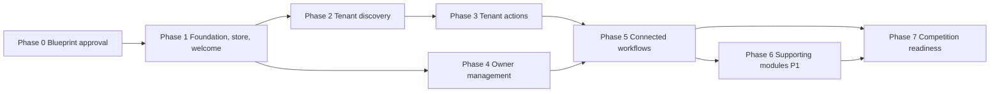

Phases 2–3 and 4 can proceed in either order after Phase 1; Phase 5 needs both. If time is short, **skip Phase 6 entirely** and go to Phase 7 — P0 completeness beats breadth.

### Phase 0 — Blueprint approval
| | |
|---|---|
| Objective | Founder reviews this document and resolves the "needs approval" items in §19. |
| Deliverable | Approved blueprint (this file, possibly revised). |
| DoD | Founder decisions of 2026-10-10 recorded (v1.1); every item in §19.3 resolved or explicitly accepted as an assumption; decision register rows needing approval marked Approved / Changed. No code written. |

### Phase 1 — Foundation, visual system, store, Welcome
| | |
|---|---|
| Objective | Runnable skeleton with the design system, shells, shared store and Welcome. |
| Screens / components | S-00, S-02, S-03 (About + Reset), shells (Public/Tenant/Owner with role switcher), tokens, base UI kit (Button, Badge, Modal, Drawer, Toast, EmptyState, ConfirmDialog, AppImage), domain types, label dictionaries, validators, `buildSeed`, persistence, `resetDemo`, router with all routes stubbed as real "Coming in a later phase" pages **only in dev** (production build must not ship dead links — hide unbuilt nav items, D-19). |
| Dependencies | Approved blueprint. |
| Deliverables | Project scaffold (Vite + React + TS), CI-style scripts (`typecheck`, `lint`, `test`, `build`), fixtures for all 16 properties, 6 requests, reference-data structures (localities and anchors with empty verification fields, §13.6.2), the image acquisition and attribution register (§14.13 — only after the founder approves the licence rules), and the store fields for Presenter Mode (`ui.presenterMode`, `presenter.simulationLog`, `seedStatus`, §9.6). |
| Acceptance | AC-01, AC-02 (Tenant/Owner destinations may be stubs), AC-19 (persistence mechanics with unit tests), AC-20, AC-24; unit tests for `buildSeed` date resolution, haversine, effective-verification, transition function. |
| Risks | Over-building the design system; image licensing; scope creep into screens. |
| DoD | `tsc`, lint, tests, build all green; Welcome pixel-reviewed on 390/1440; reset verified; no external requests on load. |

### Phase 2 — Tenant discovery
| | |
|---|---|
| Objective | Convincing search → map/list → details experience. |
| Screens | T-01, T-02, T-03 (without visit modal), S-01 Trust Center. |
| Components | SearchPanel, Combobox, FilterBar, MoreFiltersDrawer, PropertyCard, VerificationIndicator, MapView (schematic first, then Leaflet + failover), MapPreviewCard, Gallery, TrustBreakdown, Breadcrumbs. |
| Dependencies | Phase 1 store/selectors/fixtures. **Gate:** anchor and locality verification (§13.6.2) is completed and recorded **before any map code is written**; the licensed fixture image sets are in place (§14.13). |
| Deliverables | URL-driven search state; zero-result suggestions; map/list sync; unavailable-listing banner. |
| Acceptance | AC-04–AC-12, AC-17 (tenant parts), AC-18, AC-21, AC-22, AC-34 for these screens; AC-37 (anchors); AC-38 (imagery). |
| Risks | Map complexity (build **schematic first** so the demo is safe, then add Leaflet); filter-state bugs; performance with markers (small data, low risk). |
| DoD | All listed AC pass manually and via unit tests on `selectSearchResults`; offline test passes; keyboard walkthrough done. |

### Phase 3 — Tenant actions
| | |
|---|---|
| Objective | Save, request visits, track them. |
| Screens | T-04/T-05 (modal), T-06, T-07, T-08, T-09. |
| Dependencies | Phase 2 (details page), store mutations. |
| Deliverables | Visit form + review + success; duplicate/availability guards; Tenant dashboard with tabs; cancel request. |
| Acceptance | AC-13, AC-14 (tenant side), AC-15 (tenant side), AC-16 (saved), AC-25, AC-26, AC-23 (tenant cancel). |
| Risks | Date/phone validation edge cases; focus management in modal. |
| DoD | Requests created in Phase 3 visible after refresh; all error copy per spec; no success without record. |

### Phase 4 — Owner management
| | |
|---|---|
| Objective | Owner can list and manage properties. |
| Screens | O-01, O-02, O-03, O-04, O-05, O-06, O-10 (read + reconfirm + attach), O-11. |
| Dependencies | Phase 1; can run parallel to Phases 2–3 but integration tests need Phase 2. |
| Deliverables | Sidebar/mobile nav, dashboard stats selectors, 8-step wizard with persisted working copy, publish mutation, edit mode, availability toggle with confirm, activity log. |
| Acceptance | AC-03 (owner), AC-27, AC-28, AC-29, AC-17 (owner), AC-16 (owner list). |
| Risks | Wizard complexity (largest single feature); photo picker UX; validation duplication (mitigate with shared Zod schemas). |
| DoD | Publishing creates tenant-discoverable property; edit/availability reflected in Tenant views. |

### Phase 5 — Connected workflows
| | |
|---|---|
| Objective | Everything Section 9 promises works end to end. |
| Screens | O-07 (full), cross-links (Preview as Tenant), role-switch persistence, Updated indicators (P1). |
| Dependencies | Phases 3 and 4. |
| Deliverables | Owner status actions + schedule dialog; invalid-transition handling; cross-tab `storage` sync; storage-failure fallback banner; E2E-01 automated (Playwright if feasible) or scripted manual run. |
| Acceptance | AC-14, AC-15, AC-19, AC-23, AC-26, **E2E-01**. |
| Risks | Stale-state races across tabs (accept last-write-wins; test the guard messages). |
| DoD | E2E-01 passes three consecutive times from a fresh reset. |

### Phase 6 — Supporting modules (P1)
| | |
|---|---|
| Objective | Add the lifecycle previews without destabilising P0. |
| Screens | O-08 Rent Tracking, O-09 Maintenance, T-10 My Rental, owner overview cards for rent/maintenance; **S-04 Presenter Demo Mode (build first within this phase)**; optionally: save draft, objective house rules, local photo upload, lightbox, Undo toasts. |
| Dependencies | Phase 5 stable. |
| Acceptance | AC-30, AC-31, AC-32, AC-36; P0 regression suite re-run. |
| Risks | Time overrun; regressions. Cut order if short: photo upload → house rules → lightbox → Undo → drafts → T-10 → Maintenance → Rent → (last) Presenter Demo Mode. |
| DoD | Each module labelled "Preview/demo"; no dead controls; P0 AC still pass. |

### Phase 7 — Competition readiness
| | |
|---|---|
| Objective | Polish, resilience, rehearsed repeatability. |
| Work | Visual polish pass against §14; copy audit against TP-1…TP-12 and a banned-phrase search (including any NIVORA Move price figure and any "verified" without "(demo)"); re-confirmation of anchor/locality verification records (§13.6.2) and Image credits completeness (§14.13); Presenter Mode rehearsal including Undo all simulated changes; responsive pass; accessibility audit (axe + keyboard); empty/error states; R-01 Roadmap page (P2); `?today=` rehearsal override; bundle/perf check; written demo run-sheet *(a checklist, not a pitch script)*; backup plan (offline map, pre-reset). |
| Acceptance | AC-33, AC-34, AC-35, full P0 AC list, E2E-01 on target demo machine and browser. |
| Risks | Last-minute scope additions; venue network. |
| DoD | Release build tested offline on the demo machine; reset rehearsed; founder sign-off. |

---

## 18. Live Demonstration Readiness

This section defines **product behaviour** that makes a demo reliable. It is not a pitch script.

### 18.1 Known Starting State
- After **Reset demo data** (or first load): persona unset; 16 fixture properties as in §13.7; 6 fixture requests; no saved homes; empty Tenant profile; Owner profile empty ("Demo Owner"); map mode auto; counters at 1007 / next property `prop_u_001`; Presenter Mode off with an empty simulation log; anchors and localities carrying completed verification records.
- Owner overview at start: Total properties 7, Active listings 3, New Requests 1, Scheduled visits 1, Pending verification tasks derived from data (non-zero thanks to FX-02, 05, 11).
- Tenant search at start: 11 homes.

### 18.2 Recommended preparation checklist (for the presenter)
1. Open the built app on the demo machine and browser; confirm fonts/icons render offline.
2. Use **Reset demo data** (or `/#/?reset=1`).
3. Check street map loads; if not, set Schematic in About → Map mode and confirm it works.
4. Keep a second browser window ready for the other role (optional; storage events sync them).
5. Do not rely on live internet for anything except OSM tiles.
6. Confirm the anchor and locality verification records are complete and re-spot-check two property–anchor distances against a map ruler (§13.6.2).
7. Confirm the Image credits page is complete (§14.13).
8. If Presenter Mode will be used: enter it deliberately, rehearse the status transitions, finish with **Undo all simulated changes** (or Reset), and exit Presenter Mode before handing the device to anyone else.

### 18.3 Sample journeys the data must support
- **Tenant journey:** Welcome → Find a Home → "Near a college or office" → MNIT Jaipur, 5 km, max ₹25,000 → results (e.g. FX-01, FX-09, FX-14; borderline cases depend on fixture offsets) → select marker/card → open FX-01 (broad trust) and compare with FX-04 (mostly unchecked, via Trust Center) → Save → Request a Visit → success → Dashboard.
- **Owner journey:** Welcome → Manage Properties → Overview (1 new request, 1 scheduled) → Add Property (publish) → My Properties → Enquiries (act on the seeded Pending request) → Verification Center (reconfirm stale FX-05 availability) → mark FX-02 unavailable and show the Tenant side.
- **Shared scenario:** E2E-01 (§15.9) is the canonical connected demonstration.

### 18.4 Demo safeguards (behaviours)
| Risk | Built-in behaviour |
|---|---|
| Map tiles fail | Automatic schematic fallback + manual toggle (§6.3.7) |
| Images fail | Local assets; SVG placeholders |
| Storage cleared / corrupt | Re-seed with notice; in-memory fallback banner |
| Presenter makes a mess | One-click Reset (confirm) |
| Dead ends | No unbuilt controls rendered; Not Found has route-back button |
| Empty-state surprise | Every list has designed empty states (§11) |
| Accidental real-data entry | Helper text near name/phone: "Use sample details — this is a demo"; phone is stored only locally |
| Misinterpretation as real | Demo pills, footer disclaimer, "(demo)" on verification labels, About dialog |
| Presenter leaves simulated statuses behind | Visible banner while active; Undo all simulated changes; Restore seeded verification state; Reset |
| Anchor or locality data wrong | Mandatory verification gate and pre-demo re-check (§13.6.2); distances labelled approximate |

### 18.5 Fictional vs. genuine verification
All verification is demo data. The presenter can truthfully say what is simulated by pointing to the in-product labels (including *Simulated by presenter (demo)* where Presenter Mode was used). The Trust Center "What NIVORA does not claim" block and the About dialog hold the canonical wording.

---

## 19. Decision Register, Assumptions and Open Questions

### 19.0 Founder decisions log (2026-10-10)

| FD | Founder decision | Recorded as | Applied in |
|---|---|---|---|
| FD-1 | Use high-quality, appropriately licensed images for fictional listings; locally stored; different images for different listings; document attribution/licensing; never imply real customers or verified properties; no downloading yet | D-10, D-27 | §14.13, §13.7, §7.4, §17 (Phase 1–2), AC-38 |
| FD-2 | Use real, recognisable Jaipur colleges and office-area landmarks as search anchors; verify names and approximate locations before implementing the map; distinguish real anchors from fictional properties; approximate distances only; no travel times or precise locations | D-12, D-26, D-28 | §13.6, §6.2, TP-11, §17 (Phase 2 gate), AC-37 |
| FD-3 | Do not display the three Move package prices; Move is a proposed roadmap concept with pricing marked not yet validated; not an operational booking service | D-20 | §10.2, R-01, AC-33 |
| FD-4 | Include a presenter-only capability to simulate verification-review outcomes; fenced from normal journeys; deliberate entry and restore; hiding is not security; no real documents or verification claims | D-25 | §9.6, S-04, §12.7, AC-36, TP-12 |
| FD-5a | Pending is the canonical initial request status in both roles; Owner section may be called "New Requests" | D-03 | §6.7, §7.2 |
| FD-5b | No preferred-tenant-profile screening field; optional objective house rules may be a P1 feature | D-15 | §7.4 |
| FD-5c | Shared data store and persistence foundation in Phase 1 | D-06 | §17 |
| FD-5d | Map coordinate verification stays an explicit task before the live demo | D-28 | §13.6.2, §18.2 |

### 19.1 Decisions

| ID | Proposed decision | Reason | Effect on prototype | Founder approval? |
|---|---|---|---|---|
| D-01 | Persona-based demo access; no accounts or auth | Brief excludes auth/OTP; reduces friction | Two fixed personas, local only | No (confirmed by brief) |
| D-02 | Personal details (name/phone) collected only at first need (visit request; owner publish) | Brief: no PII before required | Forms prefill later | No |
| D-03 | **Founder-confirmed (FD-5a).** One request-status vocabulary: Pending, Contacted, Visit Scheduled, Visit Completed, Cancelled. **Pending** is the canonical initial status in both roles; the Owner dashboard section/card is titled "New Requests" and counts requests whose status is Pending | Same state must read identically on both sides | No separate "New" status exists | No (confirmed) |
| D-04 | Listing states: Draft, Pending review, Published, Unavailable; Tenant sees only Published/Unavailable | Brief asks to define these | Pending review/Draft appear only for Owner | Yes (confirm semantics) |
| D-05 | React + TypeScript + Vite, Zustand, CSS Modules, Zod, Vitest, Playwright | Fast, typed, light | Dependencies listed §16 | Informational |
| D-06 | **Founder-confirmed (FD-5c).** Build the shared store, persistence, seed and reset in Phase 1 | One source of truth for all later screens; avoids late rewrites | Phase plan §17 | No (confirmed) |
| D-07 | Hash routing | Static-host safe | URLs include `#` | No |
| D-08 | Leaflet+OSM street map with automatic and manual schematic fallback | No key; reliable demo | Internet only for tiles | **Yes** (OSM usage OK for competition?) |
| D-09 | Honest UI: no artificial delays; skeletons only for real async | Truthfulness principle | Instant interactions | No |
| D-10 | **Founder-confirmed (FD-1).** Locally stored, appropriately licensed, high-quality images; distinct image sets per fixture listing; separate owner-selectable pool; attribution register and in-app Image credits; nothing is downloaded or implemented before Phase 1 and approval of licence rules | Reliable offline demo; licensing hygiene; avoids a repetitive look | §14.13; "Illustrative photo" labelling | Licence/provider rules and counts: **Yes** (§19.3) |
| D-11 | P0 photo step selects from gallery; P1 local upload with size caps | Avoid storage limits and fake cloud upload | Wizard step 6 | No |
| D-12 | **Founder-confirmed (FD-2).** Real, recognisable Jaipur colleges and office-area landmarks are the search anchors (candidates in §13.6.1). Names and approximate locations must be verified (§13.6.2) before the map is implemented; coordinates stay approximate; anchors are visibly distinct from fictional homes; no travel times | Realistic location search without false precision | Distances approximate and labelled; unverified anchors cannot ship to the demo | Final anchor list after verification: **Yes** |
| D-13 | Availability freshness = 14 days → Needs re-verification | Concrete, demonstrable rule | Constant in code | Yes (number) |
| D-14 | No "recommended" ranking; sorts are Newest/Nearest/Rent | Avoid implied algorithm/pay-to-win claims | Defaults per §6.3.5 | No |
| D-15 | **Founder-confirmed (FD-5b).** No preferred-tenant-profile screening field. Optional objective house rules (minimum lease, maximum occupants, pets, smoking) may be added as P1. No fields relating to religion, caste, gender, marital status, diet, nationality, occupation or family status | Avoid discriminatory screening; legal and platform risk | Wizard Step 3 reduced | No (confirmed) |
| D-16 | Editing accuracy-relevant fields resets "Listing accuracy" to Pending review | Honest trust model | Visible downgrade after edits | Yes |
| D-17 | Owner may mark Visit Completed any time after Scheduled | Demo convenience | No date gating | No |
| D-18 | Only Jaipur shown; no "other cities" teaser | Avoid unsupported claims | None | No |
| D-19 | Unbuilt sidebar items are not rendered in the release build | No dead controls | Nav grows by phase | No |
| D-20 | **Founder-confirmed (FD-3).** The ideation package prices are not shown anywhere. NIVORA Move appears only on R-01 as a proposed moving/settling-in concept with "Pricing: not yet validated"; no booking, quote, waitlist or payment UI | Figures are unvalidated brainstorming | Roadmap page text only | No (confirmed) |
| D-21 | Light theme only | Scope control | — | No |
| D-22 | Hidden `?today=` override for rehearsal/testing | Reproducible dates | **Superseded by founder decision D6:** no URL override exists; the simulated date lives only inside Presenter Mode (demo build) and is never persisted | No |
| D-23 | Owner phone/email are not displayed to Tenants; Tenant phone is displayed to the Owner (as entered in mock flow) | Realism without exposing data; all fictional | O-07 drawer | Yes |
| D-24 | Cross-tab sync is best-effort, last write wins | Simple | Documented limit | No |
| D-25 | **Founder-confirmed (FD-4); tier proposed.** Presenter Demo Mode: deliberate entry from About, session-scoped flag with visible banner, controls only on S-04, simulated statuses labelled, log with Undo all / Restore seeded verification state / Reset, not a security boundary, excludable by build flag. Proposed tier: P1, first P1 item to build | Demonstrates verification flow without faking verification | §9.6, S-04, AC-36 | Tier (P1 vs P0): **Yes** |
| D-26 | Fixture titles and descriptions never name a real institution or landmark; real names appear only as search anchors | Prevents fictional homes appearing to be real listings near real places | FX-01 and FX-14 retitled | No |
| D-27 | Attribution register (Annex A) and in-app Image credits page; credit shown even where not legally required | Licence compliance and transparency | §14.13 | Yes (opt-out?) |
| D-28 | **Founder-confirmed (FD-2, FD-5d).** Mandatory anchor/locality verification gate before map code and a pre-demo re-check | Wrong coordinates would undermine credibility | §13.6.2, Phase 2 gate, §18.2 | No (confirmed) |
| D-30 | **Founder-confirmed (D7), 2026-10-10.** A tenant's phone number is never shown on public, search or listing screens. The visit form has an optional "Share my phone number with the owner" checkbox, **unchecked by default**; owner screens may display the number only through `getOwnerVisiblePhone`, i.e. when consent was recorded on that request. Fixtures contain no phone numbers. This supersedes D-23 and Q8 | Privacy; avoids dialable-looking fixture numbers | `VisitRequest.sharePhoneWithOwner`; seed version 2 | No (confirmed) |
| D-29 | Canonical label for the fourth status stays "Needs re-verification"; the founder's term "Needs Re-review" is treated as the same state, not a fifth status | Avoids two near-identical labels | Labels in §8.3 | **Yes** (wording) |

### 19.2 Assumptions
- A1: Demo runs on a laptop with a modern Chromium-based browser or Firefox/Safari of the last two years; localStorage available.
- A2: No real user will enter real data; helper text discourages it.
- A3: Real Jaipur institutions are used as search anchors per FD-2; the candidate list and coordinates in §13.6.1 come from general knowledge and are unverified until §13.6.2 is done.
- A4: English UI only.
- A5: No accessibility audit by third party; self-audit per AC-35.

### 19.3 Resolved questions and remaining uncertainties

**Resolved by the founder on 2026-10-10:** image source (licensed local images, D-10); real institution names as anchors (D-12); Move ideation prices (withheld, D-20); presenter simulation control (included, D-25); status wording and Phase 1 store (D-03, D-06); preferred-tenant-profile (omitted, D-15).

**Remaining uncertainties — deliberately not decided in this document:**

| # | Question | Current default in this document |
|---|---|---|
| Q1 | Which image providers and licences are acceptable (CC0 only, or also Unsplash/Pexels/Pixabay-type licences, or CC BY with visible credit)? Are recognisable people ever acceptable? Is AI-generated imagery acceptable? Final image counts/total size? | Free-stock-type licences, CC0 and CC BY accepted; no identifiable people; no AI-generated images; about 70–85 images (§14.13) |
| Q2 | Final anchor list after verification, and whether outer-city anchors (Manipal University Jaipur, Mahindra World City) are wanted, which would require extra fixtures nearby | 4–8 anchors, core-city only (§13.6.1) |
| Q3 | Is any permission or review needed before naming real institutions as location references? (Not assessed here; not legal advice.) | Named only as location references with a no-affiliation note |
| Q4 | Should Presenter Demo Mode be P0 rather than P1? | P1, built first within Phase 6 (D-25) |
| Q5 | Wording of the fourth verification status: "Needs re-verification" vs "Needs Re-review" (D-29) | "Needs re-verification" |
| Q6 | Should Presenter Demo Mode exist in any build other than the demo build? | Build flag, on in the demo build only |
| Q7 | Is OpenStreetMap's public tile server acceptable for the competition demonstration (D-08)? | Yes, with attribution and automatic offline fallback |
| Q8 | Is displaying the Tenant's entered phone number to the Owner acceptable in the mock flow (D-23)? | Yes; fictional data, helper text discourages real numbers |
| Q9 | Is the rehearsal-date override (`?today=`) acceptable (D-22)? | Yes, documented in the run-sheet |
| Q10 | Are there competition-mandated formats (time limit, device, offline requirement) that change priorities? | Unknown; none assumed |

### 19.4 Contradictions found in the brief and how they were resolved
| Topic | Resolution |
|---|---|
| "Pending" (Tenant) vs. "New" (Owner) for the same state | Single label "Pending" (D-03). |
| Journey shows "Confirmation" as a step; modal vs. page | Confirmation is the success view in the same modal (T-05), then link to dashboard. |
| "Preferred tenant profile" vs. non-discrimination requirement | Replaced by objective house rules (D-15). |
| Published listings must appear in search vs. "pending verification" states | Publishing makes a listing visible immediately with honest *pending/not checked* verification; `pending_review` listing status is a separate, non-visible state used for the review demo. |
| Real map vs. offline-safety | Both, with failover (D-08). |
| Owner dashboard needs data but "no early PII" | Pre-seeded demo owner; contact details only at publish. |
| Founder's "Needs Re-review" vs the existing "Needs re-verification" status | Treated as one state under the canonical label (D-29), pending confirmation. |
| Simulation controls placed on the Owner Verification Center (v1.0) vs the founder's requirement to keep them out of normal journeys | Moved to Presenter Mode S-04 only (v1.1, D-25). |
| Move ideation figures shown as "illustrative" (v1.0) vs the founder's instruction not to display them as confirmed prices | Figures removed from all screens; Move shows "Pricing: not yet validated" (D-20). |
| "Verify before implementing the map" vs Phase 1 scaffolding | Data structures are created in Phase 1; verification is a gate before any map code in Phase 2 (D-28). |

---

## 20. Scope Lock, Handoff and Definition of Blueprint Completion

### 20.1 What this task produced
Only this document: `docs/NIVORA_MASTER_PROTOTYPE_BLUEPRINT.md`. No application code, scaffolding, package installation, API integration, authentication, UI, slides or pitch script was created.

### 20.2 Instructions to the future implementation session
1. Treat this file as the contract. Do not invent product behaviour; if something is missing, add an entry to §19 and ask.
2. Implement **phase by phase** (§17); do not start a phase before the previous Definition of Done is met.
3. Never weaken the truthfulness policy (§2.3). Run a copy audit for banned claims before every phase sign-off.
4. Keep the screen IDs, status names and route names exactly as defined; change them here first if they must change.
5. After each phase, update a short "Implementation status" table in this document (screen ID → built / tested) rather than creating new documents.

### 20.3 Implementation status tracker (to be filled during build)

| Phase | Status | Date | Notes |
|---|---|---|---|
| 0 Blueprint approval | v1.1 recorded founder decisions FD-1…FD-5d; awaiting approval to start Phase 1 | 2026-10-10 | Remaining questions: §19.3 |
| 1 Foundation | Implemented; awaiting founder review (see notes below) | 2026-10-10 | Screens S-00, S-02, S-03; Public/Tenant/Owner shells with role switcher; UI kit; domain types, labels, validators, geo, verification, transition function; `buildSeed`; persistence, cross-tab sync and `resetDemo`. Stubs: `/tenant` and `/owner` show an honest "coming in later phases" page; all other unbuilt routes exist only in development builds. Not done by design: image assets (licence rules not yet approved), anchor/locality verification (D-28), Presenter Mode UI (store fields only), map code. |
| 2 Tenant discovery | **Partially implemented; awaiting founder review** | 2026-10-10 | Built: T-01, T-02 (list only), T-03 without the visit modal, S-01 Trust Center; URL-driven filters, zero-result suggestions, unavailable-listing banner, effective-verification display. **Blocked (not built): map views, anchor search, distances** — the §13.6.2 gate is not satisfied (evidence recorded in `src/data/reference.ts`; no anchor or locality passed, founder sign-off pending). **Blocked: licensed images** (none acquired; placeholders shown; registry and credit checks are in place). Save/heart and Presenter Mode were left to their assigned phases. |
| 3 Tenant actions | **Implemented; awaiting founder review** | 2026-10-10 | Built: save/unsave (cards, details, Saved tab); Request a Visit modal (form → review → success) with validation, availability and duplicate guards; Tenant dashboard (Overview, Saved, Visit requests with status timeline and tenant cancel, Profile); nav and Home counts. All writes go through typed store actions that attempt the storage write first (no success without a stored record). Tenant phone is shared with an owner only on explicit, unchecked-by-default consent (founder D7, D-30); fixture phone numbers removed (seed version 2). **Not built, by design:** Updated dots, Undo toasts and My Rental (P1/Phase 6); owner-side request screens (Phase 4/5). Phase 2 remains partially implemented (see §20.5). |
| 4 Owner management | **Implemented** | 2026-10-10 | O-01, O-02, O-03, O-04 (8-step wizard, persisted working copy), O-05, O-06 (edit mode), O-10 (read + reconfirm + attach sample document), O-11; sidebar + mobile bottom bar + More sheet; availability toggle with confirmation; activity log. Photo step offers placeholder slots because DW-1 is deferred. AC-03 (owner), AC-16 (owner list), AC-17 (owner), AC-27, AC-28, AC-29 verified by automated tests (`phase4.test.tsx`, `ownerMutations.test.ts`) and a real-Chrome run. Defect found and fixed: unchanged past available-from date blocked edits; label/input association in the wizard. |
| 5 Connected workflows | **Implemented** | 2026-10-10 | O-07 Enquiries & Visits (filters, schedule dialog, cancel with reason, details drawer, phone shown only with tenant consent); invalid-transition handling; cross-tab sync test; tenant "Updated" indicator. AC-14, AC-15, AC-19, AC-23, AC-26 and E2E-01 verified: automated UI test (`phase5.test.tsx`) and the full scenario driven through the real UI in Chrome three consecutive times from a fresh reset. |
| 6 Supporting modules | **Implemented (P1 optional extras not built)** | 2026-10-10 | S-04 Presenter Demo Mode (built first): deliberate entry from About, session-scoped flag, banner, any→any simulation incl. Pending review / Verified (demo) / Needs re-verification, age availability, simulate review completed, log, Undo all, Restore seeded state, simulated date (D6). **Enforced by build configuration**: `VITE_ENABLE_PRESENTER_MODE` is true only for dev/test/`npm run build:demo`; `npm run build` emits no presenter code (`npm run check:bundles` PASS). O-08 Rent Tracking, O-09 Maintenance, T-10 My Rental, owner overview cards. AC-30, AC-31, AC-32, AC-36 verified by automated tests (`presenter.test.tsx`, `phase6.test.tsx`, `lifecycle` domain tests). **Not built (optional P1):** save draft, objective house rules, local photo upload, lightbox, Undo toasts. |
| 7 Competition readiness | **Implemented in this environment; manual and device checks outstanding** | 2026-10-10 | Copy/truthfulness audit across 27 routes plus roadmap, phone-privacy and AC-33 checks (`src/audit.test.tsx`); axe-core 4.14.0 run in real Chrome over every public/tenant/owner route at 1440 and 390 px, dialogs, drawers and wizard steps 2–8: first run 57 findings (1 critical, several serious) — all fixed, re-run **0 violations**; overflow sweep of 23 routes × 5 widths (320/390/768/1024/1440) in Chrome: 0 horizontal scroll; E2E-01 driven through the real UI in Chrome 3 consecutive times on the final build: pass; Presenter flow driven in Chrome on the demo build (entry gate, banner, simulated status labelled “Simulated by presenter (demo)”, exit, session scoping) and confirmed absent from the production build. Final gates: typecheck, lint, 432 tests, `build`, `build:demo`, `check:bundles` all pass. **Not run:** Firefox, Safari, real devices, screen readers, offline test on the demo machine (DW-6). **Still blocked:** DW-1/2 (images), DW-3/4 (anchors and maps), AC-07–09, AC-11, AC-22, AC-37, AC-38. |

### 20.4 Run locally (implemented in Phase 1)

| Task | Command |
|---|---|
| Install dependencies | `npm install` |
| Start the dev server | `npm run dev` (http://localhost:5173/) |
| Type check / lint / tests | `npm run typecheck` · `npm run lint` · `npm test` |
| Production build and preview | `npm run build` then `npm run preview` (http://localhost:4173/) |
| Demo build (includes Presenter Mode) | `npm run build:demo` then `npm run preview:demo` (http://localhost:4174/); `npm run check:bundles` proves the production build has no presenter code |
| Reset to the starting state | About this prototype → Reset demo data, or open `/#/?reset=1` (asks to confirm) |

Unbuilt routes appear only in development builds as labelled stubs; production builds hide them (D-19).

### 20.5 Deferred-work register (kept so postponed manual work is not lost)

| # | Outstanding task | Why deferred | Depends on it | What unblocks it | Blocks competition-demo build? |
|---|---|---|---|---|---|
| DW-1 | **Partly done (2026-10-10): 20 of 82 photos installed (`demo-minimum`: 14 fixture covers + 6 owner-pool), chosen by eye on pexels.com in a browser with credits read from each photo page; see `docs/IMAGE_ACQUISITION_LOG.md`. Remaining 62 (`full` tier) not acquired.** Original: **Tooling ready, photos not acquired (§20.10):** `npm run images:fetch` + `scripts/image-plan.json` need a Pexels API key and curated photo IDs. Select and acquire the Pexels photo library (≈45–60 fixture images + ≥24 owner-pool images), store locally, fill Annex A and the attribution register | Founder decision 2026-10-10: manual task postponed; no scraping or bulk download | Property cards/details imagery (Phase 2), owner photo step (Phase 4), AC-38 | Founder re-opens it; images chosen one by one with licence rows (`src/data/images.ts` enforces complete rows) | **Yes** (placeholders everywhere) |
| DW-2 | In-app Image credits page and About link | **Done in code (§20.10)**: `/credits`, linked from About; lists installed photos with photographer, source, licence and date, and credits OpenStreetMap/Leaflet/Nominatim | AC-38 | Photos appear on the page automatically once DW-1 installs them | Yes (with DW-1) |
| DW-3 | **Second pass 2026-10-10 (`docs/GEO_VERIFICATION_2026-10-10.md`): Bing Maps used as the second provider; MNIT, World Trade Park and JECC now agree with OSM within 300 m, MNIT's stored point corrected (was a bus stop); UniRaj, IIS, SMS, C-Scheme and 10 of 11 localities still fail; gate NOT passed.** Verify real anchors and locality centroids per §13.6.2 (second source, official-website name check) and founder sign-off | Evidence gathered 2026-10-10 did not satisfy the gate (see `src/data/reference.ts`); no reliable second source for most items | Map views, anchor search, distances (Phase 2); AC-07–09, AC-11, AC-22, AC-37 | Founder decision on campus-scale tolerance and specific landmarks, or better sources; then flip statuses to `verified` | **Yes** (map and anchor features) |
| DW-4 | Map views (schematic first, then Leaflet + OSM tiles, with failover) | **Partly done (§20.9):** Leaflet + OSM map with radius circle and simulated-home markers inside the onboarding only, for the VGU test destination and user-chosen points. Still not built: map/list on T-02 Results and T-03 map preview; anchor search over the full anchor set | T-02 map/list, T-03 map preview | DW-3 and a venue-suitable tile provider | Yes for those screens |
| DW-5 | Presenter Demo Mode (S-04) | **Built in Phase 6 and exercised in Chrome in Phase 7**; remaining item is the founder's tier decision (D4 says P0 for the demo build, §3.1/D-25 say P1). Present only in `npm run build:demo` output. | Verification simulation demo | Founder confirms tier and that the demo build is the one shipped to the venue | No (built); tier decision open |
| DW-6 | Browser coverage: Firefox, Safari, real devices, screen reader | Not available in this environment. **Done in Phase 7:** Chrome (workflows, widths, keyboard) and axe-core automated audit (0 violations). **NOT RUN:** Firefox, Safari, real phone/tablet, NVDA/VoiceOver, offline run on the demo machine | Phase 7 competition readiness | Run on the target demo machine/browsers | Recommended before demo |
| DW-7 | Remaining open questions in §19.3 (OSM tile policy comfort, competition format, institution naming) | Founder-dependent | Phase 7 | Founder answers | No |

### 20.6 Demo run-sheet and backup plan (Phase 7)

**Before the session (on the demo machine):** `npm install`, then `npm run build:demo` and `npm run preview:demo` (http://localhost:4174/). Open it once while online so nothing is pending; it needs no network afterwards (no external requests were observed in the Chrome audit). Open About this prototype → Reset demo data, so the demo starts from the seeded state.

**Suggested flow (about 7 minutes):** 1) Welcome → Tenant: search, open a listing, read the Trust Center link. 2) Request a visit (consent box unchecked by default). 3) Switch to Owner via the role switcher: Enquiries → mark Contacted → Schedule visit. 4) Back to Tenant: the request shows Visit Scheduled. 5) Owner: add a property through the wizard; it appears as pending review. 6) About → Presenter tools… (demo build only): simulate a review outcome and show the “Simulated by presenter (demo)” label, then Undo all. 7) Future roadmap page.

**What not to claim:** maps, “near a college” search, real photos, real verification, payments or messaging — none exist. Say the labels read “Verified (demo)” because nothing is actually verified.

**If something goes wrong:** (a) a stuck or odd state → About → Reset demo data; (b) the dev server will not start → serve the already-built `dist-demo/` folder with any static server, or use `npm run preview:demo`; (c) browser storage blocked → the app shows its banner and continues in memory, so state will not survive a refresh; (d) keep a second browser profile or a screen recording of E2E-01 as the last resort. Never use the production build (`dist/`) for a demonstration that needs Presenter Mode.

### 20.7 Cinematic Discovery Experience (post-Phase 7 enhancement, founder request)

A guided, dark "cinematic" journey at `/tenant/discover`, linked from Tenant Home ("Start guided search"). Steps: Welcome (optional location permission) → Destination → Distance → Budget → Home type → Rooms → Amenities → Results. Answers live in the URL and reuse the existing search codec and selectors, so results always agree with `/tenant/search`. Code: `src/discovery/`.

**Honest limits (location gate still unsatisfied, DW-3/DW-4):** no map, no radius circle, no distances, no travel-time claims. The destination is a locality choice or a free-text keyword matched against listing text; it is never geocoded. The distance step records a preference (2/3/5/7/10 km) but does not filter, and says so. Browser geolocation is requested only after a click, the position is discarded, and nothing is stored, sent or used.

**To enable the real map and radius later:** complete DW-3 (second source and founder sign-off per §13.6.2, so `evaluateMapGate()` passes), choose an approved tile provider and confirm its attribution and usage policy (DW-7), then wire verified anchors into the Destination step and apply the radius with the haversine helper in `src/domain/geo.ts`. AC-07–09, AC-11, AC-22 and AC-37 remain NOT passed.

The guide name is one constant (`GUIDE_NAME` in `src/discovery/config.ts`). The guide is deterministic text: no model, no network.

### 20.8 Cinematic brand launch and Nivi (direction correction, implemented)

**Brand intro** (`src/intro/`, mounted once at the app root; present in both builds because it is brand, not a presenter feature, and it imports nothing from Presenter Mode). About 3.5 s plus a 0.35 s fade: gold particles flow out of darkness along curved paths and assemble into the canonical NIVORA mark (`BRAND_MARK_PATHS` in `BrandMark.tsx`, redrawn exactly) and wordmark, a crisp gold logo cross-fades over them, `THE RENTAL LIVING ECOSYSTEM` and `Your next chapter starts at home.` are revealed, and a light sweep crosses the logo. Plain canvas 2D, no animation library (bundle +~11 kB gzip with the discovery work).
- Plays on first entry to any route in a browser tab; remembered per tab (sessionStorage), so refresh and in-app navigation never replay it. **Replay intro** is in About this prototype.
- **Skip intro** button (focused on open, 44 px), Escape also skips. The app is `inert` only while the overlay is up. A failsafe timer always ends it; canvas/font/exception failures fall back to a static reveal. `prefers-reduced-motion` gives the static reveal for about 1.2 s with no canvas.
- Disabled automatically in automated tests (`MODE === "test"`); tests exercise it explicitly.

**Landing** is the Welcome page `/` (so AC-01/02 still hold): dark cinematic hero with the existing headline, **Find my home** (to `/tenant/discover`) and **Explore on my own** (to `/tenant`), Nivi's greeting, and the two journey cards (including Owner) retained below. Tenant Home keeps a "Start guided search" button above its existing search form.

**Nivi** (`src/discovery/Guide.tsx`, name in `GUIDE_NAME`): glowing orb with a face and speech bubble; deterministic text from real step and answers; no model, network or typing delay; Hide/Show Nivi at any time (remembered per tab). Opening line: "Hi! I'm Nivi. Let's find a home that fits your life. Shall we begin?"

**Discovery** reuses `/tenant/discover` unchanged in logic (URL-backed, shared search codec). Location truthfulness is unchanged: gate unsatisfied, no map/radius/distances/travel times; the destination is a locality or a keyword matched against listing text; the radius choice is recorded but not applied and says so; geolocation is optional, post-click, and discarded.

**Enabling a genuine map later (unchanged blockers):** (1) DW-3: second source and founder sign-off per §13.6.2 so `evaluateMapGate()` passes; (2) an approved tile provider with its attribution and usage policy confirmed (DW-7); (3) wire verified anchors into the Destination step and apply the radius with the haversine helper in `src/domain/geo.ts`; (4) re-run the AC-07–09, 11, 22, 37 tests. These ACs remain NOT passed.

**Evidence (this environment):** typecheck, lint, 486 tests (19 files), `build`, `build:demo`, `check:bundles` pass; in real Chrome: intro plays on both builds, Skip/Escape/replay/refresh/direct-route/reduced-motion verified, layout fits at 320/390/768/1024/1440 px, axe 0 violations on all audited screens (intro overlay itself not audited), 140-check overflow sweep clean, E2E-01 passes 3×, Presenter flow passes on the demo build. **NOT RUN:** Firefox, Safari, real devices, screen readers, performance profiling on low-end hardware (canvas cost on a weak projector laptop is unmeasured).

**Manual decisions open:** keep or drop the optional location prompt; keep the name Nivi; whether the intro should play once per tab (current) or on every fresh launch; logo is the existing mark (no new permanent logo was introduced).

### 20.9 ReGain-style conversational onboarding as the default entry (direction correction 3, implemented)

**What replaced what.** The root `/` now opens the brand intro and then a Nivi-led, one-question-per-screen onboarding for a fresh session (`src/onboarding/`). The earlier blue/violet guided-discovery UI (`src/discovery/`) was removed. `/tenant/discover` is the same onboarding as a standalone route. After the journey is finished or skipped ("Explore on my own", available on every screen), `/` shows the Welcome hub (restyled black, white, gold, lime) and the existing Tenant Home, search, property details, saved homes, requests and all Owner screens are unchanged. Reset demo data clears the onboarding session and replays the intro so a rehearsal restarts from the top. A `?s=` step in the URL means "journey in progress" (refresh safe); `?reset=1` still goes to Welcome.

**Sequence (12 screens, URL-backed, Back/Continue/progress):** name → phone → location permission → origin (current location, or college/office) → place (VGU test destination, place search, or map pin) → radius (2/3/5/7/10 km) → live count → furnishing → budget → property type → rooms → amenities (Skip / Show me homes) → results. A screen is shown only if what it needs exists (e.g. a refresh on `count` with "current location" returns to the origin screen because a precise location is deliberately not kept).

**Visual rules enforced by tests and a computed-style audit in Chrome:** near-black background, white type, grey secondary text, lime for action/selection, gold only for the brand; no blue/violet, glass, glow or decorative particles outside the intro. Nivi is an original SVG house-spirit (gold body, lime sprout) that flies in when the intro ends, floats, blinks and hops on an answer; all motion stops under reduced motion.

**Phone number:** collected for the flow only. India +91 validation; stays in this tab's memory, never in localStorage, sessionStorage or the URL, never in the app store, never shared with owners, and no OTP/SMS is simulated. "Use a demo guest instead" skips it. The visit-request phone-sharing consent is unchanged. (The number is currently not used for anything else.)

**Geographic data gate, now scoped.** The full §13.6.2 gate is still NOT satisfied (4 anchors incl. 3 colleges and 2 office areas, and every locality, are required) and anchor search (AC-37) stays off. Following the founder's instruction, **Vivekananda Global University (VGU)** is verified as a test destination only (`anchor_vgu` in `src/data/reference.ts`, offered through `getTestDestinations()`, never through `getUsableAnchors()`):
- Name and address (step 1/2): official site vgu.ac.in, "Sector-36, Sisyawas, NRI Road, VIT Campus, Karolan Ka Barh, Jaipur, Rajasthan 303012"; Wikipedia and Wikidata Q19899106 (official website vgu.ac.in).
- Coordinates (step 3): 26.8117, 75.8899 (4 dp, approximate). **OpenStreetMap has no feature for VGU** (Nominatim and an Overpass name search over Jaipur found none), so the OSM-derived coordinate and OSM-vs-second-map cross-check could not be done. Instead the official site's map link (26.81135, 75.88992; place point 26.81168) and Wikidata P625 (26.81168, 75.88989) agree within ~10 m, and the contact page's embed centre (26.81168, 75.88777) is ~210 m away, all within the 300 m tolerance. These sources may share an origin (Google Maps data), so they corroborate rather than independently confirm. The pin was only glanced at on the OSM base map in Chrome (it sits in a built-up area on the east side of Jaipur near Goner Road); that is not a verification, and a human should compare it with another map before the demo (gate step 6).
- Sign-off (step 7): the founder's written instruction on 2026-10-10 that VGU be available as a test destination if verified correctly; recorded for this one anchor only.

**Map provider.** Leaflet 1.9.4 (BSD-2, lazy-loaded, ~45 kB gzip, separate chunk) with OpenStreetMap standard tiles (`tile.openstreetmap.org`), attribution "© OpenStreetMap contributors" always visible. OSM's tile policy permits light interactive use with attribution but gives no service guarantee, and bulk or commercial use needs another provider; for the venue, check the network or switch to a paid tile provider. If tiles fail a notice appears and destination, radius and counts still work; a map error is caught and replaced by a notice. Destination search uses Nominatim only when the user presses Search (min 3 characters, ≥1.1 s apart, results rounded to 4 dp); the query text is sent to openstreetmap.org. The browser's location, if allowed, is kept in memory only.

**Radius matching and the demo inventory.** All listings are fictional, so their map positions are SIMULATED: locality centre plus a deterministic offset of at most 600 m (`approximateCoordinates`), with one designated override (`prop_fx_06`, about 1.5 km west of VGU) in `src/data/demoPositions.ts` so the radius has something to show. Cards say "simulated position". Counts come from `withinRadius` over tenant-visible listings only; for VGU the demo data gives 1 / 1 / 1 / 2 / 4 homes at 2 / 3 / 5 / 7 / 10 km. Distances are straight-line, never travel time, and the count is for the prototype's demo homes, not every home in the area.

**Evidence (this environment):** typecheck, lint, 508 tests (19 files), `build`, `build:demo`, `check:bundles` pass. Real Chrome (prod 4173 and demo 4174): full 12-screen run with screenshots in `docs/evidence/onboarding/`, intro skip/replay/refresh/direct entry/Escape/reduced motion, denied and granted location, real OSM tiles loading with attribution, radius circle, 150-check overflow sweep (320/390/768/1024/1440), axe-core 0 violations on every audited screen including all onboarding screens, E2E-01 3/3, Presenter flow intact on the demo build and absent from production, and a computed-style scan finding no blue/violet in the onboarding UI. **NOT RUN:** Firefox, Safari, real devices, screen readers, a venue-network or offline-tile test, and a human check of VGU's pin against a second map.

**Blockers and decisions that remain:** (1) the 4-anchor gate and locality verification (DW-3) for anchor search AC-37, AC-07–09, 11 and 22 in their original wording; (2) licensed images (DW-1/2/AC-38); (3) OSM tile suitability for the venue; (4) whether collecting a phone number that nothing uses is wanted; (5) Firefox/Safari/real-device/screen-reader coverage (DW-6).

### 20.10 Demo Readiness Sprint: go/no-go (2026-10-10)

**Verdict: NO-GO for a competition demonstration.** Implementation is complete and tested, but three things only a person can do are still open (images, VGU pin comparison, rehearsal on the real laptop and projector). Operating instructions, the two-minute script, the backup plan and the rehearsal checklist are in `docs/DEMO_RUNBOOK.md`.

| Sprint item | Result |
|---|---|
| 1. Licensed images and credits | **Update 2026-10-10 (later): 20 `demo-minimum` photos installed with complete credit rows (`docs/IMAGE_ACQUISITION_LOG.md`); 62 `full`-tier slots still placeholders; build and tests NOT re-run after the change (see the session report).** Earlier: **Blocked on a human.** Pexels returns HTTP 403 to automated page access and its API needs a key, so no photo was fetched and none was invented. Done: `scripts/image-plan.json` (82 slots, 20 marked `demo-minimum`), `npm run images:fetch` (looks each photo up by ID through the official API, downloads it unmodified, records photographer, page, Pexels licence and date, refuses reused photos), `src/data/images.credits.json` (empty), registry validation (AC-38 rules), the **Credits page** (`/credits`, linked from About; also credits OpenStreetMap, Leaflet, Nominatim, Inter, Lucide and disclaims affiliation with VGU). DW-2 is complete in code; DW-1 needs the founder or a delegate. |
| 2. Visual review of primary screens | Done by eye on about 30 screenshots (1440 and 390 px) of Welcome, Trust, Credits, Roadmap, Tenant Home/Results/Details/Dashboard tabs, Owner Overview/Properties/Wizard/Enquiries/Rent/Maintenance/Verification and the About and Request dialogs. **Fixed:** the About dialog and the search-form note still said maps were switched off (now truthful about the guided-search test destination); the Welcome header was white over a black page (now dark); the Credits page lost its bullets; place-search failures showed "Failed to fetch" (now a plain message). **Observed, not changed:** the main application is light with violet accents and looks different from the black onboarding; placeholders ("Image unavailable") dominate every card until images are installed. |
| 3. VGU pin | **Update 2026-10-10 (later): an independent provider (Bing Maps) places VGU 171 m from the app pin, and Esri imagery shows both inside the same campus compound; the earlier "official map link" and "embed" figures were a Street View camera position and a map-view centre, and Wikidata copies Google's point (`docs/GEO_VERIFICATION_2026-10-10.md`). Coordinate unchanged; human comparison and sign-off still pending.** Earlier: **Evidence strengthened, human check still required.** Extra searches (Wikimedia Commons geosearch, Wikipedia geosearch, Wikidata references) found no new coordinate source (the only VGU file on Commons is a logo; Wikidata's coordinate has no reference). Sensitivity analysis: demo counts at 2, 3, 5, 7 and 10 km are unchanged for pin errors up to 250 m (the `prop_fx_06` simulated position was moved to about 1.5 km from VGU to make the 2 km count robust, and a test now enforces this). Status stays "verified as a founder-designated test destination only"; the sign-off for a human map comparison is recorded as pending. Remaining gates (unchanged): 4 verified anchors incl. 3 colleges and 2 office areas, all 11 localities, the search-form anchor mode, AC-37, and the original wording of AC-07–09, 11 and 22. |
| 4. Presentation laptop | **Not confirmed.** Everything below ran on the development machine (Windows 10, headless Chrome and Edge, wired network). `npm run preflight` (new) checks build freshness, Presenter isolation, image status, reachability of OpenStreetMap tiles and place search, and installed browsers. Failure fallback verified in Chrome by blocking OpenStreetMap: honest tile notice, search failure message, destination, radius, counts and results all still work; reload works; reset restarts the rehearsal. A real browser permission prompt cannot be shown headless: allow and deny were exercised through simulated permission states only. |
| 5. Firefox and devices | **NOT RUN.** Firefox is not installed here, no Safari, and no physical phone or tablet is available. Edge (Chromium) was run on the full onboarding flow and passed. Screen-reader testing (NVDA, JAWS, VoiceOver, TalkBack) is **pending**; only axe-core (0 violations) and keyboard checks have been done. |
| 6. Accurate labels | Unchanged and covered by the copy audit (now including `/credits` and the onboarding screens): "Verified (demo)", "Simulated by presenter (demo)", "Recorded as paid (demo)", "simulated position", straight-line distance (never travel time), demo homes only, no Move prices, no dialable numbers, phone never stored. |
| 7. Script and backup | `docs/DEMO_RUNBOOK.md`. |
| 8. Checks | See the final report: typecheck, lint, tests, builds and bundle checks all run after these changes. |

**Exact remaining tasks (updated 2026-10-11):** (1) replace the four semi-furnished covers FX-01, FX-05, FX-08, FX-15, or record the founder's decision to keep them (`docs/IMAGE_REPLACEMENT_PLAN.md`; the 20 `demo-minimum` photos are otherwise installed and verified); (2) compare the VGU pin with a second map and sign off or correct it; (3) rehearse twice on the real laptop and projector with the checklist; (4) run Firefox, Safari and a real phone, and a screen-reader pass, or accept them as untested; (5) founder decisions (the phone step and demo-guest option stay for now, per the founder on 2026-10-11): accept OpenStreetMap tiles at the venue, accept the light main app next to the black onboarding.

### 20.11 Image and location integration check (2026-10-10, after the Cowork session)

- **Images:** 20 licensed Pexels photos (the `demo-minimum` set: covers of the 14 tenant-visible fixtures plus owner-pool 1–6) are installed and credited; the Credits page lists all 20 with photographer, source page, licence, date and use. On integration, each file carried an extra C2PA provenance block added during transfer (+5,771 bytes, so none matched the log); it was removed, and all 20 now match both the logged SHA-256 and a fresh byte-for-byte download from the Pexels CDN. All files are ≤ 144,582 bytes (≤ 150 KB, §14.12), including `fx04-1.jpg`. `pool-03` gets an on-screen focus point instead of a bad 16:9 crop. "Illustrative photo" appears on cards and the gallery, and a compact "Illustrative" label on every small thumbnail. Open: the four semi-furnished listings (FX-01, FX-05, FX-08, FX-15) still show fully furnished lounges, and most photos look European; replacements need someone who can open pexels.com pages (brief in `docs/IMAGE_ACQUISITION_LOG.md`). 62 `full`-tier slots are not filled, so galleries show one photo.
- **Also fixed:** numbered list markers and an indent leaked into the Add Property stepper and the breadcrumbs (`ol` was not reset); now reset globally like `ul`.
- **Location (unchanged in substance):** VGU stays a founder-designated test destination at 26.8117, 75.8899; the second pass added an independent provider point (Bing, 171 m away) and satellite imagery showing a campus at the pin. The full 4-anchor gate is still unsatisfied (`getUsableAnchors()` is empty, `evaluateMapGate()` false), MNIT's stored point was corrected from a bus stop to a college building but stays unverified, and no real-world distance is shown except straight-line distances from the chosen origin to simulated demo positions, labelled as such. Open decisions: a human second-map check of VGU, campus/suburb tolerance, mall/exhibition centre as "office areas", which University of Rajasthan point, a C-Scheme landmark, and the Jagatpura disagreement (`docs/GEO_VERIFICATION_2026-10-10.md`).

**VGU pin sign-off record (fill in only after the founder confirms):** _not yet recorded._ Format: "VGU pin compared on <date> by <name> against <map>: <within ~300 m / corrected to lat, lng>". Recording it confirms the VGU test destination only; it does not satisfy the overall §13.6.2 gate.

*End of blueprint.*
